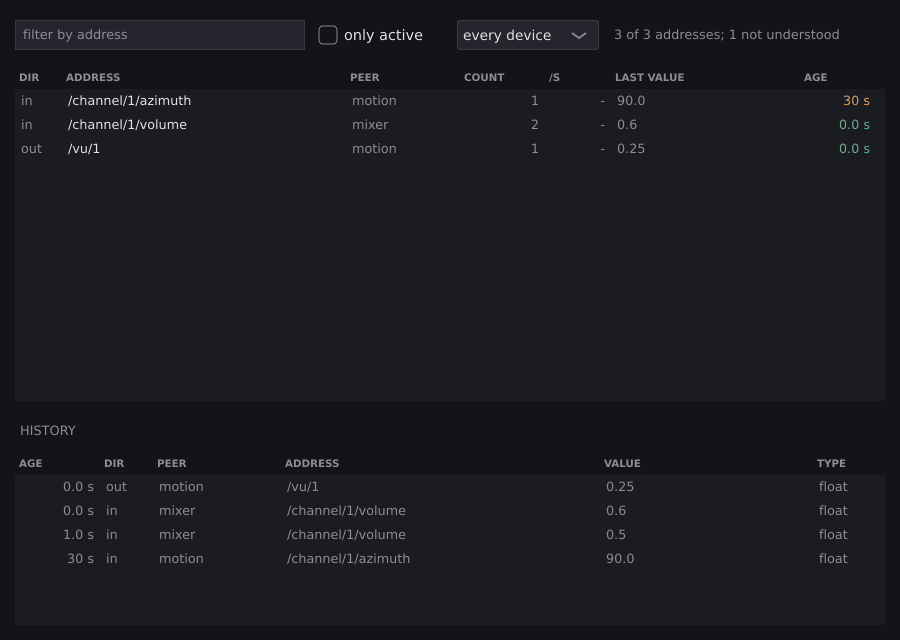
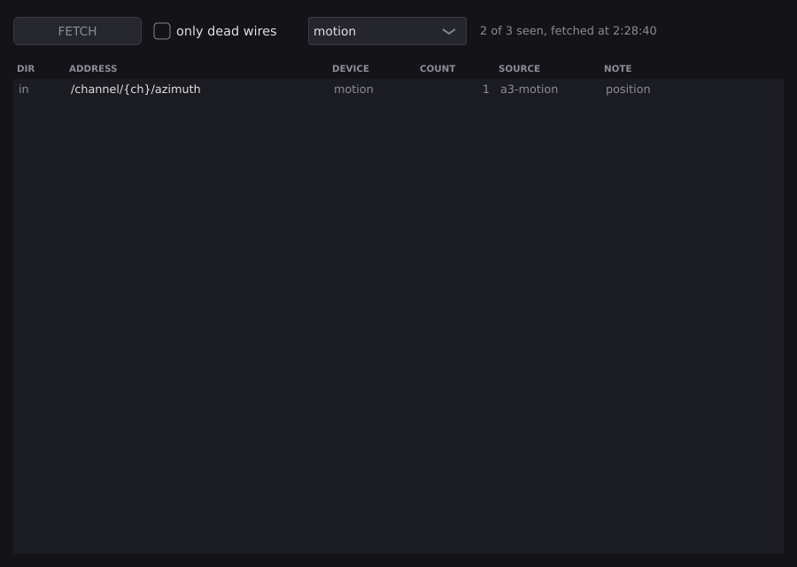

(development-core)=

# A³ Core Development

## The program `a3-core`

A³ Core is one C++ program, `a3-core` (JUCE, C++17; CMake target
`a3-core-app`), built from the [a3-core](https://github.com/a3-audio/a3-core)
repository and shipped as `/usr/bin/a3-core` by the one package `a3-core`. The
same repository holds the *installation* around it: units, drop-ins, i3, the
truth, the postinst; its `PROGRAM.md` describes the program. The program grew in
a separate repository, `a3-engine`, which is archived since the move, and its
package `a3-engine` is replaced by `a3-core`. The Python Core is gone; there is no
Python on the rig.

```text
a3-core [--role window]                  the window (attaches to Core and the engine)
a3-core --headless                       supervisor: Core and the engine as children
a3-core --role core    [--ip …] [--port N] [--mixer H:P] [--motion H:P]
                       [--subscriber NAME=H:P]... [--print-osc] [--web-bind H:P] [--no-web]
a3-core --role engine  [--config FILE] [--spatial DIR] [--truth FILE]
                       [--no-connect] [--timing] [--check-config]
a3-core --role screencast-fanout --port N [--linger SECONDS] -- COMMAND...
a3-core --role i3-bar
a3-core --render-truth user|network-file|network
a3-core --truth host NAME | --truth port PROGRAM ROLE
```

- **Each role takes only its own flags.** Another role's flag, an unknown one
  or a missing value prints the usage and exits with 2.
- **Core and the engine are two processes** (`src/a3-core/`, `app/`). The window
  is a third: it reaches Core over HTTP (`core.web`) and the engine over its
  control API (`engine.control`), both on loopback, so closing it never stops
  the sound. The engine keeps its OSC listener on `engine.osc`.
- On the rig the units run the roles; on a laptop the window or `--headless`
  does ({ref}`the laptop rule <core-window>`). A role whose user unit is enabled is
  never started a second time.
- **Every default comes from the truth**: `$A3_OSC_TRUTH`, else
  `/usr/share/a3/a3-osc.json`, joined with `$A3_NETWORK`, else
  `~/.config/a3/network.json` ({ref}`truth <osc-truth>`,
  {doc}`ports <../ressources/ports>`). A `meters` block that fails its checks is
  dropped alone and named in the status.
- **State** under `$XDG_STATE_HOME/a3-core`, else `~/.local/state/a3-core`;
  SIGTERM writes it and exits 0. A refused start says why on stderr and exits 1.
- **Everything that asks the operating system** (environment, home, host
  name, unit state, child processes) goes through one `Platform` seam
  (`src/a3-core/Platform.h`), so tests run without a rig.

| Topic | Where | Rule |
| :--- | :--- | :--- |
| data beside the source | `osc-register.json` in a3-core; `engine.json`, `spatial/` as `/usr/share/a3-engine/` | {ref}`files <core-files>` |
| total recall | `Recall`, `CoreState`, `Evening`, `StartupRecall` | {ref}`/state/recall <osc-recall>` |
| everything to everyone | `Subscribers` | {ref}`rule <osc-everyone>`, {ref}`new subscriber <core-subscriber>` |
| the way back | none: the engine reports nothing back; Core keeps the evening | {ref}`The way back <osc-way-back>` |
| tempo to the delay | `/beat` handling | {ref}`/beat and the delay <osc-beat-delay>` |
| the meters | the engine measures; Core's relay forwards | {ref}`The meters <osc-vu-meters>` |

### The meters

The engine measures each `/vu` point in its audio callback and sends the
bundles at 25 Hz to the truth's `core.vu-relay` on loopback; Core forwards an
engine datagram unchanged to the routes that carry `vu` (Motion, the desk,
radla) and to the followed remote devices, each endpoint once. StemDeck's
(41–50) pass as before. The points: `tests/engine/data/vu-points.json` in
a3-core.

### Build and test

```sh
cd a3-core
nice -n 19 env JOBS=3 ./test.sh          # builds, then runs the whole C++ suite
python3 -m unittest discover -s tools/tests    # the Python tests: truth, register, package, no JACK
```

The package is built with the umbrella's `installer/package.py` (`python3
<a3-system>/installer/package.py <a3-core checkout> --out <dir> --juce ~/local/juce`),
which calls the repository's `packaging/stage`. The IEM plug-in suite is a
submodule (`third_party/IEMPluginSuite`, initialised on its own, never
recursively).

On a rig machine every build is load: niced and with few jobs. The tests that
read the OSC contract run against the committed truth, not the live one.

## The window

The window is the `a3-core` program run without a role. Its MONITOR pages
show what actually crosses the wire — because over UDP every silent link looks
the same. The data comes from Core's HTTP API ({ref}`osc-http`), so a Core with
no screen can be examined with `curl http://<core>:9080/api/…`.



One row per address: direction, peer, count, rate, last value, age; the
HISTORY below lists the last messages. The monitor is a switch (the MONITOR
switch in the window's footer, remembered in `~/.config/a3/core/window.settings`); while it is off the
window asks Core nothing.

- **The filter is applied on the server**: Core sends only the rows asked
  for, never the whole stream.
- **Stream and query are separate**: live values stream, the big table is
  fetched on demand.
- **The window never blocks Core's start**: a broken state file, odd register
  or taken port gives a status with a problem, never an exception.

### Which truth each device speaks

Mixer, StemDeck and Motion send `/device/hello` with the sha256 of their truth
({ref}`desk <mic-truth>`, {ref}`Following Core <osc-follow>`);
Core compares it with Core's fingerprint and the window
shows *a3-osc.json is Core's* or, red, *DIFFERS* ({ref}`what to do <osc-differs>`).

### The register

A traffic log can't show what is *possible*: an address that never arrived and
one that does not exist look the same. `tools/osc_register.py` in a3-core writes
`share/a3-core/osc-register.json` from `a3-osc.json`: one row per address shape
and device, direction from Core's side (`in`, `out`, `both`, `aside`);
the IEM plug-ins' words as `both`. `tools/tests/test_osc_register.py` keeps it
in step.



Filter by device and tick *only dead wires*: every address that exists and
never arrived.

### The address list survives a restart

A device announces its vocabulary once, on connecting, so the **list** of
addresses (not values or history) is kept in
`$XDG_STATE_HOME/a3-core/seen.json`. Never written from the hot path: a
separate thread writes once new rows stop appearing.
19,335 rows: 1.27 MB, 24 ms; the 50,000-row cap: 3.29 MB, 62 ms. Restored rows
have **no value** — an old knob position would look live; `/state/recall`
answers that.

## Beat-Analyzer

[a3-beat-analyzer](https://github.com/a3-audio/a3-beat-analyzer), a3-core's submodule
`a3-beat-analyzer` (since 2026-10-31), a C++/CMake service on the same JACK graph: **the beat clock only**, with no meter code
and no `vu_*` ports. Use:
{doc}`../user/beat-analyzer`; build: {doc}`build`.
