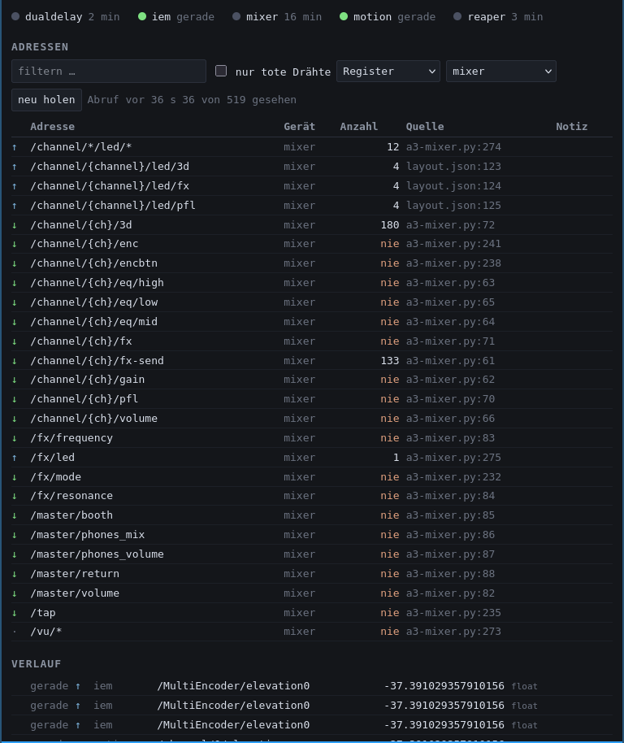

# OSC communication

What the messages *mean*. Every port is on [Ports and endpoints](ports.md).

(osc-truth)=

## Where addresses and ports live

Every OSC address, port and IP is written **once**, in `a3-osc.json`, in two
parts:

| Part | Owner | Where |
| :--- | :--- | :--- |
| **contract**: addresses, arguments, senders, listeners, ports, routes, VU map | the a3-core package, replaced on every install | `/usr/share/a3/a3-osc.json` (source: `platform-config/debian-x86_64/a3-core/usr/share/a3/a3-osc.json` in [a3-core](https://github.com/a3-audio/a3-core)) |
| **network**: `hosts`, Core's own `network` | the maintainer; created once by the installer, never overwritten | `~/.config/a3/network.json` on the Core |

Core **joins** them key by key; `network.json` wins, missing hosts come from
the package. A `network.json` that does not parse or lacks `hosts` or `network`
is **refused** (reason in the journal) and the package's values are used.

Core serves the result at `http://<core>:9080/api/truth` (`core.web`, {ref}`HTTP API <osc-http>`). Header
`X-A3-Truth` is its **fingerprint**: sha256 of the canonical JSON (sorted keys,
no spaces, UTF-8).

| Section | Holds |
| :--- | :--- |
| `network` | Core's interface, address, gateway, DNS, and the audio socket (`audio_port`) with its address (`audio_address`) |
| `hosts` | machines by name: `core`, `mixer`, `radla`, `local`, `any` |
| `listeners` | program, role, host, port |
| `routes` | who sends to which listener |
| `addresses` | pattern, types, sender, hearer, meaning |
| `vu_meters` | the forty meters by name, in `/vu/1..40` order |
| `external` | the IEM plug-ins' words |

The tables here and on the ports page are rendered from it.

### Who reads it, and how

| Device | How it gets the truth |
| :--- | :--- |
| A³ Core | the package's contract joined with `network.json`, read and joined by the program; serves it |
| A³ Motion | fetches it from Core, shared cache `~/.cache/a3/a3-osc.json`; see [Following Core](#osc-follow). No addresses in its `config.json` or menu |
| A³ Mixer | fetches it from Core on `/core/here`, cache as above, restarts on a new fingerprint; waits without one; see {ref}`the desk <mic-truth>` |
| StemDeck | like Motion; reads `prolink.*` and `stemdeck.bus`, and `stemdeck.ahead` if the truth has it (its preview of the music). Without: `PIO: no a3-osc.json` |
| beat-analyzer | the `a3-osc` block in `build/.env`, written by `a3-core --render-truth user`; see {ref}`Beat Analyzer <beat-analyzer-config>` |
| AES67 sender | `~/.config/pipewire/pipewire-aes67.conf`, rendered from `network.audio_port`; no file without a second socket |
| installer | offers the package's `network` and creates `network.json` from it once |

- **Core will not start without the package's file** (or `$A3_OSC_TRUTH`).
- **Core announces itself** every 2 s: `/core/here` broadcast on
  `devices.announce`, with the `/api/truth` URL, the fingerprint and a boot id
  (new with every Core start, so a device notices even a very quick restart). Broadcasts
  don't cross routers; a device on another subnet uses `~/.config/a3/core`
  ([radla](#osc-radla)).

(osc-follow)=

### Following Core: StemDeck and A³ Motion

Both run on the Core as `aaa`, share the cache and listen for `/core/here`. At
start each takes `$A3_OSC_TRUTH`, else a valid cache, else the package file.

On an unknown fingerprint the app fetches `/api/truth` off the UI thread,
checks body sha256, header and announcement agree and the truth is usable
(StemDeck needs `stemdeck.bus`, Motion every address it speaks; `stemdeck.ahead` is optional for both, so an older truth is still usable), writes the
cache and **exits 1**; systemd restarts it after 5 s. A refusal is logged once
per reason. With `$A3_OSC_TRUTH` set it does not follow.

**What you see:** after a truth change their windows close and reopen once,
about 5 s. Motion saves its state first.

(osc-radla)=

#### StemDeck on radla

radla is on another subnet:

1. Write Core's address into `~/.config/a3/core`, e.g.
   `http://192.168.8.10:9080` (a trailing slash or the full `/api/truth` URL
   also works; empty means unset).
2. Restart StemDeck.

It polls `/api/truth` at start and every 30 s; on a new header it fetches,
checks, writes the cache and exits 1 to restart. Core unreachable: one journal
line, it plays on. The audio network needs no
OSC address from it: the AES67 streams find each other by SAP.

### When a port or an address has to change

| Change | Do |
| :--- | :--- |
| address or host | edit `~/.config/a3/network.json`, restart Core; restart the beat-analyzer (Core re-renders its file at start). Desk, StemDeck, Motion follow |
| port, address or word of the contract | edit `a3-osc.json` in a3-core, reinstall, restart Core; the rest follows as above |

Never set a port on a device: that is a second truth.

(osc-differs)=

### "DIFFERS from Core's"

The A³ Mixer and StemDeck send `/device/hello` (name, sha256 of their truth)
with each state request. Core's window shows per device **a3-osc.json is
Core's**, or in red **DIFFERS from Core's**. The desk, StemDeck and Motion fix
that within seconds; if it stays red, look for a refused fetch in the device's
log — until then it may send where nobody listens.

(osc-addresses)=

## Addresses

Every address of ours. `{ch}` is **1–4**, as on the panel. "Core passes it on":
Core acts on it, then relays or announces it.

<!-- a3-osc:addresses -->
| Address | Types | From | To | Meaning |
| --- | --- | --- | --- | --- |
| `/channel/{ch}/gain` | f | mixer, desk, prodj, motion | core (Core passes it on to mixer, desk, motion) | input trim |
| `/channel/{ch}/eq/high` | f | mixer, desk, prodj, motion | core (Core passes it on to mixer, desk, motion) | EQ high band |
| `/channel/{ch}/eq/mid` | f | mixer, desk, prodj, motion | core (Core passes it on to mixer, desk, motion) | EQ mid band |
| `/channel/{ch}/eq/low` | f | mixer, desk, prodj, motion | core (Core passes it on to mixer, desk, motion) | EQ low band |
| `/channel/{ch}/volume` | f | mixer, desk, prodj, motion | core (Core passes it on to mixer, desk, motion) | channel fader |
| `/channel/{ch}/aux-send` | f | mixer, desk, prodj, motion | core (Core passes it on to mixer, desk, motion) | send to the FX bus (the beat-synced DualDelay) |
| `/channel/{ch}/cue` | f | mixer, desk, prodj, motion | core (Core passes it on to mixer, desk, motion) | cue the channel to the headphones (its pre-fader send to enc_phones); was pfl until 2026-10-01 |
| `/channel/{ch}/cue/led` | f | core | mixer, desk, motion | the cue lamp, 1 = lit |
| `/channel/{ch}/filter` | f | mixer, desk, prodj, motion | core (Core passes it on to mixer, desk, motion) | this channel through the master filter |
| `/channel/{ch}/filter/led` | f | core | mixer, desk, motion | the filter key's lamp, 1 = lit |
| `/channel/{ch}/filter/frequency` | f | motion | core (Core passes it on to mixer, desk, motion) | the channel's own filter cutoff (was pot_1) |
| `/channel/{ch}/filter/q` | f | motion | core (Core passes it on to mixer, desk, motion) | the channel's own filter Q (was pot_2) |
| `/channel/{ch}/3d` | f | motion | core (Core passes it on to mixer, desk, motion) | how much of the channel's isolated band moves, as an amplitude 0..1; the steady rest never changes |
| `/channel/{ch}/azimuth` | f | motion | core (Core passes it on to prodj) | the channel's direction, degrees; live only to the pro-DJ apps followed; a recall replays the last one to everyone, as before |
| `/channel/{ch}/elevation` | f | motion | core (Core passes it on to prodj) | the channel's height, degrees; live only to the pro-DJ apps followed; a recall replays the last one to everyone, as before |
| `/channel/{ch}/stem/turn` | i | mixer, desk, prodj | core | the channel's encoder turned by this many clicks (signed): moves its selector's cursor over the channel's three positions in a ring -- on channel N: deck 1's stem N, deck 2's stem N, then A, the analog input; left from deck 1's stem N is A; switches nothing |
| `/channel/{ch}/stem` | i | core | mixer, desk, motion | what the channel plays: while its source is STEM, the stems on its bus as a bit mask of pairs 1-8 (bit 0 = pair 1 = deck A stem 1); 0 = the analog input, sent whenever its source is ANALOG, whatever is on its bus; on channel N only bit N-1 (deck 1's stem N) or bit N+3 (deck 2's stem N) |
| `/channel/{ch}/stem/push` | i | mixer, desk, prodj | core | the channel's encoder pushed: on A, the channel's source becomes ANALOG -- the engine crossfades the channel from its deck input to its analog input (10 ms), StemDeck is not asked and the stem on its bus stays there, unheard; on a stem (deck 1's or deck 2's stem N on channel N), the source becomes STEM and the stem the channel's only input -- the other deck's stem N goes to StemDeck's AUX bus, the delay's send; on the stem already on its bus nothing moves; without StemDeck a stem push switches nothing, A still does |
| `/channel/{ch}/stem/cursor` | i | core | mixer, desk, motion | the channel's selector cursor: on channel N one of N-1 (deck 1's stem N), N+3 (deck 2's stem N) and 8 = A, the analog input; a stored cursor outside these comes back as 8 |
| `/filter/frequency` | f | mixer, desk, prodj, motion | core (Core passes it on to mixer, desk, motion) | the master filter's cutoff (was /fx/frequency) |
| `/filter/resonance` | f | mixer, desk, prodj, motion | core (Core passes it on to mixer, desk, motion) | the master filter's resonance (was /fx/resonance) |
| `/filter/mode` | f\|s | mixer, desk, prodj, motion | core (Core passes it on to mixer, desk, motion) | high-pass or low-pass (was /fx/mode) |
| `/filter/led` | s | core | mixer, desk, motion | the filter section's lamp: blue HPF, green LPF (was /fx/led) |
| `/master/volume` | f | mixer, desk, prodj, motion | core (Core passes it on to mixer, desk, motion) | the main outputs |
| `/master/booth` | f | mixer, desk, prodj, motion | core (Core passes it on to mixer, desk, motion) | the booth outputs |
| `/master/phones-mix` | f | mixer, desk, prodj, motion | core (Core passes it on to mixer, desk, motion) | cue <-> main in the headphones |
| `/master/phones-volume` | f | mixer, desk, prodj, motion | core (Core passes it on to mixer, desk, motion) | the headphone level |
| `/master/aux-return` | f | mixer, desk, prodj, motion | core (Core passes it on to mixer, desk, motion) | RETURN: the FX Return's level, the master of the delay channel -- it scales the delay's output into main, booth and rec (was /master/return) |
| `/aux-return/stem/push` | i | mixer, desk, prodj | core | the FX Return's encoder pushed: toggles the FX Return's cue; the desk steps its delay page (BEAT, FEEDBK, COLOR, SPREAD) locally on a short push and sends this word only on a hold of 0.5 s or more, so it still toggles the cue; Core answers with aux-return.cue.led and tells the engine aux-return.cue. Its turn is the aux-return.delay.<page>.turn words |
| `/channel/{ch}/source` | i | core | engine, mixer, desk, motion | the channel's source in engine mode: 0 = analog, k = deck k (1 = A ... 4 = D); from Core's deck selector, to the engine as its switch and to the desk and Motion as the channel-source report |
| `/channel/{ch}/source/cursor` | i | core | mixer, desk, motion | engine mode: the channel's selector cursor over its ring, 0 = analog, k = deck k (1 = A ... 4 = D); moves on channel.stem.turn, becomes the source on channel.stem.push |
| `/aux-return/cue` | i | core | engine | the FX Return's cue in engine mode, 1 = on, 0 = off: a PFL, the delay's output before RETURN in the phones, at the cue weight of PHONES MIX |
| `/delay/bpm` | f | core | engine | the delay's tempo for both lines in engine mode, 20-400 (Core's tempo follower) |
| `/aux-return/delay/beat/turn` | i | mixer | core | the AUX-RTN encoder turned on the BEAT page: relative detents, + clockwise. Core steps the value (one legal step per detent, clamped at the ends) and announces it with aux-return.delay.beat |
| `/aux-return/delay/feedback/turn` | i | mixer | core | the AUX-RTN encoder turned on the FEEDBK page: relative detents, + clockwise. Core steps the value (one legal step per detent, clamped at the ends) and announces it with aux-return.delay.feedback |
| `/aux-return/delay/color/turn` | i | mixer | core | the AUX-RTN encoder turned on the COLOR page: relative detents, + clockwise. Core steps the value (one legal step per detent, clamped at the ends) and announces it with aux-return.delay.color |
| `/aux-return/delay/spread/turn` | i | mixer | core | the AUX-RTN encoder turned on the SPREAD page: relative detents, + clockwise. Core steps the value (one legal step per detent, clamped at the ends) and announces it with aux-return.delay.spread |
| `/aux-return/delay/beat` | f | core | engine, mixer | BEAT: the delay time in beats, one of 0.125, 0.25, 0.5, 0.75, 1, 2; default 0.25. Core announces the beat that plays: 2 below 92 BPM is longer than DualDelay's line and plays, and is announced as, 1 while 2 stays selected; from 92 BPM on it is 2 again. The engine maps it to DualDelay's delayBPM and delayMult against delay.bpm and snaps an incoming value to the nearest legal one in log; a change jumps to the new time with a short crossfade, no pitch sweep. Core decides the value (it steps on a turn and announces it, the engine and the desk follow) |
| `/aux-return/delay/feedback` | f | core | engine, mixer | FEEDBK: the delay's feedback as a share of the loop gain, 0.00-0.95 in 0.05 steps; default 0.70. The engine splits it into the direct and the cross feedback (0.738 : 0.262) and smooths it; it clamps an incoming value. Core decides the value (it steps on a turn and announces it, the engine and the desk follow) |
| `/aux-return/delay/color` | f | core | engine, mixer | COLOR: the delay's colour, -1.0 to +1.0 in 0.1 steps (21): below 0 a high-pass, above 0 a low-pass, 0 neutral; default 0.0. The engine maps it to the two filters and glides them; it clamps an incoming value. Core decides the value (it steps on a turn and announces it, the engine and the desk follow) |
| `/aux-return/delay/spread` | f | core | engine, mixer | SPREAD: the delay's spread in degrees per repeat, 0-180 in 15 degree steps; default 60. The engine turns the left line by +s and the right by -s (yaw) and glides it; it clamps an incoming value. Core decides the value (it steps on a turn and announces it, the engine and the desk follow) |
| `/engine/open` | i | core | engine | 1 opens main, booth and phones (a 1 s ramp to the calibrated level), 0 closes them |
| `/engine/hello` | s | engine | core | the engine's boot id, every 2 s; a new id makes Core replay its state and open the outputs |
| `/engine/deck/{deck}/audio` | i | engine | core | 1 = every map link of this deck slot is live, 0 = any missing; sent with each hello (every 2 s) and on change. Core counts a deck as present while its hello is fresh and the engine does not report 0 (an engine that never reports counts as 1) |
| `/stemdeck/{deck}/3d` | f | core | stemdeck | deck k's 3D, 0-1: the desk's 3D of the channel holding deck k, 1 (neutral) while it is on no channel |
| `/stemdeck/{deck}/present` | i | core | mixer, desk, motion | 1 while deck k's hello is fresh (5 s at most) and the engine does not report its audio missing (engine.deck-audio), else 0 |
| `/stemdeck/{deck}/hello` | s | stemdeck | core | a StemDeck instance names the deck it plays (host), at start and every 2 s; device.hello carries no deck number |
| `/stemdeck/{deck}/tempo` | fii | stemdeck | core | deck k's tempo as it plays in BPM (the track's tempo times its pitch; 0 with no track loaded), whether it plays (1/0) and whether it is MASTER (1/0); on every change of one of them and with every deck hello (2 s) |
| `/aux-return/cue/led` | f | core | mixer, desk, motion | the FX Return's cue lamp, 1 = on |
| `/stemdeck/{deck}/{stem}/bus/{bus}` | i | core | stemdeck | set one bus switch of a stem, 1 on 0 off; bus 1-4 the desk channels, 5 AUX (StemDeck's own cue bus 6 is gone since 2026-10-07: a channel is cued through its own bus); stem N reaches only bus N and 5 (AUX): StemDeck and Core refuse a switch onto another bus |
| `/stemdeck/{deck}/{stem}/buses` | i | stemdeck | core | a stem's bus switches as a bit mask (bit 0 = bus 1), after every change and for all 8 stems after /stemdeck/recall |
| `/stemdeck/recall` | i | core | stemdeck | report every stem's buses once; Core asks when StemDeck's hello is news |
| `/stemdeck/ahead` | ssif | stemdeck | core (Core passes it on to motion) | StemDeck's preview of the music on the audible deck (the MASTER deck when both are heard): the current bar's section (groove, build, drop, breakdown; none: no deck is heard, or it is not analysed yet), the next section (end: no change before the set ends), the bars until it (-1: a loop turns back before it) and the bar's energy 0-1 against the set's loud bars. On every downbeat and on a load, jump, loop, pitch or deck change; Core passes it on to the Motion it follows, unchanged, and never replays it |
| `/device/hello` | ss | mixer, desk, prodj, stemdeck, motion | core | a device names itself and the sha256 of its copy of this file, at start and every 30 s; Core's window shows whether it is Core's own. Core follows the StemDeck and the Motion that arrived last (one of each), a remote Motion instead of the rig's own, and forgets one silent for a minute; and every desk (the A³ Mixer on a screen) that says hello with Core's own truth, four at most, each until it has been silent for a minute; a pro-DJ app says `prodj` and is followed as a desk of that kind |
| `/core/here` | sss | core | mixer, desk, prodj, motion, stemdeck, radla | Core, every 2 s by broadcast: the URL of the joined truth, its fingerprint (sha256 of the canonical JSON) and a boot id, a random token that is new with every Core start (a changed boot id means a new Core, even one restarted within seconds); readers also accept the older two-string form |
| `/state/recall` | i | motion, desk, prodj | core | say the state again; the answer is the ordinary messages |
| `/prodj/live` | i | prodj, desk, motion | core (Core passes it on to desk, prodj, motion, stemdeck) | the single global pro-DJ LIVE state, 1 = a pro-DJ app may operate. Core holds it, starts off, and repeats it every 5 s while on; a device counts it off 12 s after the last 1. Motion only ever sends 0 |
| `/stemdeck/pointer` | iff | prodj | core (Core passes it on to stemdeck) | a click on StemDeck's screen picture: phase 0 down, 1 move, 2 up; x, y a share of the screen from top-left; forwarded only while pro-DJ LIVE |
| `/motion/pointer` | iff | prodj | core (Core passes it on to motion) | a click on Motion's screen picture: phase 0 down, 1 move, 2 up; x, y a share of the screen from top-left; forwarded only while pro-DJ LIVE |
| `/core/device/at` | ss | core | prodj | where a followed device runs: device (motion, stemdeck) and host. Sent to a pro-DJ app when it joins or recalls, and when that device moves |
| `/beat` | iif | beat-analyzer, motion | core, motion, mixer, desk, radla, beat-analyzer | beat in bar, bar, tempo -- the clock (Motion sends it only in clock mode 0) |
| `/tap` | i | mixer, desk, prodj, motion | beat-analyzer | a tap on the beat |
| `/clockmode` | i | motion | beat-analyzer | 0 a3motion, 1 intern, 2 pioneer |
| `/vu/{n}` | ff | engine, stemdeck | motion, mixer, desk, radla | peak, rms (linear) of VU channel n, measured by the engine at its meter points and sent to Core, which forwards them. 41-50 come from StemDeck, 9-10 are free. 1-8 analog1_L ... analog4_R the four channels' analog inputs, L and R each (the engine's analog inputs 1-8, before any channel processing, shown under the desk's A even while a stem plays); 11-20 main_sub, main_top1 ... main_top9 the main outputs; 21-30 booth_sub, booth_top1 ... booth_top9 the booth outputs; 31-34 phones_L, phones_R, rec_L, rec_R the phones and the recording bus; 35-36 aux_L, aux_R the FX Return: the delay's output after RETURN, its W on both sides (L and R read the same; analog inputs 11-12 feed no return); 37-40 deck_a ... deck_d each deck's W as it reaches the engine (deck slots 1-4, before any channel), whatever channel plays it -- the desk's deck bars; 41-48 StemDeck's stems, one each (stem_a1 ... stem_b4: peak of the louder side, rms over both, as the stem leaves StemDeck on a bus: after knob, mute, deck fader and the bus trim -- so a stem alone on a channel reads as that channel's in{n}_pre; a stem on no bus shows what it would send); 49-50 StemDeck's AUX bus, L and R: peak and rms of each side after the bus; 51-66 the channels in stereo, L and R each: 51-58 in1_pre_L ... in4_pre_R (input after TRIM/EQ, post-fader), 59-66 in1_post_L ... in4_post_R (channel bus post-fader, moving + steady); see vu_meters. A remote Motion gets the engine's from Core (core.vu-relay), unchanged |
<!-- /a3-osc:addresses -->

### Renamed addresses

Code written against old words must follow:

| Old | Now |
| :--- | :--- |
| `/channel/0..3/…` | `/channel/1..4/…` |
| `/fx/frequency`, `/fx/resonance`, `/fx/mode`, `/fx/led` | `/filter/…` |
| `/channel/{ch}/fx` | `/channel/{ch}/filter` |
| `/channel/{ch}/led/pfl`, `/channel/{ch}/pfl`, `/channel/{ch}/pfl/led` | `/channel/{ch}/cue`, `/channel/{ch}/cue/led` |
| `/channel/{ch}/led/fx` | `/channel/{ch}/filter/led` |
| `/channel/{ch}/pot_1`, `pot_2` | `/channel/{ch}/filter/frequency`, `/filter/q` |
| `/master/phones_mix`, `phones_volume` | `/master/phones-mix`, `phones-volume` |
| `/master/return`, `/master/fx-return` | `/master/aux-return` |
| `/vu/0..39` | `/vu/1..40` |
| `/channel/{ch}/stem/menu` (ii) | `/channel/{ch}/stem/cursor` (i): 0–7 stems, 8 = **A** (analog input) |
| `/stem/cue`, `/stem/cue/led` | dropped |

`/channel/{ch}/stem` is a bit mask of the stems on a channel. On the desk,
turning only moves a selection (`…/stem/turn`) and a push loads it
(`…/stem/push`; `…/stem/selected`). The FX Return has no selection: its push,
`/aux-return/stem/push`, toggles its cue. Cursor 8 pushed takes a playing stem
off; Core remembers no last stem.
See {ref}`the desk's input selectors <a3mix-displays>`.

(osc-vu-meters)=

## The meters

The **audio engine** measures each `/vu/n` (peak and RMS, linear, 0–1) at its
meter points, sends them 25 times a second to Core's `core.vu-relay` on
loopback, and **Core forwards them unchanged** to every route that carries `vu`
and to the followed remote devices. The beat-analyzer sends no `/vu`; StemDeck
sends its own 41–50. Where each number is measured:
{ref}`Where the meters come from <core-meters>`. **Devices find a
meter by name** in `vu_meters`, not by number:

| Device | Shows |
| :--- | :--- |
| A³ Motion | channel inputs `in1_pre_L` … `in4_pre_R` (`/vu/51`–`/vu/58`, louder side); sphere glow `main_sub` (`/vu/11`); towers `main_top1`–`4` (`/vu/12`–`/vu/15`); MIXER master `main_sub`, `main_top1`–`9` (`/vu/11`–`/vu/20`) |
| A³ Mixer | inputs `in1_pre_L` … `in4_pre_R` (`/vu/51`–`/vu/58`); outputs `main_sub`, `main_top1`–`7` (`/vu/11`–`/vu/18`); channel displays `stem_a1` … `stem_b4` (`/vu/41`–`/vu/48`) and under A `analog1_L` … `analog4_R` (`/vu/1`–`/vu/8`); the FX Return `aux_L/R` (`/vu/35`–`/vu/36`) |

`/vu/1`–`/vu/8` are the analog inputs before any processing, whatever the
channel plays.

<!-- a3-osc:vu -->
| Address | Meter |
| --- | --- |
| `/vu/1` | analog1_L |
| `/vu/2` | analog1_R |
| `/vu/3` | analog2_L |
| `/vu/4` | analog2_R |
| `/vu/5` | analog3_L |
| `/vu/6` | analog3_R |
| `/vu/7` | analog4_L |
| `/vu/8` | analog4_R |
| `/vu/9` | free39 |
| `/vu/10` | free40 |
| `/vu/11` | main_sub |
| `/vu/12` | main_top1 |
| `/vu/13` | main_top2 |
| `/vu/14` | main_top3 |
| `/vu/15` | main_top4 |
| `/vu/16` | main_top5 |
| `/vu/17` | main_top6 |
| `/vu/18` | main_top7 |
| `/vu/19` | main_top8 |
| `/vu/20` | main_top9 |
| `/vu/21` | booth_sub |
| `/vu/22` | booth_top1 |
| `/vu/23` | booth_top2 |
| `/vu/24` | booth_top3 |
| `/vu/25` | booth_top4 |
| `/vu/26` | booth_top5 |
| `/vu/27` | booth_top6 |
| `/vu/28` | booth_top7 |
| `/vu/29` | booth_top8 |
| `/vu/30` | booth_top9 |
| `/vu/31` | phones_L |
| `/vu/32` | phones_R |
| `/vu/33` | rec_L |
| `/vu/34` | rec_R |
| `/vu/35` | aux_L |
| `/vu/36` | aux_R |
| `/vu/37` | deck_a |
| `/vu/38` | deck_b |
| `/vu/39` | deck_c |
| `/vu/40` | deck_d |
| `/vu/41` | stem_a1 |
| `/vu/42` | stem_a2 |
| `/vu/43` | stem_a3 |
| `/vu/44` | stem_a4 |
| `/vu/45` | stem_b1 |
| `/vu/46` | stem_b2 |
| `/vu/47` | stem_b3 |
| `/vu/48` | stem_b4 |
| `/vu/49` | stem_aux_L |
| `/vu/50` | stem_aux_R |
| `/vu/51` | in1_pre_L |
| `/vu/52` | in1_pre_R |
| `/vu/53` | in2_pre_L |
| `/vu/54` | in2_pre_R |
| `/vu/55` | in3_pre_L |
| `/vu/56` | in3_pre_R |
| `/vu/57` | in4_pre_L |
| `/vu/58` | in4_pre_R |
| `/vu/59` | in1_post_L |
| `/vu/60` | in1_post_R |
| `/vu/61` | in2_post_L |
| `/vu/62` | in2_post_R |
| `/vu/63` | in3_post_L |
| `/vu/64` | in3_post_R |
| `/vu/65` | in4_post_L |
| `/vu/66` | in4_post_R |
<!-- /a3-osc:vu -->

(osc-meter-ballistics)=

### How a meter moves

**Sources send raw peaks; every display applies the same ballistics** (decided
2026-10-07): the desk's displays and LEDs, StemDeck's strips, A³ Motion's
meters. Per tick a source sends the highest peak since the last, no fall, no
hold. Each display, on its own clock: attack (0 = at once), release in dB/s,
and a hold of the highest recent peak before it falls; a higher peak restarts
the hold.

The numbers are the truth's `meters` block: devices read it from Core and
restart on a new fingerprint; a truth without the block reads as the package
values below. Tune them on the rig in `network.json`
({ref}`The one truth <core-the-one-truth>`).

<!-- a3-osc:meters -->
| Key | Value |
| --- | --- |
| `attack_ms` | 0 |
| `release_db_per_second` | 20 |
| `peak_hold_seconds` | 1.5 |
<!-- /a3-osc:meters -->

(osc-core)=

## A³ Core

Three listeners ({ref}`ports <ports-by-listener>`); the port decides the meaning.
The engine has its own, `engine.osc`, and the window reaches it on
`engine.control` (loopback):

| Listener | Receives |
| :--- | :--- |
| `core.osc` | commands from Mixer, Motion, StemDeck, beat-analyzer |
| `core.vu-relay` | the engine's and StemDeck's `/vu` bundles (loopback), forwarded unchanged |
| `core.web` | HTTP: the {ref}`API <osc-http>` the window and `curl` use, and `/api/truth` |

(osc-http)=

### Core's HTTP API

`core.web` (9080) is plain HTTP and JSON, for the `a3-core` window, for
devices fetching the truth, and for `curl` on a Core without a screen. There is
**no web page**: `GET /` answers 404 with a short text that names `/api/…` and
the `a3-core` window. Refusals are plain English sentences.

| Request | Answers |
| :--- | :--- |
| `GET /api/status` | what Core says about itself: peers, state, problems |
| `GET /api/rig` | the rig state: the engine, its gate, who is there |
| `GET /api/devices` | the devices and the truth each speaks, with Core's fingerprint |
| `GET /api/traffic` | every address seen: count, rate, last value, peer |
| `GET /api/unknown` | the addresses Core did not understand |
| `GET /api/register` | the catalogue of addresses that can exist, against the traffic |
| `GET /api/truth` | the joined truth; `X-A3-Truth` is its fingerprint |
| `GET /api/stream` | the live values, streamed |
| `POST /api/send` | one OSC message from the bench: JSON `{"to": …, "address": "/…", "value": …}` with `to` one of `self`, `mixer`, `motion` |

```sh
curl http://<core>:9080/api/rig
curl -d '{"to":"self","address":"/master/volume","value":0.5}' http://<core>:9080/api/send
```

There is no login: bind Core to the machine (`--web-bind`) to keep it local.
The window asks Core only while its OSC MONITOR switch is on.

(osc-everyone)=

### Everything goes to everyone

Every A³ message Core produces goes to **every subscriber**; there is no
recipient list (a missing recipient fails silently over UDP).

```
      what comes in                        what goes out

   A³ Mixer                                   A³ Mixer
   A³ Motion            ──▶   A³ Core   ──▶   A³ Motion
   beat-analyzer             core.osc         light    (--subscriber)
                                              video    (--subscriber)

   One message in, the same message out to every subscriber:
       /channel/*    /master/*    /filter/*    /state/recall

   And, each in its own language, to exactly one:
       /engine/…           the engine       engine.osc
```

New subscriber: {ref}`Adding a department <core-subscriber>`.

- The engine is not a subscriber: it has its own words on `engine.osc` (the
  channel, master and send words in its own spelling, and `/engine/open`).
  REAPER and the IEM plug-ins' own OSC receivers are gone: the IEM code is
  compiled into the engine.
- **Lamps are broadcast too** (`/channel/{ch}/cue/led`,
  `/channel/{ch}/filter/led`, `/filter/led`), beside the flags: a lamp is a
  light, a flag a setting.
- Only changes are sent; a value already passed on is dropped.

### What the address table does not say

- **Values are 0–1**, except `azimuth` −180…180 and `elevation` −90…90,
  clamped; the clamped value is replayed.
- **gain, EQ, volume, `aux-send`** go out to all devices when Core passes them
  on, never from the engine: nothing is read back ([The way back](#osc-way-back)).
- **`cue`, `filter`** take [two spellings](#osc-two-spellings); Core sends the
  state back as a number.
- **`3d`**: see [/channel/{ch}/3d](#osc-3d).
- **`/master/phones-mix`** goes out unbent, as a track volume.
- **`/master/aux-return`** is RETURN, the FX Return's level: the delay's
  output into main, booth and rec; full travel is 0 dB.
- **`/filter/mode`**: `high_pass`/`low_pass` or a number (1 = high pass); sent
  as a number, the word goes to the desk on `/filter/led`.
- **`/beat`**: only the tempo is used, for the [delay](#osc-beat-delay), which
  also follows the decks' `/stemdeck/{deck}/tempo` when no beat clock is running.
- **`/vu/{n}`** comes from the engine (StemDeck's 41–50), through Core.
- `/channel/{ch}/reverb`, `/width`, `/order`: no handler; counted as
  unrecognised.

(osc-two-spellings)=

### The two spellings of a button

The A³ Mixer sends a button's **edge** as a string (`"1"` down, `"0"` up); A³
Motion sends a **state** as a number. Core tells them apart by type. Make
`a3-mixer.py` send `int(value)` and the desk's cue becomes momentary — and no
test catches it.

(osc-recall)=

### /state/recall

A device that just started asks; Core answers with **the ordinary messages**,
each to the device it belongs to:

1. **Lamps**: Core's own flags, from its state file.
2. **Position and 3d** per channel, held by Core because nobody else can be
   asked (the engine reports nothing back).
3. **Continuous values**: what Core last passed on, kept in its evening file.

A cold Core, with no evening yet, answers short. A value never seen is **left
out**, not sent as zero: zero degrees is a real position. The engine is not
asked: when it says `/engine/hello` with a new boot id, Core replays the evening
into it and then opens the outputs.

(osc-way-back)=

### The way back: there is none

REAPER used to report its track values, and Core bent them back through their
curves and broadcast them. REAPER is gone, and the engine sends Core nothing but
`/engine/hello` and `/vu`. What the devices see of a value is what Core passed
on, so Core's evening file is the only record of it.

```{warning}
**Relay back only what no action script can drive.** `3d`, `freq` and `Q` carry
an accent envelope; writing that back as the base would ratchet them up. If a
return path is built again, gain, EQ, volume and `aux-send` are the safe ones.
```

The desk ignores returned values anyway: its pots are analog.

(osc-beat-delay)=

### /beat, the decks' tempo, and the delay that follows them

```
beat-analyzer  ──/beat b bar bpm──▶  A³ Core (core.osc)  ──delay.bpm──▶  the engine's DualDelay (engine.osc)
StemDeck k     ──/stemdeck/k/tempo f i i──▶  ▲
```

Core chooses the delay's tempo from four sources, in this order; the first that
applies wins:

1. **A live beat clock**: a `/beat` with a tempo arrived within the last
   **3.0 s** (three beats at 60 BPM). The tempo must have held still for a
   steady **4 beats** before it is used.
2. **The MASTER deck**: the *playing* deck that reports itself MASTER (with a
   valid BPM, 20-400) in `/stemdeck/{deck}/tempo`, if that report is no older than **5.0 s** (the
   window of a deck's hello). A deck's tempo is exact, so there is no wait.
3. **A playing deck**: the deck that reports playing. With several playing, the
   one on the desk channel with the **highest fader** wins; a playing deck on
   no channel ranks last, and equal ranks go to the lower deck number. A deck
   on a channel whose fader Core has not heard yet counts as fader 0 (still
   above a deck on no channel); this lasts a moment after a Core start.
4. **Hold**: otherwise the delay keeps the last tempo.

The tempo changes only when it differs by **≥ 0.1 BPM** (a changing delay
shifts pitch). Core re-evaluates on every input and once a second, so the
choice also moves when a beat clock stops (after 3.0 s) or a report goes stale
(after 5.0 s). A deck reports its tempo as the track's tempo times its pitch,
and 0 with no track loaded. Both lines get the same tempo; their multipliers
stay in the engine. The delay is IEM's, compiled into the engine, so there is
no plug-in receiver to open and no `Sync` switch.

Core's `/api/rig` shows the source in use as `tempo_source`: `beat`,
`master deck k`, `deck k` or `held`. In beat-analyzer clock mode 1 (intern) the
analyzer always sends beats, so the beat clock wins there; the decks' tempo
matters in the other modes when no beats arrive, for example with StemDeck as
the only source.

### The aux send

```
/channel/{ch}/aux-send  ──▶  Core  ──aux-send──▶  the engine (engine.osc)   (0..1)
```

The send reaches the FX bus (`enc_fx`); the phones bus (`enc_phones`) has its own
cue and mix taps. It scales only the channel's **own signal**: the analog
input, or the deck's main 16 channels when a deck is on the channel, taken
after the fader. A deck's AUX bus (the stems sent with StemDeck's AUX knobs)
does not pass through it; see {ref}`Decks <audio-engine-decks>`. 3D is A³ Motion's alone (`/channel/{ch}/3d`).

## A³ Motion

Three listeners: `motion.osc` (Core's relays, `/beat`), `motion.vu` (meters),
`motion.energy` (the IEM EnergyVisualizer's frames; nothing sends them since REAPER went, see [below](#osc-energy)), so high-rate streams don't share the
clock's socket. One handler serves all three.

- **Position** (`azimuth`, `elevation`) is sent while a blob moves.
- **`3d`** from the pot; **`filter/frequency`**, **`filter/q`** from the
  channel row and the encoders.
- **The MIX pages** send the A³ Mixer's addresses and receive Core's relays;
  `cue` and `filter` as states, `/filter/mode` as a number.
- **`/state/recall`** once at start-up.
- **`/beat`** sent in INT, received in EXT and PIO (syncs tempo and phase);
  floats are truncated.
- **`/tap`**, **`/clockmode`** go to the beat-analyzer.

| External address | Direction | What |
| :--- | :--- | :--- |
| `/EnergyVisualizer/RMS` | received, `motion.energy` | energy per direction lighting the sphere; see [below](#osc-energy) |
| `/StereoEncoder/azimuth`, `/elevation` | sent | alternative backend: straight into an IEM chain |

Addresses and ports come only from `a3-osc.json`. A meter's meaning exists
only in the file: the analyzer sends one meter per JACK input in port order.

(osc-3d)=

### /channel/{ch}/3d

Each analog channel is split in the engine: the steady part feeds the shared
bed, the moving part the channel's own encoder source. `filter/frequency` and
`filter/q` set the band that is split off. `3d` is how much of it moves; band
and rest always sum to the input, so **3d moves sound without changing the
level**. It is continuous.

(osc-energy)=

### /EnergyVisualizer/RMS

```{note}
**Nothing sends this now.** The frames came from the IEM EnergyVisualizer plug-in
inside REAPER. The engine does not send them, so Motion's listener stays open
and stays silent; this is an open issue, not a setting. What follows is the
format Motion expects.
```

From the [IEM EnergyVisualizer](https://plugins.iem.at/docs/energyvisualizergrid/)
≥ 1.0.0, with "OSC send" on: **426 float32** per message, one per point of its
grid, about 9 a second, linear. Directions come from
`resources/EnergyVisualizerGrid.json` in the A³ Motion UI. Any other length is
discarded. Unlike the VU meters it carries elevation.

### Total recall at start-up

Motion sends `/state/recall` and stays silent until the answer (or a short
grace period). **At start-up Core wins; when a set is loaded the set wins.**
Asking once is safe; reporting continuously would loop (see
[The way back](#osc-way-back)).

(osc-beat-analyzer)=

## beat-analyzer

Listens on `beat-analyzer.clock` (`OSC_PORT_A3MOTION` in its `.env`) and the
Pro DJ Link ports (`prolink.*`, not OSC); sends to every target in its
`a3-osc` block ({ref}`config <beat-analyzer-config>`).

- **`/beat`** (beat 1–4, bar, bpm): sent in every mode to every target (mode 0:
  not to `motion`). Received and relayed only in mode 0; beats outside 1–4
  dropped. Mode 2: bar always 0.
- **No `/vu/{n}`**: the beat-analyzer no longer measures or sends meters,
  whatever `ENABLE_VU` says; the engine does ({ref}`meters <osc-vu-meters>`).
- **`/clockmode`**: 0 a3motion, 1 intern, 2 pioneer; clamped; not stored
  (starts in 1).
- **`/tap`**: mode 1 only; always sets the beat to 1.

Modes: {ref}`Beat Analyzer <beat-analyzer-modes>`.

## IP and Port

All listeners: [ports page](ports.md). Every port comes from `a3-osc.json`; none
is set inside a plug-in any more.

### Known inconsistencies

- A device on an older truth shows *DIFFERS from Core's* ([above](#osc-differs)).
- A target hand-written into the beat-analyzer's `.env` outside the block is
  commented out (`# was: …`) at the next install.

## The register: which addresses exist at all

Core's window holds the **register** — every address the system can speak,
from `a3-osc.json` — against the traffic it has seen. **An address that exists
and never arrived is a dead wire.**



*nie* in that column: never heard. The window: {doc}`../development/core`.
