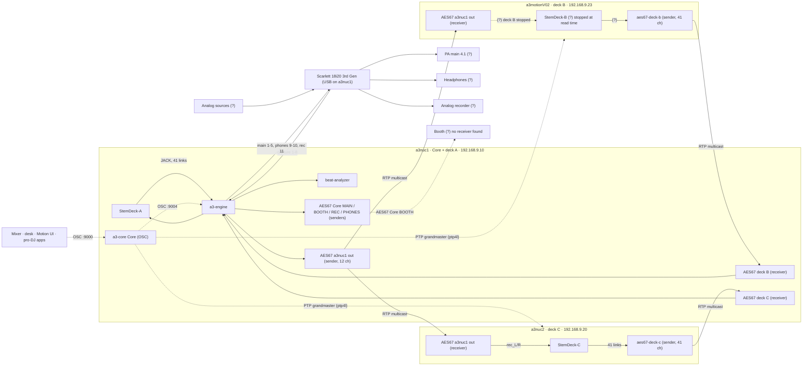
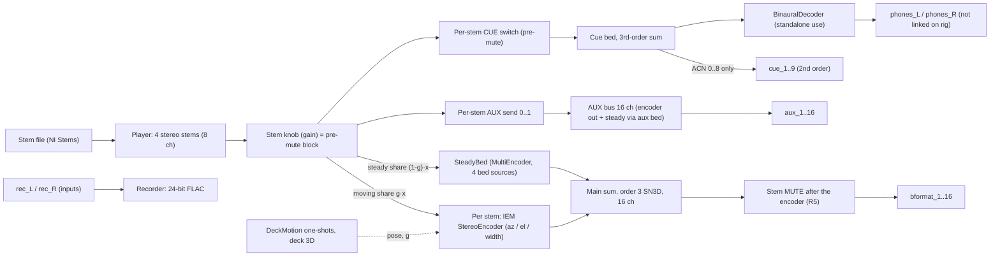
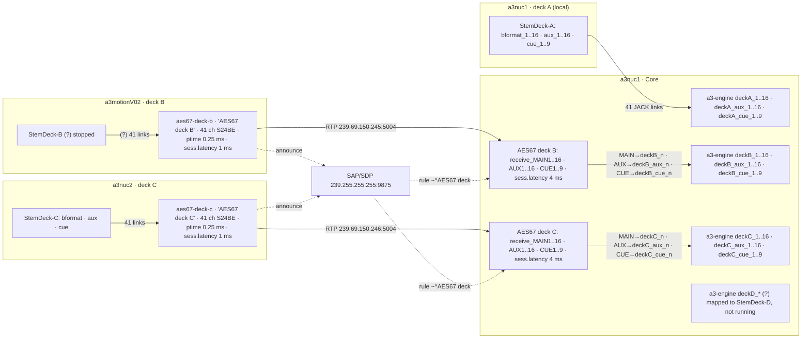
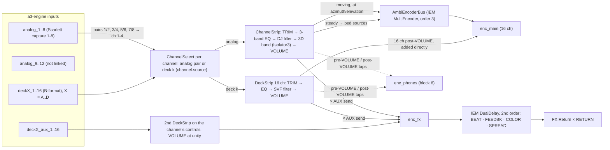
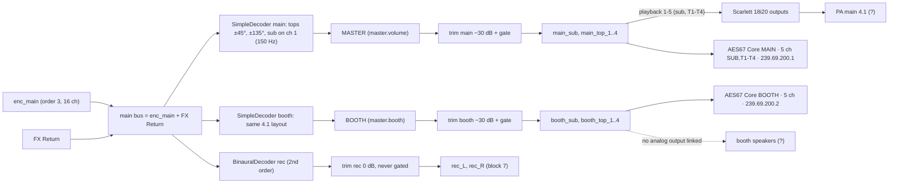
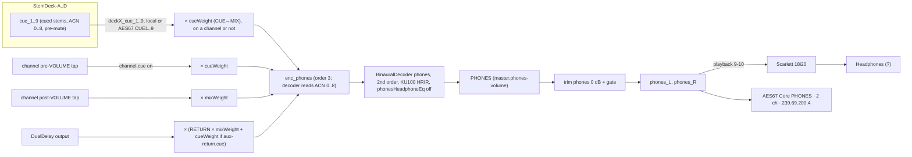
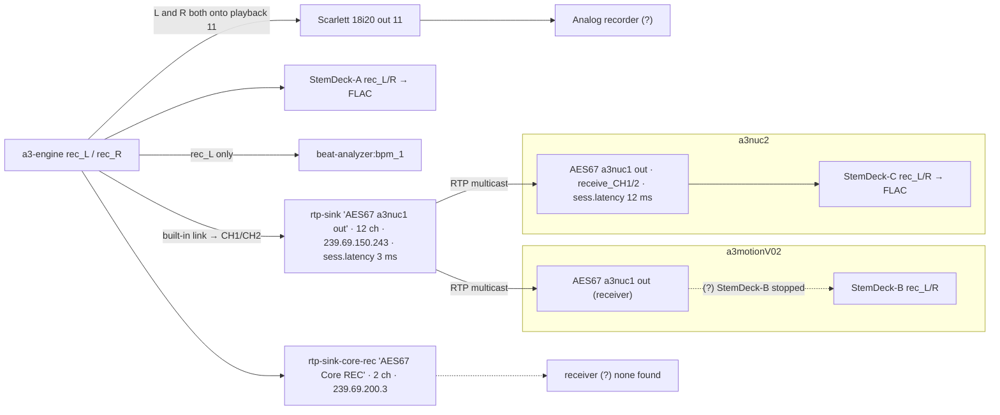
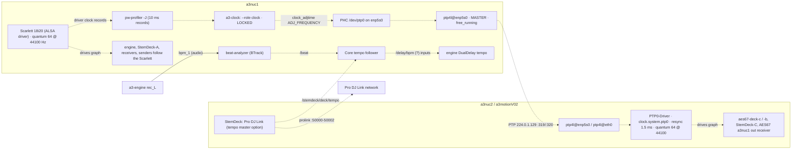
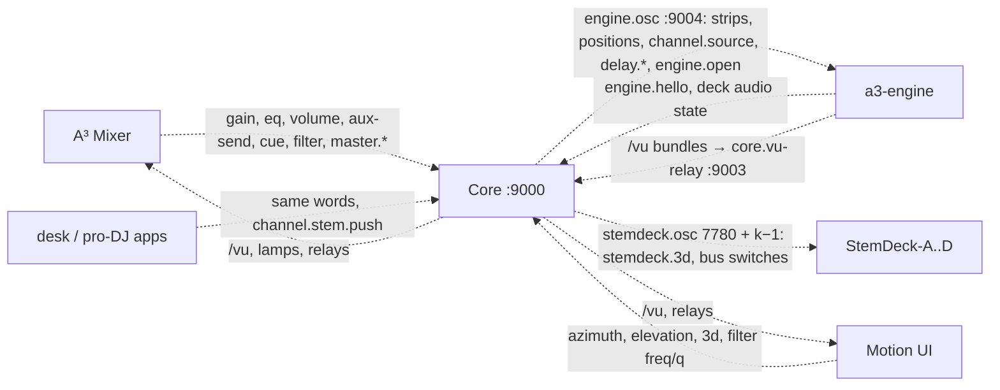

(signal-flow)=

# Audio signal flow

The audio path of the whole rig, block by block, as read on the rig on 2026-11-10. Each block is its own
diagram and can be read alone.

**Legend.** Solid arrows (`-->`) are audio. Dashed arrows (`-.->`) are control (OSC) or clock (PTP,
SAP announcements). Subgraphs are machines. A label with **(?)** marks something that could not be verified;
each one is listed under *Open points* at the end. "Live" means read on the rig on 2026-11-10 with
`pw-link -l`, `pw-top -b`, `pw-metadata -n settings` and `cat` of configs (read-only). Port names are
exactly as PipeWire/JACK show them.

---

## 1. Rig overview

Three machines carry audio: a3nuc1 (Core engine, deck A, the Scarlett), a3motionV02 (deck B) and
a3nuc2 (deck C). Decks B and C reach the Core as AES67 streams on the audio network (192.168.9.0/24);
the Core sends one stream back (`AES67 a3nuc1 out`, carrying REC) that the deck hosts receive for
their recorders. Controllers only send OSC.

Sources: live `pw-link -l`/`pw-top` on a3nuc1, a3nuc2, a3motionV02; `ip -br a` on each; truth
`a3-osc.json` (`hosts`, `aes67_streams`, `listeners`); `systemctl --user is-active` on each host.

---

## 2. One StemDeck deck (one-deck `-bformat` instance, `StemDeck-<X>`)

Four stereo stems pass their stem knob (the "pre-mute block"), then each stem is split into a moving
share (IEM StereoEncoder at the stem's pose) and a steady share (a SteadyBed of four fixed sources),
summed to 3rd-order B-format. The instance exposes exactly 43 output ports (B-format, AUX, cue,
phones) and two inputs (`rec_L/R`); it has no stereo buses.

Sources: `a3-stemdeck/Source/DeckSpatial.h` (stems pre-mute, g·x / (1-g)·x, R5, cue = first 9 ACN, aux
bus, phones decoder), `Outputs.h` (`outputs::oneDeck::layout`, 43 ports, `portName`),
`SpatialLaw.h` (`order = 3`, `bformatChannels = 16`, `stemsPerDeck = 4`), `SteadyBed.h`,
`StemDeckPlayer.h` (pre-mute block, cue send pre-mute), `Recorder.h`, `DeckLinks.h`; live a3nuc1/a3nuc2
(`phones_*` unlinked). The two-deck StemDeck's five stereo buses (1-4 + AUX, `Buses.h`) are the legacy
mode and are not drawn.

---

## 3. Deck-to-Core transport

Deck A is a local JACK client linked straight to the engine. Decks B and C each run a PipeWire
`module-rtp-sink` with 41 channels (MAIN1-16, AUX1-16, CUE1-9) in the PTP group, announced by SAP;
the Core's `module-rtp-sap` turns every session matching `~^AES67 deck ` into a 41-port receiver with a
4 ms buffer, whose ports `engine.json` links onto the engine's deck slot.

Sources: live `pw-link -l` on a3nuc1 and a3nuc2; live `~/.config/pipewire/pipewire-aes67.conf` (a3nuc1),
`pipewire-aes67-deck-C.conf` (a3nuc2), `pipewire-aes67-deck-B.conf` (a3motionV02); template
`a3-stemdeck/tools/pipewire-aes67-deck.conf.in` (`sess.latency.msec = 1`, 41 channels); live
`engine.json` `io.jack` (deckA-D maps); truth `aes67_streams.deck` (group base .244, step 1);
`a3-doc/src/ressources/aes67.md`.

---

## 4. Core engine inputs and channel strips

Four channels (N = 4 on the rig); each selects one source: its analog pair or a deck slot. Analog
goes through the stereo strip and is encoded at the channel's position (moving band) plus the shared
steady bed; a deck's 16 B-format channels go through the 16-channel deck strip and are added to the
bus directly. AUX sends feed `enc_fx` and the beat-synced DualDelay, whose output is the FX Return.

Sources: `a3-core/PROGRAM.md` (Plan 4a: Channels, Buses, FX Return, delay page, Orders), `src/a3-engine/Engine.h`
(graph comment), `ChannelStrip.h`, `DeckStrip.h`, `AmbiEncoderBus.h`; live `engine.json` (`channels 4`,
`analogPairs [1,2,3,4]`, `analogInputs 12`, `filterKind svf`); live `pw-link -l` (only `analog_1..8` linked).
A deck channel ignores positions, 3D, FREQ and Q (PROGRAM.md). The dashed taps into `enc_phones` are
audio drawn dashed only to keep this block readable; block 6 draws them solid.

---

## 5. Core spatial mixing and outputs

`enc_main` plus the FX Return feeds three decoders: main and booth (IEM SimpleDecoder, AllRAD 4.1,
3rd order) and rec (IEM BinauralDecoder, 2nd order). Main and booth pass MASTER/BOOTH, then the
calibration trim and gate; every output port goes both to the Scarlett (where mapped) and to its own
AES67 stream.

Sources: `PROGRAM.md` (Outputs, Orders, Gate), `Engine.h`, `Engine.cpp` `decode()` (busMain += busFx;
main/booth/rec from busMain); `data/spatial/main.decoder.json` and `booth.decoder.json` (loudspeakers at
az 45, −45, −135, 135, el 0, on decoder channels 2-5; imaginary ±90° el), `main.parameters.json`
(`swMode 1`, `swChannel 1`, low/high pass 150 Hz), `variant.json` ("Default 4.1"); live `engine.json`
(`trimsDb` main −30, booth −30, phones 0, rec 0; `spatial` both `/usr/share/a3-engine/spatial`); live
`pw-link -l` (main → `playback_AUX0..4`, booth only → `rtp-sink-core-booth`); live a3nuc1
`pipewire-aes67.conf` (Core senders: 5/5/2/2 ch, ptime 0.5 ms, sess.latency 3 ms, S24BE).

---

## 6. Cue and phones path

The phones bus collects each channel's pre-VOLUME tap (when its CUE is on) and post-VOLUME tap,
weighted by the CUE↔MIX knob, the delay's output (with RETURN on the mix side, and as a PFL when the
return's cue is on), and every deck's 9-channel stem cue. One 2nd-order BinauralDecoder renders it;
the headphone EQ is off on the rig.

Sources: `Engine.h` (enc_phones and phones lines), `Engine.cpp` (`addStemCues`, cue/mix/returnCue weights),
`PROGRAM.md` (Stem cue R13, Orders: headphone decoders 2nd order, KU100 data), `EngineConfig.h`
(`phonesHeadphoneEq` "off" or an IEM headphone model); live `engine.json` (`phonesHeadphoneEq: "off"`,
phones → `system:playback_9/10`); live `pw-link -l` (`phones_L/R` → `playback_AUX8/9` and
`rtp-sink-core-phones`); truth (`channel.cue`, `master.phones-mix`, `master.phones-volume`, `aux-return.cue`).

---

## 7. REC path

`rec_L/R` (the binaural rec decoder, block 5) fans out to five places: the Scarlett, StemDeck-A's
recorder, the beat-analyzer's tempo input (left only), the legacy 12-channel `AES67 a3nuc1 out`
stream (CH1/CH2, the one the deck hosts receive for their recorders) and the `AES67 Core REC` stream.

Sources: live `pw-link -l` on a3nuc1 (`rec_L/R` → `StemDeck-A:rec_L/R`, `playback_AUX10`, `beat-analyzer:bpm_1`,
`rtp-sink:send_CH1/2`, `rtp-sink-core-rec:send_L/R`) and on a3nuc2 (`AES67 a3nuc1 out:receive_CH1/2` →
`StemDeck-C:rec_L/R`); live `pw-top` on a3motionV02 (`AES67 a3nuc1 out` node present, nothing linked);
`PROGRAM.md` (built-in links P40/P46, beat-analyzer link, P39); live `engine.json` (`rec_L`, `rec_R` →
`system:playback_11`); `a3-stemdeck/tools/pipewire-stemdeck-aes67.conf.in` (rule `~ out$`, 12 ms);
`a3-stemdeck/Source/Recorder.h`.

---

## 8. Clock and sync

One sample clock: the Scarlett drives a3nuc1's graph; `a3-core --role clock` steers the audio port's
PTP hardware clock to it, ptp4l on the Core serves it as grandmaster, and the deck hosts' PipeWire
graphs are driven by `PTP0-Driver` from their PTP-locked clocks. The beat clock (BTrack on the rec
signal) and StemDeck's Pro DJ Link are tempo, not sample clock.

Sources: `PROGRAM.md` ("The one clock: --role clock", "Block on PipeWire"); live a3nuc1
`$XDG_RUNTIME_DIR/a3/clock.json` (`master scarlett-ptp`, `health locked`, `frequencyPpm 14.37`,
`errorNs 594`) and `/run/a3/ptp-state.json` (`MASTER`); live `pw-top` (a3nuc1: Scarlett input node drives
at quantum 64, PTP0-Driver idle; a3nuc2 and a3motionV02: PTP0-Driver drives at 64); live
`pw-metadata` (all three: `clock.rate 44100`, `clock.quantum 64`, `force-quantum 0`); live
`pipewire-stemdeck-aes67.conf` (PTP0-Driver, `resync.ms 1.5`); `pgrep ptp4l` on the deck hosts; live
`20-a3-profiler.conf`; truth (`ptp4l.event/general`, `beat`, `stemdeck.tempo`, `delay.bpm`,
`prolink.*`, `clockmode`); `CLAUDE.md` (beat-analyzer clock modes 0/1/2).

---

## 9. Control paths that move audio parameters (OSC, not audio)

Every controller talks only to Core (`core.osc`, UDP 9000); Core passes what the engine needs on
`engine.osc` (loopback 9004) and switches StemDeck instances on `stemdeck.osc` (7780 + deck − 1).
Positions only move analog channels; a deck's movement is StemDeck's own.

Sources: truth `a3-osc.json` (`listeners`, `routes`, `addresses`: `channel.*`, `master.*`,
`channel.azimuth/elevation/3d` from motion, `channel.source`, `aux-return.delay.*`, `engine.open`,
`engine.hello`, `engine.deck-audio`, `stemdeck.3d`, `stemdeck.bus`); `PROGRAM.md` (positions on
`engine.osc` 9004; deck channel ignores positions/3D/FREQ/Q; /vu meters).

---

## Latency budget

| Stage | Value | Kind | Source |
|---|---|---|---|
| PipeWire block, all three hosts | 64 frames @ 44.1 kHz = 1.45 ms | configured | live `pw-metadata`, `engine.json` `blockSize 64` |
| Core digital round trip (Scarlett S/PDIF loop) at Block 64 | 212 samples = 4.8 ms | measured (2026-11-06) | `PROGRAM.md` "Block on PipeWire" |
| same at Block 128 (before) | 343 samples = 7.8 ms | measured | `PROGRAM.md` |
| Deck sender (B, C) | `sess.latency.msec` 1 ms, packet 0.25 ms | configured | live deck-B/C confs, template |
| Core deck receiver | `sess.latency.msec` 4 ms (2 and 3 ms crackled at Block 64) | configured | live a3nuc1 conf, `PROGRAM.md` |
| Deck → Core, calculated | 7.3 ms | calculated, assumes a 3 ms sender | `PROGRAM.md` STATUS row |
| Core senders (MAIN/BOOTH/REC/PHONES, `out`) | `sess.latency.msec` 3 ms, packet 0.5 ms | configured | live a3nuc1 conf |
| Deck host receive of `AES67 a3nuc1 out` | `sess.latency.msec` 12 ms | configured | live a3nuc2 / a3motionV02 conf |
| Deck → Core end to end, Core → booth | — | not measured | — |

---

## Open points

1. **Deck B audio**: `stemdeck@B` was inactive on a3motionV02 at read time (sender `a3-aes67-deck@B` and
   `stemdeck-aes67` active). Its links into `aes67-deck-b` and from `AES67 a3nuc1 out` are assumed to
   match deck C's.
2. **Deck D**: `engine.json` maps `deckD_*` to a local `StemDeck-D` on a3nuc1; no such client ran, and
   which host would play deck D was not checked.
3. **What is plugged into the Scarlett**: the port mapping is verified (capture 1-8 → analog_1..8;
   out 1-5 main, 9-10 phones, 11 rec, 12 round-trip loop), but the PA, headphones, analog recorder and
   analog sources behind them are not.
4. **Booth**: no analog output is linked (`booth_*` only to `AES67 Core BOOTH`), and neither deck host
   receives any `AES67 Core *` stream. Accepted for now: the booth is not used in the home setup.
5. **Deck internals**: whether a one-deck instance applies a deck fader, and whether MUTE also acts on
   the AUX and cue buses (the cue is pre-mute by design), was not checked in code.
6. **Core's tempo follower**: which inputs it uses for `/delay/bpm` (`/beat` from the analyzer, deck
   tempo, or both) was not read.
7. **analog_9..12**: the engine has 12 analog inputs, only 1-8 are linked. The stale `return stereo`
   row was removed from `aes67.md`.
8. **rec on one output**: `rec_L` and `rec_R` both go to Scarlett out 11 (L+R summed), verified live
   and in `engine.json`; the maintainer corrects this in the engine configuration.
9. **Small source drifts**: the live round-trip loop is channel 12/12 (`PROGRAM.md` names 11 as the
   default); `PROGRAM.md`'s 7.3 ms deck-to-Core calculation assumes a 3 ms sender while the shipped and
   live sender is 1 ms; `PROGRAM.md` puts MASTER after the decoder, `Engine.h` before (linear gain, no
   audible difference).
10. **Mermaid syntax**: no Mermaid CLI is installed locally (`mmdc` absent; adding it would be a new
    dependency), so the diagrams were checked by eye only.
