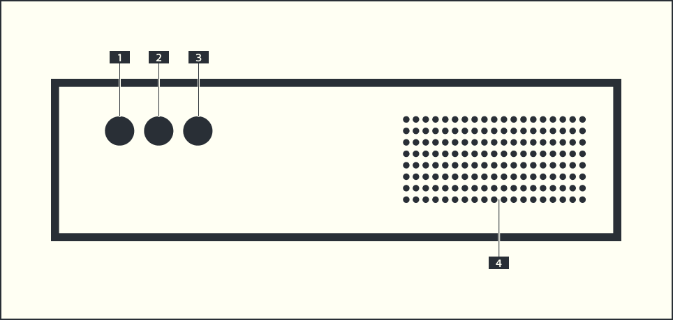

# A³ Core

```{figure} https://a3-audio.github.io/img/a3-core-about.jpg
:name: a3core-picture
:alt: a3-core's ABOUT page: the A³ logo, the tree of every A³ repository with versions and licences, and the third-party software

a3-core's ABOUT page: the A³ logo, the tree of every A³ repository with versions and licences, and the third-party software
```

**A³ Core is the hardware** everything plugs into: a Linux PC (today an Intel
NUC on Debian) with a multichannel audio interface and a portrait touch
screen. **a3-core**, the program on it (audio backend included), takes the
ST inputs and the StemDecks, computes the 3D/ambisonics field and sends it to
the speakers. You
play it from the desk and A³ Motion, over OSC; its own screen is for setting
up, not for playing ([What you need](what-you-need.md)).
Source: [a3-core](https://github.com/a3-audio/a3-core): the program and the
installation around it, one repository, one package.

## One program: `a3-core`

A³ Core is **one C++ program, `a3-core`** (`/usr/bin/a3-core`). It has no Python
and no REAPER (REAPER and its patchbay are gone). The same binary plays several **roles**, each its own
process:

| Role | What it does | On the rig |
| :--- | :--- | :--- |
| `--role core` | the OSC router: takes commands, relays state, serves the HTTP API | `a3-core.service` |
| `--role engine` | the {doc}`audio backend <audio-engine>`: channel strips, 3D, effects, outputs, meters | `a3-engine.service` |
| `--role clock` | locks the network's PTP clock to the Scarlett, so decks over AES67 run on the sound card's clock | `a3-clock.service` |
| *(no role, or `--role window`)* | the **a3-core window**: shows both, edits the audio settings | run on the screen |
| `--headless` | a supervisor: Core and the audio backend as children, no window | a laptop without a screen |

The beat clock is separate: {doc}`beat-analyzer` measures nothing any more, it
only keeps time. The meters are a3-core's ({ref}`below <core-meters>`).
Which unit runs what, and how to start any role by hand:
{ref}`A³ Core services <core-services>`.



## The front panel

Nothing here controls audio:

| № | Element | What it does |
| :--- | :--- | :--- |
| 1 | **POWER** | switches the device on |
| 2 | **RESET** | reboots the server, just in case |
| 3 | **POWER LED** | says whether it is on |
| 4 | **Fan and filter** | clean it regularly |

## Audio in and out

a3-core connects its ports to the sound card itself; the shipped map and how
to change it: {ref}`The I/O map <audio-engine-io>`. Between machines, audio goes
over AES67: {ref}`The audio network <ports-audio-network>`.

## Clock sources

The tempo comes from A³ Motion (**INT**), from the music (**EXT**) or from a
Pro DJ Link tempo master (**PIO**), chosen on A³ Motion's clock key. What each
mode needs: {ref}`Beat Analyzer › Clock modes <beat-analyzer-modes>`.

(core-workspaces)=

## The screen and its workspaces

The portrait touch screen (768 × 1024) shows one workspace at a time:

| Workspace | What is on it |
| :--- | :--- |
| **MOTION** (1) | [A³ Motion](a3motion.md)'s touch screen |
| **STEMDECK** (2) | [StemDeck](stemdeck.md), always running |
| **ENGINE** (3) | the a3-core window (i3 sends it here by its window class `a3-core`): its pages and the monitor |
| **4** | nothing assigned; free for a tool |
| **SCARLETT** (5) | the Scarlett interface's mixer, when it is open |

- **Between the touch apps and the a3-core window**: the key at the far right
  of the top bar (STEMDECK in A³ Motion and in the a3-core window, MOTION in
  StemDeck), in the same spot in all three. **▾** lists workspaces that have a
  window.
- **On 4, SCARLETT**: tap MOTION or STEMDECK in the bar at the top (hidden
  on the touch apps, which fill the screen).

(core-window)=

## The window

Run **`a3-core`** on the screen (workspace ENGINE). The a3-core window attaches
to Core and the audio backend over their local ports; it has no audio of its
own. Its pages are AUDIO, SPEAKERS (SPEAKERS, ZONES), I/O (INPUT, OUTPUT,
DEPARTMENTS), CALIBRATION, RIG and STATUS (A³ CORE, ABOUT), each with a picture
on {doc}`Setting up a room <audio-engine>`. DEPARTMENTS lists the light and
video desks Core tells everything ({ref}`how <core-subscriber>`).

**MONITOR**, in the bar at the bottom, adds a second row of keys: what the
devices actually say to each other, the answer to *"cable, setting, or me?"*,
since over UDP a control nobody hears looks like one that works.

```{figure} pics_user/a3-core-window-monitor.png
:alt: The a3-core window with MONITOR ticked: below the page keys a second row TRAFFIC, TRUTH & DEVICES, NOT UNDERSTOOD, REGISTER and BENCH
:width: 50%

MONITOR ticked: the second row of keys.
```

- **The MONITOR switch**: off, the window asks Core nothing. Your choice is
  remembered (`~/.config/a3/core/window.settings`, written only when you flip
  it).
- **TRAFFIC**: one row per address — count, rate, last value, device; filter
  by address or device, *only active* hides what is older than 6 s.
- **TRUTH & DEVICES**: Core's fingerprint, and per device *a3-osc.json is
  Core's* or, red, *DIFFERS from Core's* (an older truth;
  {ref}`what to do <osc-differs>` — desk, StemDeck and Motion fix themselves
  within seconds).
- **REGISTER**: every address that *can* exist; *only dead wires* shows those
  that never arrived. **NOT UNDERSTOOD** lists what Core did not recognise.
- **BENCH**: send one value to Core itself, the mixer or Motion. It only
  looks otherwise, it never controls.
- The address list survives a Core restart; values and history don't.

### On a laptop

Without the rig's units, the window **starts what is missing**: it asks Core
and the audio backend whether they answer, and starts a role that does not (and whose
unit is not enabled) as its own child. Closing asks once, *"Stop Core and the
engine too?"*, naming only the roles it started. On the rig, where the units run
them, the window starts and stops nothing.

`a3-core --headless` does the same without a window: Core and the audio backend as
children, restarted if they fail, ended on Ctrl-C.

### Without a screen: `curl`

Everything the monitor shows is also on Core's HTTP port
(`http://<core>:9080/api/…`), so a Core with no screen can be examined from any
terminal:

```sh
curl http://<core>:9080/api/status      # what Core says about itself
curl http://<core>:9080/api/rig         # the rig state: engine, gate, peers
curl http://<core>:9080/api/devices     # who is there, and whose truth they speak
curl http://<core>:9080/api/traffic     # every address seen: count, rate, value
```

The full list: {ref}`Core's HTTP API <osc-http>`. There is no web page any
more: `http://<core>:9080/` answers with a short text that points here.

(core-meters)=

## Where the meters come from

Every `/vu/n` number is **measured by a3-core**, inside its audio callback,
at its own meter points: the analog inputs
(`/vu/1`–`/vu/8`, and the return's pair 35–36) raw; the main, booth, phones and
rec outputs as they leave (11–34); each deck as it arrives (37–40); each
channel before and after its fader (51–66). The audio backend sends them 25
times a second to **Core, which forwards them** to Motion, the desk and the
other listeners; StemDeck still sends its own stem meters (41–50). The free
numbers 9–10 are sent as 0. The map by
name: {ref}`The meters <osc-vu-meters>`.

## Screencast

`a3-screencast.service` shows this machine's screen as one MPEG-TS stream for
OBS and the pro-DJ app: several viewers, one encode, started with the first
viewer and stopped 10 s after the last. Its fan-out is another role of the same
program, `a3-core --role screencast-fanout`. It is off until a machine opts in
(`systemctl --user enable --now a3-screencast`); its settings (cores, frame rate
and quality for the encoder) are in `~/.config/a3/screencast.env`.

```{toctree}
:titlesonly:

beat-analyzer
```
