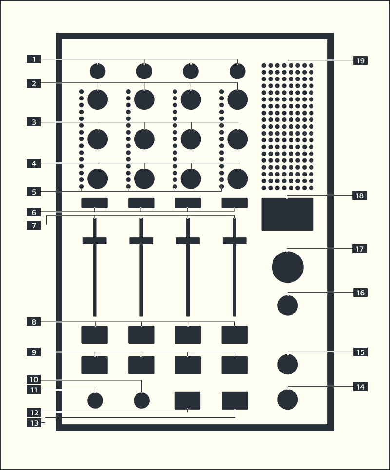

# A³ Mixer

A four-channel DJ mixer that makes no sound: every control sends OSC to A³
Core, which does the audio. A³ Motion's MIX pages show the same values.
Source: [a3-mixer](https://github.com/a3-audio/a3-mixer).

The drawing predates the V02 panel: **AUX SEND** and **FX RETURN** (printed
AUX RETURN) exist but have no number.

## The channel strip

Four strips, in signal order:

| № | Control | What it does | Range |
| :--- | :--- | :--- | :--- |
| – | **AUX SEND** | to the beat-synced tape delay on the FX bus | −inf … 0 dB |
| 1 | **TRIM** | input level | −inf … 0 dB |
| 2–4 | **EQ HIGH / MID / LOW** | 24 kHz / 1 kHz / 20 Hz | −inf … 0 dB |
| 5 | **INPUT VU** | pre-fader peak, 8 LEDs at −36, −24, −18, −12, −9, −6, −3, 0 dBFS (4 green, 2 yellow, 2 red); red is −3 dBFS and clipping. Louder side of `in<N>_pre_L/R` ({ref}`meters <osc-vu-meters>`) | |
| 6 | **TAP** | taps the tempo on the press; all four do the same and flash red on the beat. Goes straight to the beat-analyzer, not via Core | |
| 7 | **FADER** | output level | −inf … 0 dB |
| 8 | **FX** | channel through the shared filter; green while on | |
| 9 | **CUE** | pre-fader cue to the phones; blue while on. See [The cue](#a3mix-cue) | |

3D is A³ Motion's pot, not the desk's.

## The filter section

One filter for all channels; a strip's **FX** key sends it through.

| № | Control | What it does |
| :--- | :--- | :--- |
| 10 | **FREQUENCY** | cutoff |
| 11 | **RESONANCE** | Q at the cutoff |
| 12 / 13 | **HPF** / **LPF** | high-pass / low-pass; lamp blue / green |

## Monitoring and outputs

| № | Control | What it does | Range |
| :--- | :--- | :--- | :--- |
| 14 | **HEADPHONE LEVEL** | phones level | |
| 15 | **CUE/MIX** | cue (left) to mix (right), constant power | |
| 16 | **BOOTH** | monitor outputs | −inf … 0 dB |
| 17 | **MASTER** | PA outputs | −inf … 0 dB |
| – | **FX RETURN** | the master of the delay channel: the delay's output into PA, booth and recording | 0 dB at full travel |
| 18 | **DISPLAY** | BPM, work in progress | |
| 19 | **OUTPUT VU** | `main_sub`, `main_top1` … `main_top7`, one 32-row column each | |

(a3mix-cue)=

## The cue

Each channel feeds the phones bus (`enc_phones`) twice in the engine: a
**pre-fader** tap (cue, open only while CUE is on) and a **post-fader** tap
(mix). **CUE/MIX** crossfades them.

- A channel's cue is its **CUE** key (desk or A³ Motion), nothing else.
- It is always the channel's own cue, analog or stem, with its filter and EQ:
  push another stem on and the cue follows.
- **The FX Return has its own cue**, pre-fader like a channel's (CUE field on
  {ref}`its display <a3mix-fx-return>`); on the mix side the phones get it after the
  RETURN pot.
- StemDeck has no cue: cue the channel a stem is on, or the return for a stem
  on AUX.

(a3mix-virtual)=

## The virtual desk

The **A³ Desk** is the A³ Mixer on a screen. It looks like the panel and
sends the same OSC to Core. Use it as a second operator beside the hardware,
or as a stand-in when the hardware is not there.

### Install and open

Install it with the installer's role **desk** (on any Debian machine with a
screen). Then start `a3-desk` from a terminal, or **A3 Desk** from the
launcher.

### What it shows

All pots, keys, the channel LEDs, the five displays and the meters, as on the
panel. The values come from Core, so the desk shows what the room is doing,
not what it last sent.

### The ring

A value you set on the desk carries a small **ring**. It means: *this value
was set here; the hardware knob probably stands elsewhere.* The ring goes
away when Core reports a different value for that control.

The mixer has no motor faders. When someone touches the hardware knob next,
it sends its own position and the value **jumps** to it. Watch the ring
before you hand a control back to the hardware.

### LOCK

**LOCK** holds **MASTER**, **BOOTH** and **PHONES** level. While it is lit,
the desk ignores these three pots, and the status bar says *master locked*.
Press LOCK again to release them.

### Keyboard

| Key | Does |
| :--- | :--- |
| 1 – 4 | CUE of channel 1 – 4 (phones only) |
| Space | TAP |

Nothing on the keyboard changes the PA. Ctrl, Alt and Cmd combinations are
left alone.

### Limits

- **Core follows four desks.** A fifth is refused.
- **One desk per machine.** A second one says *another desk runs on this
  machine*.
- **The desk is dim until Core answers.** It stays dim and ignores input
  while it says *waiting for Core's answer*.
- **Core silent:** no sign of life from Core for 5 seconds. The desk dims
  again and takes no input until Core is back.
- ***Core serves another truth*:** Core's OSC table differs from the one the
  desk was built with. Install the desk from the same version as Core.
  The desk does not say hello to a stale Core.
- Core drops a desk that has been silent for a minute, which frees its place.

(a3mix-displays)=

## The input selectors

The desk switches [StemDeck](stemdeck.md)'s stems through Core. Each of the 8
stems (2 decks × 4) can play on **its own channel** (stem N on channel N) or on
AUX (the return). **StemDeck owns the switches**; Core relays requests and
reports. Five OLED displays with encoders: channels 1–4 and the return.

**The rule:** a channel plays **one input**: deck 1's stem N, deck 2's stem N,
or its analog input. A stem plays on its own channel only; nothing moves
between channels. A stem on a channel shuts its analog input.

### A channel

*Bracket: the stem that plays. Arrow: the cursor, on the other deck's stem
(silent). A: a little analog level. Ticks: −9 and −3 dBFS, the LED scale. The
picture still shows the older nine-meter selector.*

Three meters under **A | B | ST**: deck A's stem N, deck B's stem N, and
**ST**, the channel's analog input (always metered, louder side of
`analog<N>_L/R`, `/vu/1`–`/vu/8`). The **bracket**
marks what plays; the **arrow** is the cursor. On the virtual desk, tapping a
meter turns the cursor there.

In engine mode the display has one bar per slot, **A B C D ST**. The bar of
the deck that plays on the channel shows that deck's **W**, the omni channel
of its B-format signal (the louder side of `in<N>_pre_L/R`,
`/vu/51`–`/vu/58`), with the same scale and ballistics as the others. That
meter sits after the channel's trim and fader, so the bar follows the fader.
The other deck bars keep showing the stem levels, and **ST** the analog
input. While **ST** plays, nothing changes.

| Action | Result |
| :--- | :--- |
| turn | moves the cursor round the ring of three; switches nothing |
| push a stem | it becomes the only input; the other deck's stem N goes to StemDeck's AUX bus (the delay's send) |
| push the stem that plays | off; the channel plays analog |
| push **ST** while a stem plays | same as above |
| push **ST** while analog plays | nothing |

Core remembers no last stem; the cursor stays after a push. A stored cursor
that is not on the ring comes back on A. Several stems on one channel, or a
stem on another channel (older StemDecks): Core keeps the lowest and puts a
foreign stem on AUX, about 0.3 s after StemDeck's reports settle.

(a3mix-fx-return)=

### The FX Return

The FX Return is the master of the delay channel. Everything that reaches the
delay gets there through a send: each channel's **AUX** pot (an analog
channel's input is encoded at its position, so the echo keeps its direction)
and StemDeck's AUX bus. The return has no source to choose.

- **RETURN pot** (**FX RTN** where the full name does not fit): the delay's
  level into PA, booth and recording. At zero the delay is silent there.
- **Meter**: one bar under **AUX-RETURN** on the desk display, the delay's output after the RETURN
  pot (`aux_L/R`).
- **CUE**: push the return's encoder (on the virtual desk, or tap the CUE
  field). The field is filled while the cue is on. The cue is pre-fader: you
  hear the delay in the phones even with the RETURN pot down, on the cue side
  of CUE/MIX. On the mix side the phones get the delay after RETURN, like any
  channel.

Turning the return's encoder does nothing. The analog inputs 11/12 are no
longer a return; nothing plays them.

### How the meters move

10 updates a second; instant rise, 20 dB/s fall, no peak marks. Over 0 dBFS
the bar is **hatched** for a second; a clean full bar stays solid.

### Without StemDeck

- Core keeps each cursor and the return's cue across restarts; a cursor
  starts on A.
- Without StemDeck, turning works, pushing switches nothing, all channels play
  analog. A fresh StemDeck takes no channel (stems start on AUX).
- A click on StemDeck's own bus switch moves the bracket too.
- StemDeck says hello every 30 s. Silent for a minute: Core takes all stems
  off the channels (noticed at the next hello of any device, so up to ~90 s).

## Connectors

| Where | Socket | For |
| :--- | :--- | :--- |
| Front | **PHONES OUT** | 6.3 mm stereo jack |
| Back | **PHONES IN** | cue outputs back, 2× female XLR |
| Back | **ETHERNET** | PoE: power and all messages |

## Hardware

{ref}`A³ Mixer hardware <mic-hardware>`.
