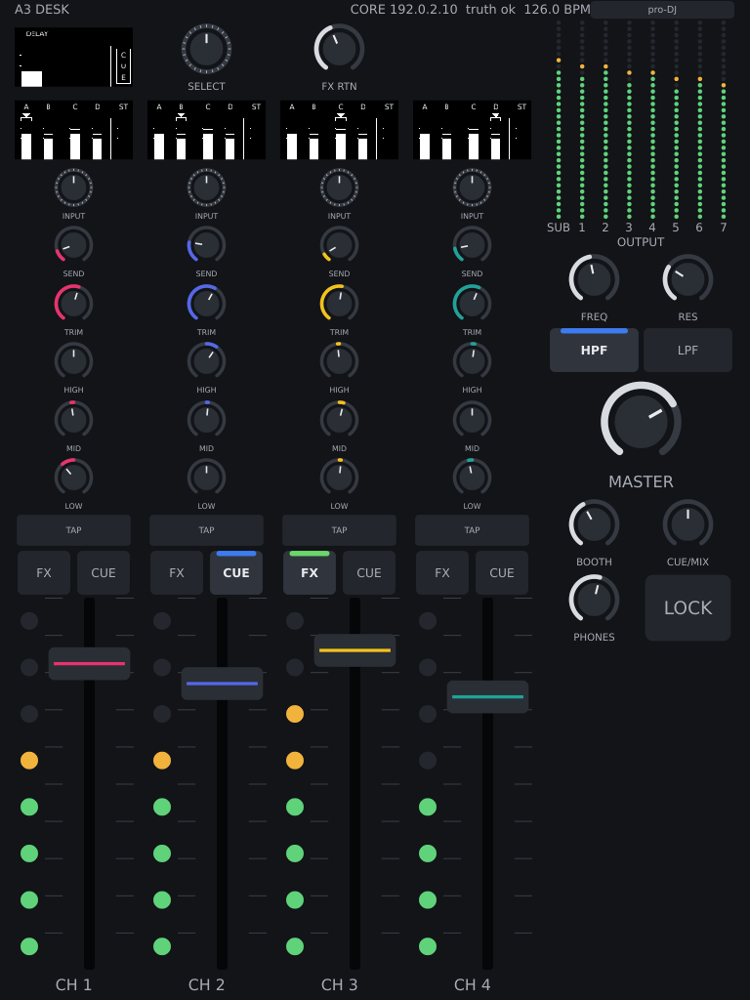
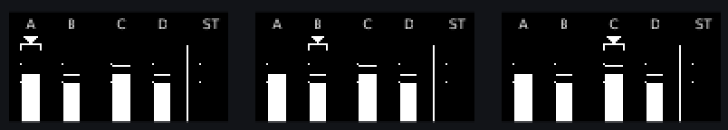
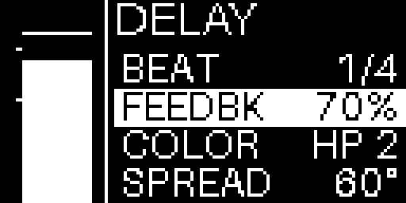

# A³ Mixer

Four channels, each with an INPUT knob that picks what plays: a StemDeck
deck (**A** to **D**) or **ST**, the stereo input for a CDJ or a turntable.
Then TRIM, an isolator EQ, the fader, a cue and an AUX-Send to the beat
delay, as on a club mixer. The A³ Mixer makes no sound itself: every control
sends OSC to A³ Core, whose Engine does the audio. A³ Motion's MIX pages show
the same values.

**The A³ Mixer is the hardware panel; the virtual desk is the same mixer in
software**, on a screen ([The virtual desk](#a3mix-virtual)). "The desk"
means either. Source: [a3-mixer](https://github.com/a3-audio/a3-mixer).

The drawing predates the V02 panel: **AUX SEND** and **FX RETURN** (printed
AUX RETURN) exist but have no number.

## The channel strip

Four strips, in signal order:

| № | Control | What it does | Range |
| :--- | :--- | :--- | :--- |
| – | **AUX SEND** | the channel's AUX-Send: to the beat-synced tape delay on the FX bus (**SEND** on the virtual desk) | −inf … 0 dB |
| 1 | **TRIM** | input level | −inf … 0 dB |
| 2–4 | **EQ HIGH / MID / LOW** | a three-band isolator (crossovers at 200 Hz and 4 kHz), as on a DJM in isolator mode | full kill at the left stop, flat at the centre, +6 dB fully right |
| 5 | **INPUT VU** | pre-fader peak, 8 LEDs at −36, −24, −18, −12, −9, −6, −3, 0 dBFS (4 green, 2 yellow, 2 red); red is −3 dBFS and clipping. Louder side of `in<N>_pre_L/R` ({ref}`meters <osc-vu-meters>`) | |
| 6 | **TAP** / **DELAY CUE** | the key row under the strips has two jobs. **Strip 4** is **TAP**: it taps the tempo and flashes on the beat (straight to the beat-analyzer, not via Core). **Strip 3** is **DELAY CUE**: it cues the delay return to the phones and is lit while cued ([The FX Return](#a3mix-fx-return)). Strips 1 and 2 have no function there | |
| 7 | **FADER** | output level | −inf … 0 dB |
| 8 | **FX** | channel through the shared filter; green while on | |
| 9 | **CUE** | pre-fader cue to the phones; blue while on. See [The cue](#a3mix-cue) | |

3d is A³ Motion's pot, not the desk's.

## The filter section

One filter for all channels; a strip's **FX** key sends it through, like a
Color FX knob that several channels share.

| № | Control | What it does |
| :--- | :--- | :--- |
| 10 | **FREQUENCY** | cutoff |
| 11 | **RESONANCE** | Q at the cutoff |
| 12 / 13 | **HPF** / **LPF** | high-pass / low-pass; lamp blue / green |

## Monitoring and outputs

| № | Control | What it does | Range |
| :--- | :--- | :--- | :--- |
| 14 | **HEADPHONE LEVEL** | phones level | |
| 15 | **CUE/MIX** | cue (left) to mix (right), constant power | |
| 16 | **BOOTH** | monitor outputs | −inf … 0 dB |
| 17 | **MASTER** | PA outputs | −inf … 0 dB |
| – | **FX RETURN** | the master of the delay channel: the delay's output into PA, booth and recording | 0 dB at full travel |
| 18 | **DISPLAY** | BPM, work in progress | |
| 19 | **OUTPUT VU** | `main_sub`, `main_top1` … `main_top7`, one 32-row column each | |

(a3mix-cue)=

## The cue

Each channel feeds the phones bus (`enc_phones`) twice in the engine: a
**pre-fader** tap (cue, open only while CUE is on) and a **post-fader** tap
(mix). **CUE/MIX** crossfades them.

- A channel's cue is its **CUE** key (desk or A³ Motion), nothing else.
- It is always the channel's own cue, ST or deck, with its filter and EQ:
  push another source on and the cue follows.
- **The FX Return has its own cue**, pre-fader like a channel's (the **DELAY CUE** key,
  {ref}`see the FX Return <a3mix-fx-return>`); on the mix side the phones get it after the
  RETURN pot.
- **A StemDeck stem has its own CUE key**, in StemDeck: it puts that stem
  in the phones, on the cue side of CUE/MIX, whether or not its deck is on a
  channel ({ref}`the stems <stemdeck-stems>`).

(a3mix-virtual)=

## The virtual desk

The **virtual desk** (the program `a3-desk`) is the A³ Mixer on a screen. It
looks like the panel and sends the same OSC to Core. Use it as a second operator beside the hardware,
or as a stand-in when the hardware is not there.

### Install and open

Install it with the installer's role **desk** (on any Debian machine with a
screen). Then start `a3-desk` from a terminal, or **A3 Desk** from the
launcher.

### What it shows

All pots, keys, the channel LEDs, the five displays and the meters, as on the
panel. The values come from Core, so the desk shows what the room is doing,
not what it last sent.

### The ring

A value you set on the desk carries a small **ring**. It means: *this value
was set here; the hardware knob probably stands elsewhere.* The ring goes
away when Core reports a different value for that control.

The mixer has no motor faders. When someone touches the hardware knob next,
it sends its own position and the value **jumps** to it. Watch the ring
before you hand a control back to the hardware.

### Full screen, workspaces and layout

The desk opens full screen by itself. Its status line has a workspace switch
at the right end, as StemDeck and the Motion UI have: the **STEMDECK** key and
a **▾** list of workspaces, so you can reach another program without a
keyboard. There is no LOCK.

**MASTER** and **BOOTH** sit at the top, above the master VU. In the lower
master card, **PHONES** (CUE/MIX and level) is on top, then **FREQ** and
**RES**, then **HPF** and **LPF**. Every pot needs the same finger travel
for its full range, the big ones too.

At start the desk asks Core for the whole state, so every value shows at once.

### Keyboard

| Key | Does |
| :--- | :--- |
| 1 – 4 | CUE of channel 1 – 4 (phones only) |
| Space | TAP |

Nothing on the keyboard changes the PA. Ctrl, Alt and Cmd combinations are
left alone.

### Limits

- **Core follows four desks.** A fifth is refused.
- **One desk per machine.** A second one says *another desk runs on this
  machine*.
- **The desk is dim until Core answers.** It stays dim and ignores input
  while it says *waiting for Core's answer*.
- **Core silent:** no sign of life from Core for 5 seconds. The desk dims
  again and takes no input until Core is back.
- ***Core serves another truth*:** Core's OSC table differs from the one the
  desk was built with. Install the desk from the same version as Core.
  The desk does not say hello to a stale Core.
- Core drops a desk that has been silent for a minute, which frees its place.

(a3mix-displays)=

## The input selectors

Each channel's **INPUT** knob picks what plays on it, from a ring of five:
**A B C D ST**. A to D are the StemDeck decks, ST is the channel's own
stereo input. On the hardware the knob is the encoder at the channel's
display; on the virtual desk it is the display itself.

*The selectors of channels 1 to 3 on the virtual desk: one bar per deck, A to
D, and **ST**, the stereo input. Arrow: the cursor. Bracket: what plays.*

| Action | Result |
| :--- | :--- |
| turn | moves the cursor (the arrow) round the ring; switches nothing |
| push on a deck | the channel plays that deck; the bracket moves there |
| push on **ST** | the channel plays its stereo input |
| push on what already plays | nothing |
| tap a bar (virtual desk) | moves the cursor there |

- **A deck plays on one channel at most.** Push deck A on channel 3 while it
  plays on channel 2, and channel 2 goes back to ST.
- **A channel plays one source**: a deck or ST, never both. The change is
  smoothed, so nothing clicks.
- **The bars**: each deck bar shows that deck's own level (`deck_a` …
  `deck_d`, `/vu/37`–`/vu/40`), whichever channel plays it; ST shows the
  channel's stereo input (`/vu/1`–`/vu/8`). A deck that is not running (say
  deck D) keeps its letter and the scale marks; its bar stays empty.
- **A deck that drops out stays on its channel**, silent, and comes back by
  itself when it returns; nothing switches over on its own.
- **Core remembers** each channel's source across restarts. A fresh Core
  starts every channel on ST.
- On a deck channel, **A³ Motion shows DECK A** (or B, C, D) and moves
  nothing: the deck moves its own stems
  ({doc}`StemDeck × A³ Motion <stemdeck-with-motion>`).

(a3mix-fx-return)=

### The FX Return

The FX Return is the master of the delay channel. Everything that reaches the
delay gets there by one of two routes: each channel's **AUX-Send** (it scales
the channel's own signal, an ST input or the deck's main output; an ST input
is encoded at its position, so the echo keeps its direction), and the
AUX-Sends of StemDeck's stems, whose bus goes **straight into the delay** and
is not scaled by the channel's AUX-Send. A deck's AUX bus still follows the channel that holds the deck: a
pulled fader, or a deck on no channel, sends nothing. The return has no source
to choose.

- **RETURN pot** (**FX RTN** where the full name does not fit): the delay's
  level into PA, booth and recording. At zero the delay is silent there.
- **Display**: headed **DELAY**, with the four rows (see below). The return's
  VU meter, the delay's output after the RETURN pot (`aux_L/R`), uses the
  display's full height.
- **CUE**: the **DELAY CUE** key on strip 3's key row (hardware and virtual
  desk alike). It toggles the cue and is lit while cued. The
  cue is pre-fader: you hear the delay in the phones even with the RETURN pot
  down, on the cue side of CUE/MIX. On the mix side the phones get the delay
  after RETURN, like any channel.
- **Encoder**: sets the delay (see below).

The analog inputs 11/12 are no longer a return; nothing plays them.

#### Shaping the delay

The A³ Mixer and the virtual desk work the same way. The display lists four
rows with their values: **BEAT**, **FEEDBK**, **COLOR**, **SPREAD**.

The encoder has two states, and a **push** switches between them:

- **Pick a row**: the whole row is lit. Turn **left** to move **down** the
  list, **right** to move **up**; it stops at both ends.
- **Edit**: only the value is lit. Turning changes it (right = more), and the
  change is heard at once.

After about 4 seconds without a touch, edit goes back to select by itself;
the lit row stays where it was.

| Row | What it sets | Values | At start |
| :--- | :--- | :--- | :--- |
| **BEAT** | delay time, tied to the tempo | 1/8, 1/4, 1/2, 3/4, 1, 2 beats | 1/4 |
| **FEEDBK** | how many repeats | 0 to 95 % in 5 % steps (never 100 %) | 70 % |
| **COLOR** | a filter in the repeats | HP 10 … HP 1, 0, LP 1 … LP 10 | 0 |
| **SPREAD** | how far each repeat turns around the room | 0 to 180° in 15° steps | 60° |

- **BEAT**: a change jumps to the new time, like a DJM, with a 20 ms
  crossfade: no pitch sweep, no click. A tempo jump (a deck change) crossfades
  the same way; small drift of the beat clock still glides gently. **2** needs
  92 BPM or more; below that it plays **1** and the display shows **1**. Your
  choice of **2** is kept and comes back when the tempo rises.
- **COLOR**: left of 0 is a high-pass (thinner), right of 0 a low-pass
  (darker). Higher numbers cut more. Turning across the centre stops on 0.
- **SPREAD**: each repeat is rotated further around the room, the left line
  one way, the right line the other. 0 keeps the repeats where they were.
- Core keeps the four values and restores them after a restart; the desk only
  shows them. With an older Core that lacks these words, the delay rows stay
  as they were and a push of the encoder toggles the cue.

### How the meters move

10 updates a second; instant rise, 20 dB/s fall, no peak marks. Over 0 dBFS
the bar is **hatched** for a second; a clean full bar stays solid.

### Without StemDeck

Without any StemDeck running, every deck bar stays empty and the channels
play ST. Core keeps each channel's source, each cursor and the return's cue
across restarts.

## Connectors

| Where | Socket | For |
| :--- | :--- | :--- |
| Front | **PHONES OUT** | 6.3 mm stereo jack |
| Back | **PHONES IN** | cue outputs back, 2× female XLR |
| Back | **ETHERNET** | PoE: power and all messages |

## Hardware

{ref}`A³ Mixer hardware <mic-hardware>`.
