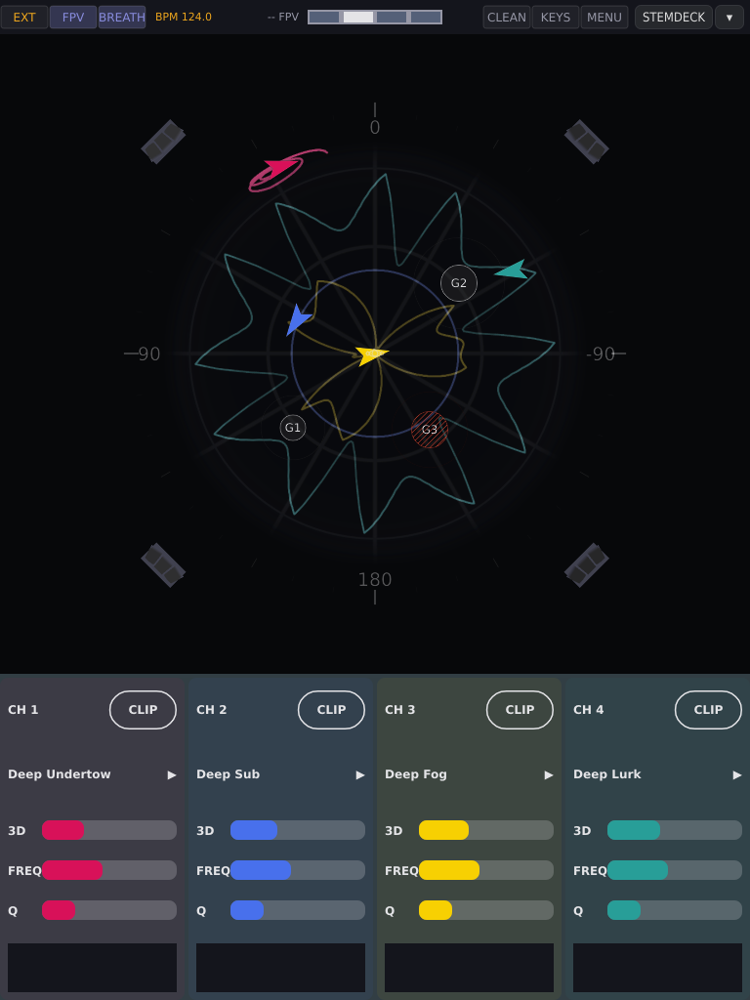
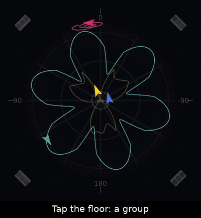

(motion-fpv)=

# FPV: play the floor

**FPV** is A³ Motion's second view, for watching and playing a set: the room
and four ships, no editor. **FULL** is everything else on these pages. The
key between them is in the status bar, right of the clock key; it lights
while FPV is up. Switching only changes what you see: the sound does not
move, and the device wakes up in the view it was left in.

<!-- SCREENSHOT: fpv-overview.png | region: full screen 0,0,768,1024 | recorded 2026-10-08 off the device (sandbox on Xvfb, a3-motion-ui 5f180dc, quiet-indigo-2, set Deep, EXT 124 BPM) | steps: FPV, three groups on the floor (G1 a G, G2 a C, G3 an X) | all four channels are in CLIP: ORBIT needs the panel's PAGE, which an off-device recording cannot press; re-take with ch 1 and ch 2 in ORBIT on the rig | caption: "FPV: the sphere with its ships and groups, four channel strips below" -->

| Part | What it shows |
| :--- | :--- |
| **status bar** | as in FULL, plus **FULL/FPV**, **BREATH** and **PILOTS** |
| **sphere** (top two thirds) | the room; each playing clip is a **ship**, a small craft pointing where it is going. The guest groups are marked on its **dance floor** |
| **strips** (bottom third) | one per channel: `CH n` and **CLIP** (hollow) or **ORBIT** (filled), the clip name with ▶ or ❚❚, the **3d**, **FREQ** and **Q** bars and a level meter. In ORBIT the clip row says **PATROL** or **→ G2**. The strips are to read; they take no touch |

The strip's meter is the same LED meter StemDeck shows: green up to about
−12 dB, yellow above it, red near full scale, and a short line that holds the
last peak for a moment. The two screens read alike side by side.

(motion-fpv-floor)=

## The floor and the four kinds of people

You tell A³ Motion where people are by **tapping the floor**. Each tap puts a
**group** there: a mark painted on the dance floor, labelled **G1** to **G8**
(a number, not a kind). Tap the group to say what it is; each tap steps to
the next kind:

| Kind | On a real floor | Pull | What an ORBIT ship does | Looks like |
| :--- | :--- | :--- | :--- | :--- |
| **G** group | a few people | light (0.5) | leans towards them on the one | a small disc on the floor |
| **C** crowd | a dancing crowd | 1 | leans a little more | a bigger disc |
| **H** hotspot | "more of this here" | 1.5, the strongest | leans most | the biggest disc |
| **X** dead zone | "not here": the bar, the booth, a dead corner | pushes away (−2) | keeps out of it, always | red and hatched: the only red thing on the floor |

Tap order: **G → C → H → X → G**. The discs swell on the one and rest on
the other beats.

- **Groups pull only on the one** (beat 1 of each bar), so every lean lands on
  the downbeat. A dead zone's wall works on every beat.
- **The pull is light on purpose.** A group says *where* the sound goes; it
  does not make the movement on its own (see [What to expect](#motion-fpv-expect)).
- **Groups last for the session.** A restart of the device clears the floor.
- **Up to eight.** A ninth tap says `-- 8 GROUPS`.
- **Out to the speakers.** A group can stand anywhere on the floor, out to
  the four speaker towers, not only inside the ball. The ships themselves
  stay inside the ball's outline: a ship that circles a group at the edge
  slides back and forth along the rim in front of it.
- **Rings.** A faint ring round a group shows how far it reaches; round a
  dead zone it shows the space the ships keep clear. Seen from the side,
  discs and rings lie flat on the floor like paint. **Hold** a group and a
  red ring fills clockwise from the top; when it closes, the group is gone.

<!-- GIF: howto-fpv-groups.gif | region: sphere 560x560+104+82 | recorded 2026-10-08 off the device (sandbox on Xvfb, a3-motion-ui 5f180dc, quiet-indigo-2, set Deep, EXT 124 BPM) | steps: tap the floor three times; tap G2 four times (C, H, X, G); drag G1; hold G3 until it goes | "Tap the floor: a group" / "Tap it: crowd, hotspot, dead zone" / "Drag it where the people are" / "Hold it: gone" -->

(motion-fpv-orbit)=

(motion-fpv-ships)=

## The ships

Each playing clip is a **ship**: a small craft in the channel's colour with a
glowing engine at the tail. It points the way it is flying, and it turns with
the view like everything else in the room.

- **Hidden behind something.** When the ball, a speaker tower or another ship
  is between you and a ship, you see only a thin dim outline of it, so you
  never lose where it is. Inside the glass ball nothing hides a ship.
- **The far side.** A ship on the back half of the ball is drawn smaller and
  darker than one on the front, so you can tell near from far.
- **Its line.** What the ship draws on the ball depends on its mode:

| The ship is … | The line on the ball |
| :--- | :--- |
| in **CLIP** | the clip's trajectory, as in FULL |
| in **ORBIT**, patrolling | its **orbit**, the big path it is really flying, in the channel's colour, a little quieter than a trajectory |
| in **ORBIT**, escorting | the **escort circle** round the group |
| in a [game](#motion-fpv-games) | no line: the game's dashed line and its name mark it |

The clip's own trajectory is not drawn under an ORBIT ship, because the ship
has left it. When the ship goes back to CLIP the trajectory comes back at the
start of its one-beat glide. Two ships on the same orbit draw it twice, and
it shows brighter.

## CLIP or ORBIT

In FPV every channel is in one of two modes, shown on its strip:

| Mode | The ship … |
| :--- | :--- |
| **CLIP** | flies the clip, exactly as in FULL. Groups do nothing to it |
| **ORBIT** | leaves the clip and flies **one big ellipse round the room, one lap per four bars**. The groups bend it |

**PAGE** (short press) switches a channel between them. Nothing jumps: into
ORBIT the ship glides off its line from where it is; back to CLIP it glides
onto the clip over one beat, in phase, because the clip kept running
underneath.

- The ellipse turns slowly, once every 32 bars, so even an empty floor is not
  the same circle again and again.
- It is locked to the bar: however far a group pulls the ship, it stays in
  time. At any tempo a lap is four bars.
- The ship stays in its clip's height band. A clip that sits low flies a low
  orbit.
- **ORBIT flies only while the clip plays.** With no clip, or a stopped one,
  the readout says `CH1 ORBIT · no clip` or `CH1 ORBIT · stopped`.
  **Play\|Pause** stops and starts an ORBIT ship as it does a clip.
- ORBIT is the channel's, not the view's: switch to FULL and the ship keeps
  flying its orbit; its blob follows it, and Play\|Pause or PAGE reads
  `CH1 ORBIT`.

<!-- GIF: howto-fpv-orbit.gif | region: full screen 0,0,768,1024 | steps: ch 1 playing in CLIP; short PAGE press on ch 1; 8 bars; short PAGE again | "CLIP: the ship flies its clip" / "PAGE: ORBIT, no jump" / "One lap every four bars" / "PAGE again: back onto the clip, in phase" | not recorded: needs the panel's PAGE, which an off-device recording cannot press (2026-10-08) -->

(motion-fpv-escort)=

## Patrol and escort

An ORBIT ship **patrols** by default: it flies the big path and leans
towards groups on the way. You can also send it to **escort** one group: it
leaves the path and circles that group, one turn every two bars. The heavier
the group, the wider the circle (the ring drawn round the group is the
circle it flies). A thin line in the ship's colour joins it to its group.

| To | Do | Strip and readout |
| :--- | :--- | :--- |
| escort a group | **hold** the channel's **PAGE**, **tap** the group | `→ G2`, `CH1 → G2` |
| back to the path | **hold PAGE**, tap **empty floor** | `PATROL`, `CH1 PATROL` |

- Escort switches the channel to ORBIT if it was in CLIP.
- A dead zone cannot be escorted: the ship patrols.
- Removing the group, or making it a dead zone, sends its ship back to
  PATROL, and it stays there.
- While PAGE is held, a tap never removes a group, however long the finger
  stays.

<!-- GIF: howto-fpv-escort.gif | region: full screen 0,0,768,1024 | steps: ch 2 in ORBIT; hold ch 2 PAGE, tap G1; 4 bars; hold PAGE, tap empty floor | "Hold PAGE, tap a group" / "The ship circles it" / "Hold PAGE, tap the floor: patrol" | not recorded: needs the panel's PAGE, which an off-device recording cannot press (2026-10-08) -->

(motion-fpv-breath)=

## The breath

With **BREATH** on, every ORBIT ship **stands still on beat 4 of every bar**
and sets off again on the one. The stop on the grid is what keeps the
movement alive: the restart on the one is an event the whole floor hears.
Without it, an orbit soon sounds like it only goes round.

- **On at every start.** **BREATH** in the status bar switches it off or on
  for the session; the readout says `-- BREATH ON` or `-- BREATH OFF`. The
  next start has it on again.
- It works in both views, so the key is in both.
- A stop is never cut short and never starts late: switched during beat 4,
  the change shows from the next bar.
- Escorting ships breathe too and keep their circle. Ships in CLIP don't
  breathe: they fly their clip. A ship in a [game](#motion-fpv-games) flies
  through the stop and does not breathe.
- In a bar of fewer than three beats there is no breath.

(motion-fpv-games)=

## Pilots and games

A **game** is a short figure that ships fly against the guests on the floor,
timed to the music. It is a gesture for the room: something builds, something
feints, something lands on the one. A game starts at once and lands on the
next fitting change in the music (a drop, the end of a breakdown), or else on
the next four-bar line. A ship in a game ignores its target group's pull and
flies through the breath's stop. A ship is never in two games at once.

| Game | What the room hears | Fits | How long |
| :--- | :--- | :--- | :--- |
| **Fake-out** | The ship heads for the target group through the build, veers away a bar before the drop, then dives at it on the one. A feint, then the hit | a **build** with a drop up to eight bars away | at least two bars, up to the drop |
| **Formation & scatter** | The ships line up across the room during the build, then burst outwards on the one. The whole room gathers and explodes | a **build** | at least one bar, up to the burst |
| **Hide & seek** | The ship slips quietly away to one side and reappears on the opposite side on the next one | a **breakdown** | a few bars: about two to slip away, then back on the one |
| **Call & response** | Two ships on opposite sides of the room answer each other, a bar each, two turns each | a steady **groove** (it starts in the first four bars of every sixteen) | about four bars |

The two ships of a call & response are always a pair. Fake-out and formation
need a **target**: the nearest group, one you name, or the nearest crowd or
hotspot. Without a group on the floor a game has nothing to play against, so
put one down first.

### Starting a game from a pad

A game is asked for by an action. Its script has a **Pilot** section with
three lines; FULL ignores it, because the games are played on the floor FPV
shows.

| Line | Says |
| :--- | :--- |
| `~game` | which game: `\fakeout`, `\formation`, `\hideseek`, `\callresponse`, or `\none` to end the game this ship is in |
| `~target` | whom it is played against: `\nearest`, a group `\group1` to `\group8`, `\crowd` or `\hotspot` (fake-out and formation only) |
| `~with` | which ships fly it: `\self` (this channel only), `\nearest` (it and the nearest free ship) or `\all` (every free ship) |

Press the pad and the readout says, for example, `CH1 A1 GAME FAKE-OUT`. A
ship that is already in another game is not taken. Ships borrowed from CLIP
glide back onto their clip when the game ends. The newest request wins. The
[FPV Games set](#motion-library-fpv-games) has the four games on pads A1 to
A4; your own actions can carry the lines too.

### The PILOTS key

The **PILOTS** key in the status bar (FPV only, left of CLEAN) says how much
the pilots do on their own. Each tap steps **OFF → HINT → FLY → OFF**, and the
choice is kept over a restart. Leaving FPV ends every game.

| Level | What happens |
| :--- | :--- |
| **OFF** | A game only when you press a pad that asks for one |
| **HINT** | When the music reaches a moment a game fits, the **pad that would start it** pulses in time with the beat. It is the lowest pad (A1 to A6) on a channel whose action asks for a fitting game, on a ship that is flying ORBIT and not in a game. Press it, or leave it |
| **FLY** | The pilots play. On a downbeat, when a fitting moment opens, one pilot starts one game on free ORBIT ships, then rests for four bars |

**Your tap always wins.** At FLY, if you press a pad that starts a game, or
touch a ship that a pilot's game is flying, the pilots' games end and the key
drops back to **HINT**. One tap on the key takes it to FLY again.

### What you see

Under every ship in a game stands its **name**: `FAKE-OUT`, `FORMATION`,
`HIDE` or `CALL`. A game a pilot started itself carries a small, dimmer
`AUTO` beside the name; a game you started with a pad does not. When the game
ends the name stays one more bar and fades out, so a short game does not
vanish before you looked. Fake-out and formation also draw a **dashed line**
from the leading ship down to its target group.

### Where the timing comes from

If **StemDeck** is running, its preview of the set says what is coming (build,
drop, breakdown) and when the change lands, and the games follow it. Without
StemDeck, A³ Motion listens to the room's own levels: a drop is a jump to at
least one and a half times the last bar's loudness, a breakdown is a fall to
half or less, a build is three rising bars. That guess expects the change on
the next eight-bar line, so it is less sure than the preview. If you see
games landing on the wrong bar, start StemDeck.

(motion-fpv-controls)=

## All controls

### Panel

| Control | In FPV |
| :--- | :--- |
| **PAGE**, short press | that channel CLIP ↔ ORBIT (on release) |
| **PAGE** held + tap a group | that ship escorts it |
| **PAGE** held + tap empty floor | that ship back to PATROL |
| **Play\|Pause** | as in FULL: starts and pauses on the downbeat; SHIFT + it stops now |
| **encoders** | as with SHIFT: upper turns its column's **FREQ**, lower its **Q**. A press does nothing |
| **3d pot** | as in FULL |
| **action pads** | fire as in FULL; an action with a Pilot section also starts its [game](#motion-fpv-games). They don't switch the page; FULL shows the action next time you look, if ACTION is open |
| **REC** (hold **SHIFT**, then **PLAY all**) + **Play\|Pause** | switches to **FULL** first and starts the take there, since a take is drawn and kept in FULL. The channel is CLIP afterwards |
| **MENU** (**SHIFT** + the row-6 key) | switches to FULL and opens the menu |

### Screen

| Where | Gesture | Does |
| :--- | :--- | :--- |
| floor, empty | tap | a new group (G) |
| a group | tap | next kind: G → C → H → X → G |
| a group | drag | moves it; the view stays put |
| a group | hold (0.6 s) | a red ring fills clockwise, then the group goes |
| floor, out to the speakers | tap, drag | places or moves a group anywhere out to the towers. Past the ball's edge the finger still counts as floor; beyond the towers it turns the view |
| anywhere but a group | one finger drag | tilts and turns the view; places nothing |
| anywhere on the sphere | pinch | zoom |
| outside the floor | double tap | view straight above, unzoomed. On the floor a double tap places a group and steps its kind |
| status bar | **FULL/FPV** | the other view |
| status bar | **BREATH** | the breath on or off |
| status bar | **PILOTS** | OFF → HINT → FLY → OFF |

**KEYS** and the overlays (FILES, MIXER, PADS) switch to FULL first; going
into FPV closes them. With FILES open, a rename in progress is dropped.

(motion-fpv-playing)=

## Playing a set with FPV

1. **Load and start the set in FULL**, set the clock, check 3d. Then FPV.
2. **Put the floor down**: a crowd where they dance, a hotspot where you want
   more, a dead zone on the bar or the booth. **Few and spread out** beats
   many: each extra group costs the room a little attention.
3. **Two ships move, the rest wait.** Put two channels in ORBIT; leave the
   others in CLIP on a quiet clip, or paused. Four moving ships tire a floor
   fast.
4. **Leave the breath on.** It is the move that carries the set.
5. **Move the top of the mix.** The encoders are FREQ and Q in FPV: a high
   band (around 6–8 kHz) a couple of octaves wide is followed best, or a
   lower one (about 3 kHz) that is wider still. Never narrower than about an
   octave, and nothing down at the bass: under ~250 Hz nobody hears where a
   sound is.
6. **Fly low.** Side to side is heard better than up and down; a clip that
   sits near ear height makes a better orbit than one overhead.
7. **Let the pilots play, or hint.** Put **PILOTS** at HINT and watch for the
   pad that pulses: a fake-out into the drop is one tap. At FLY the room
   plays itself; your tap takes over at once.
8. **Escort is a gesture, not a routine**: a few bars on the group you want
   to lift, then back to PATROL. Don't feed the biggest group all night.
9. **Change something every few laps.** Move a group, swap which two ships
   fly, drop one back to CLIP. An orbit that never changes is heard, then
   tuned out.

(motion-fpv-expect)=

## What to expect

- **The planets are quiet.** A crowd beside the path moves the ship by a
  small lean on the one, not a swerve you would hear on its own. That is
  decided, not a fault: the groups say *where*, the breath carries the
  motion. Check the lean goes the right way, towards the people.
- **A dead zone is firm.** Its wall works on every beat; a ship keeps clear
  of it.
- **The sound path is the same as FULL.** FPV adds no OSC address; Core sees
  positions as before.
- **Little is saved.** Groups, escorts and the breath switch are for the
  session. The view (FULL or FPV) and the PILOTS level survive a restart.

| Symptom | Why, and what to do |
| :--- | :--- |
| PAGE switched to ORBIT, the ship stands still | No clip, or it is stopped (`ORBIT · no clip` / `stopped`): load or start one |
| A ship never stops on beat 4 | It is in CLIP, or BREATH is off |
| A pad pulses and I did not press it | PILOTS is at HINT: that pad is the game that fits the moment |
| A game did nothing | Fake-out and formation need a group on the floor; the ship must be playing; a ship in another game is not taken |
| Games land off the beat | No StemDeck preview, so the room's levels are guessing. Start StemDeck |
| The game name is still there after the game | It fades over one more bar |
| A group seems to do nothing | Groups only lean on the one, and lightly. Escort it if you want the ship there |
| A drag turned the view instead of moving a group | Start the drag on the group itself |
| A double tap on the floor didn't reset the view | On the floor it places a group; double tap the rim or background |
| The editor is gone | That is FPV. **FULL/FPV** in the status bar |
