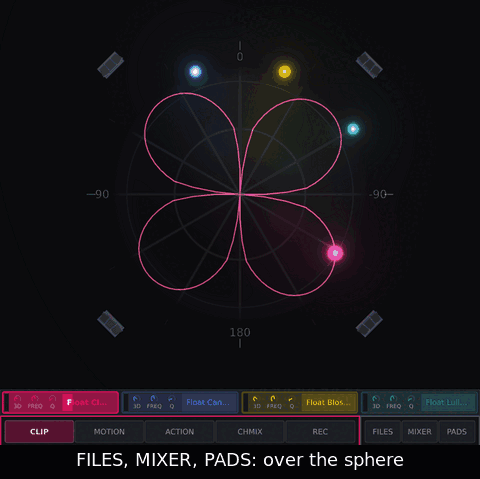
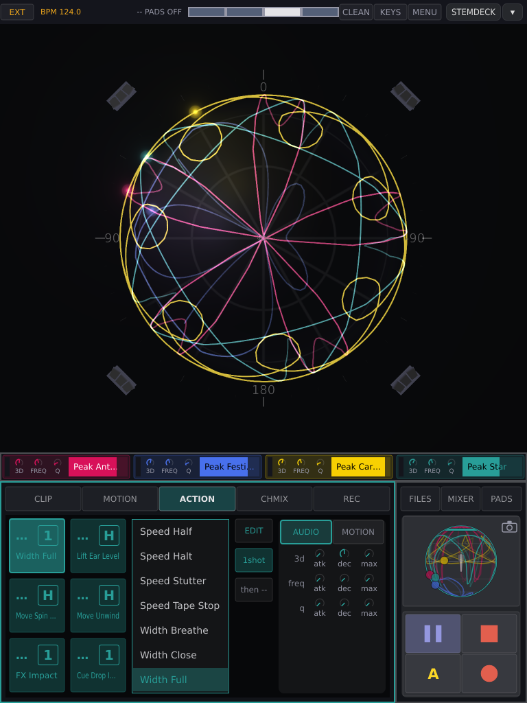
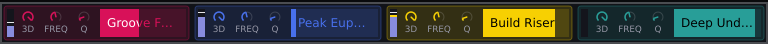
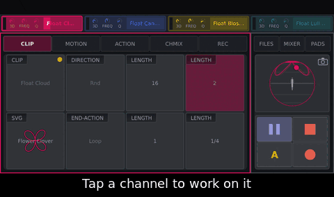
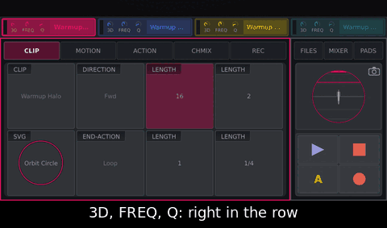
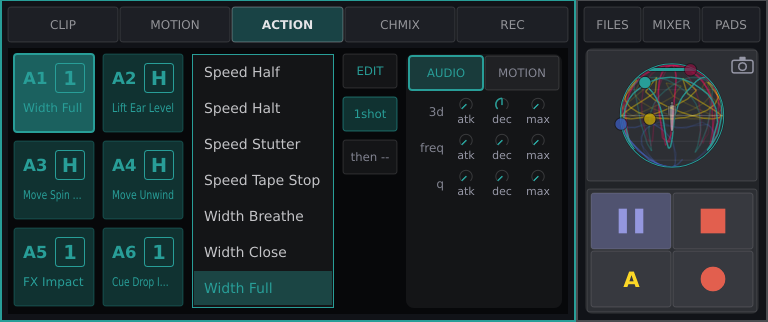
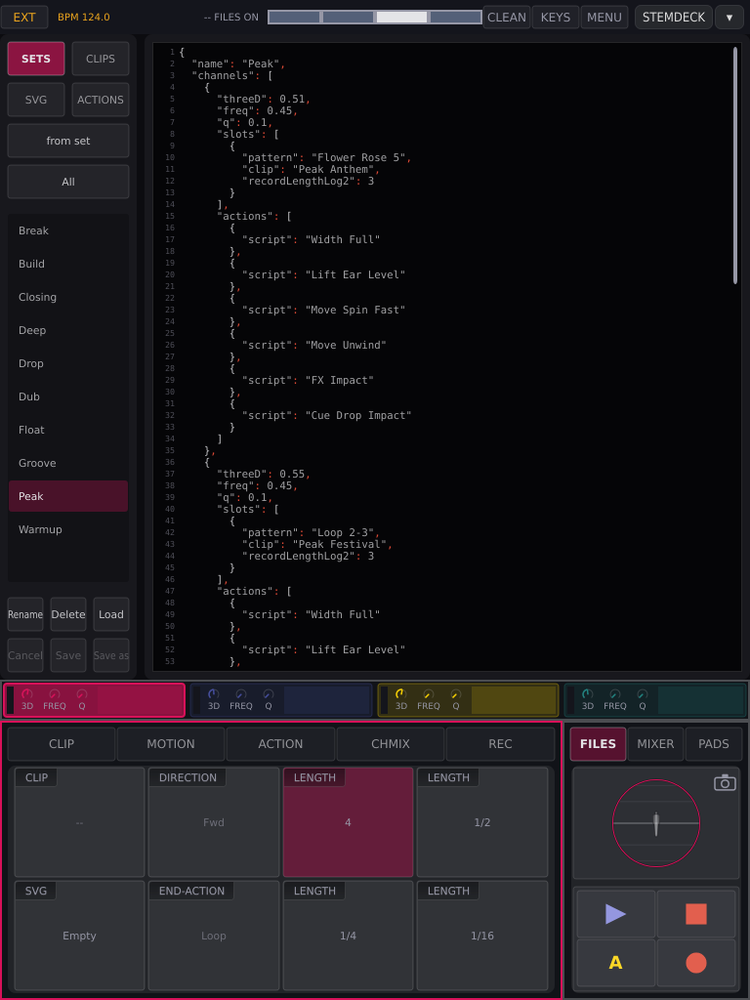
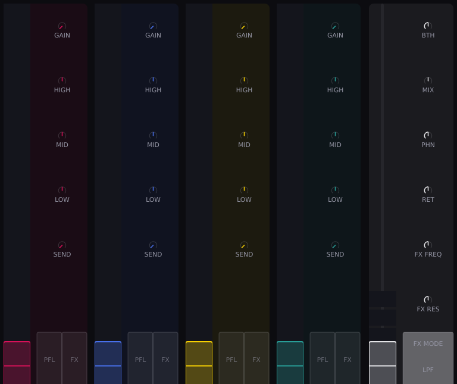
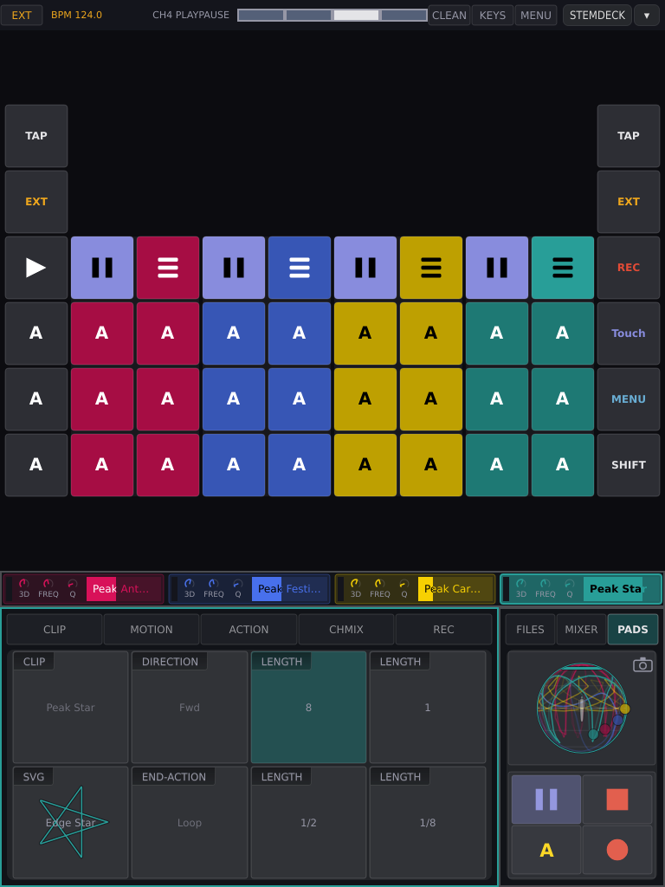

# Screen and panel

(motion-reference-screen)=

## The screen

### Windows at a glance

| Window | For | Opens with | Closes with |
| :--- | :--- | :--- | :--- |
| **Main screen** | room, channels, selected clip | always there | — |
| **FPV** | the room and four strips, for playing; see [FPV](a3motion-fpv.md) | **FULL/FPV**, status bar | **FULL/FPV** again |
| **CLIP**, **MOTION**, **ACTION**, **CHMIX**, **REC** | the selected channel's clip, movement, actions, strip, takes | its tab in the bar (REC also with ●) | another tab |
| **FILES** | sets, clips, shapes, actions on disk | FILES, global strip | FILES again; MIXER or PADS (swaps); any tab; MENU; PAGE on the panel |
| **MIXER** | four strips and the master | MIXER, global strip | as FILES |
| **PADS** | the panel on the screen | PADS, global strip | as FILES |
| **Menu** | skins, LEDs, folders | MENU, status bar or panel | ‹ or MENU: one level; ✕: all |
| value list, edit box | one menu value | double tap or ENTER on a row | ENTER or a tap keeps; back, MENU or Escape drops |
| colour picker | one skin colour | double tap a colour row | **done** keeps the colour; back, MENU or Escape put the old one back |
| **Keyboard** | typing | KEYS, or by itself | KEYS or HIDE |
| workspace list | the Core's other screens | ▾, status bar | tap a workspace, or beside the list |

FILES, MIXER and PADS open over the sphere, one at a time; the channel row,
bar and global strip stay visible. Closing FILES drops a rename and an armed
Delete; editor text stays, unsaved.

<!-- GIF: howto-overlays.gif | region: 0,36,768,712 | recorded 2026-10-01, quiet-indigo-2, --fuzz 0 (quantized before optimizing), PADS as the panel | steps: Tap FILES, MIXER, PADS: each lies over the sphere, one at a time. Tap CLIP: it closes. | "FILES, MIXER, PADS: over the sphere" / "FILES" / "MIXER: one at a time" / "PADS" / "A bar tab closes it" -->



### The main screen



<!-- The main screen, the channel row and the ACTION page were taken on 2026-09-30 from the rig's running A³ Motion, which runs the skin "custom" (quiet-indigo-2's colours with the maintainer's effect settings), not quiet-indigo-2 itself: the sandbox would have stopped the live service. Re-shoot in quiet-indigo-2 when the sandbox may run. -->

Top to bottom: **status bar**, **sphere**, **channel row**, then the **bar**
(left three quarters) beside the **global strip** (right quarter).

#### Status bar

| Part | What it does |
| :--- | :--- |
| **clock key** | tap: INT → EXT → PIO; see [Clock modes](#motion-clock) |
| **FULL/FPV** | the view: FULL (this page) or [FPV](#motion-fpv); lit in FPV. Kept over a restart |
| **BREATH** | ORBIT ships stand still on beat 4 of every bar; on at every start. See [the breath](#motion-fpv-breath) |
| **PILOTS** | FPV only, left of CLEAN: **OFF → HINT → FLY**, how much the pilots play on their own. Kept over a restart. See [Pilots and games](#motion-fpv-games) |
| **BPM** | the tempo. Read only |
| **readout** | what was last done, e.g. `-- REC ARMED` |
| **beat display** | four cells, one per beat. **Tap it to tap the tempo** (INT); in EXT and PIO taps go to the beat analyser |
| **CLEAN** | clean skin on/off: thin lines, plain blobs, no effects. Grey when none is installed |
| **KEYS** | on-screen keyboard on/off |
| **MENU** | [the menu](#motion-menu) |
| **STEMDECK**, **▾** | the Core's workspace switch; see {ref}`A³ Core's screen <core-workspaces>` |

#### The sphere

The room from above: the middle is overhead, the rim is ear height. **Front** is
0° at ear height, the direction Core's speaker layout calls 0°: the rim's top
point, as long as camera mode has not turned the view.
Each channel is a blob where its sound is; it swells and sparks with the
channel's level. A playing clip draws its path as a braid. Below ear height is
drawn darker. The corners are the speakers: lightning shows each one's level,
ball lightning the subs. No lightning while music plays: nothing comes back
from Core ([Troubleshooting](#motion-troubleshooting)).

| Gesture | What it does |
| :--- | :--- |
| drag a blob | moves its sound, live. Start **on the blob**; a drag on empty sphere does nothing. A playing clip takes it back on release. Blobs in the way are pushed aside, sound and all |
| several fingers | one blob each |
| during a take | the first finger writes the take; see [REC](#motion-rec) |

**Camera mode** (tap the elevation picture in the global strip; it lights)
turns the view instead. No finger moves a blob; the view survives a restart.

| Gesture in camera mode | What it does |
| :--- | :--- |
| drag up / down | lean towards the horizon / back (from straight above, down does nothing) |
| drag sideways | walk round |
| pinch, mouse wheel | zoom |
| double tap | straight above, unzoomed |

#### The channel row

One field per channel, channel 1 left: **meter**, **3d**, **FREQ**, **Q**
(drag to turn), and a progress bar with the clip's name. **Tap a field to
select the channel**; touching one of its knobs selects it too. Double tap:
3d and FREQ to twelve o'clock, Q closed — unless the panel is attached, then
the pot decides.



<!-- GIF: howto-channelrow-select.gif | region: 0,626,768,398 | recorded 2026-09-29, 8.4 s | steps: Tap channel 2, channel 3, then channel 1 in the channel row: the bar follows the channel and takes its colour. | "Tap a channel to work on it" / "Channel 2: the bar turns blue" / "Channel 3: its clip, its keys" / "Channel 1: back where you were" -->



<!-- GIF: howto-channelrow-pots.gif | region: 0,626,768,398 | recorded 2026-09-29, 9.5 s | steps: Drag channel 1's FREQ pot up and down, then drag channel 2's 3D pot: channel 2 becomes selected. | "3D, FREQ, Q: right in the row" / "Drag FREQ up, then down" / "3D on channel 2: now selected" -->



#### The bar

Tabs **CLIP MOTION ACTION CHMIX REC**, all for the selected channel; a tab also
closes FILES, MIXER or PADS. **Double tap a knob** to rest it: most to the
middle, sweeps and spin to off, **elv** so the shape is centred on ear height
(as near as the clips allow; how high that puts the line depends on `reach`). On a knob playing a lane, the double tap clears
the [lane](#motion-howto-lanes).

#### The global strip

| Part | What it does |
| :--- | :--- |
| **FILES**, **MIXER**, **PADS** | open their window; tap again to close |
| elevation picture | the channels seen from the side. Tap: camera mode |
| **▶ / ❚❚** | Play\|Pause on the **next downbeat**; blinks while waiting. ❚❚ keeps the place, ▶ goes on from there and blinks slowly while paused |
| **■** | stop **now** and back to the top; ends a take |
| **A** | fires the chosen action button while held |
| **●** | arms a take and opens [REC](#motion-rec) |

After a take, ● becomes **SAVE** and A becomes **DISCARD**.

(motion-clip)=

### CLIP

| Field | What it does |
| :--- | :--- |
| **CLIP** | the loaded clip. **Drag** to step through clips. A **drift dot**: values changed since loading. `--`: a shape without a clip |
| **SVG** | the shape. **Drag** to step through shapes; the values stay |
| **DIRECTION** | tap: **Fwd → Rev → Bnce → Rnd** (random start each pass) |
| **END-ACTION** | tap: **Loop → Stop → Paus**. Stop returns to the start; Paus stays where the pass ended |
| **LENGTH** × 4 | beats per pass. **Tap** to play at it; **drag** to change the key's length |

The LENGTH keys scale the clip's own length: the same key reads 4 on a
four-beat shape, 8 on an eight-beat one, 3/8 on a short one. No key lit: the
clip plays at a length none holds. The keys are saved in the set.

(motion-motion)=

### MOTION

Each field has two knobs: **left moves, right sets**.

| Field | Left (movement) | Right (value) |
| :--- | :--- | :--- |
| **ROTATION** | `spin`: keeps turning, either way | `rot`: turns the shape |
| **REACH** | `swell`: sweeps the reach | `reach`: how far down the sphere the edge lands |
| **SQUEEZE X** | `strX`: sweeps it | `sqzX`: front to back |
| **SQUEEZE Y** | `strY`: sweeps it | `sqzY`: left to right |
| **ELEVATION** | `sway`: height up and down | `elv`: centre height |
| **ELEVATION CLIP** | `clip-top`: ceiling | `clip-bot`: floor |
| **TILT** | `tswp`: sweeps tilt | `tilt`: lean forward/back |
| **ROLL** | `rswp`: sweeps roll | `roll`: lean sideways |

Movement counts in bars, never seconds. A moving knob shows a **blue arc**.
See [How a shape sits on the sphere](#motion-shape-on-sphere).

(motion-action)=

### ACTION

Six action buttons per channel, A1–A6. An action changes the clip while its
accent lasts, then the clip is itself again.



| Part | What it does |
| :--- | :--- |
| **A1–A6** | number, action name, badge **1** (one-shot) or **H** (Hold). **A tap chooses, it does not fire**; pads and **A** fire |
| list | tap a script to put it on the chosen button; **no action** clears it |
| **EDIT** | the script in FILES › ACTIONS |
| **Hold** / **1shot** | lasts while held, or fires and lets go |
| **then** | the button fired after this one (`then A3`) or none (`then --`). Tap steps, two taps clear |
| **AUDIO** tab | the accent for **3d**, **freq**, **q**: `atk` rise and `dec` fall in bars, `max` how far. `max` 0: row off. An accent only ever **raises**: the channel's own value is the floor, and a `max` below it does nothing |
| **MOTION** tab | what the action sets: every MOTION knob, plus speed, direction, end. Grey: left to the clip; coloured: set. Two taps hand it back |

Coloured: carries an action; grey: empty (does nothing); thick outline:
chosen; **white: running**. An action pad brings this page up with its button
chosen (not with SHIFT, not during a take).

```{note}
**What you set here is saved into the script, for every channel and set.** A
shipped script is copied first ("Bloom 2", onto every button that had it),
unless Developer Mode is on. See [Fire and assign actions](#motion-howto-action).
```

More: [How actions play](#motion-actions-play), [Scripting actions](#motion-scripting).

| Encoder | Turn | Press |
| :--- | :--- | :--- |
| 1 | chooses A1–A6 | – |
| 2 | highlight in the list | assigns it |
| 3 | ring over EDIT, mode, **then** | presses it |
| 4 | AUDIO ↔ MOTION | same |
| 5–8 | the marked row's values | marks the next row |

(motion-chmix)=

### CHMIX

The selected channel's strip, as in [MIXER](#motion-mixer).

| Control | What it does |
| :--- | :--- |
| **GAIN** | input gain. Double tap: full |
| **HIGH**, **MID**, **LOW** | EQ. Double tap: flat |
| **SEND** | to the FX bus (the beat-synced delay). Double tap: none |
| **CUE** | pre-fader cue. Tap |
| **FX** | through the shared filter. Tap |
| meter | level and **VOL fader**: drag the **handle**, one to one; elsewhere does nothing. Double tap: full |

(motion-rec)=

### REC

Steps: [Record a take](#motion-howto-take).

| Field | What it does |
| :--- | :--- |
| **CLIP**, **SVG** | as on CLIP |
| **RECMODE** | **Touch → Latch → Write**; see [Touch, Latch, Write](#motion-rec-modes) |
| **LENGTH** × 4 | **the lit key is the take's length** |
| **GAP-CONNECTOR** | `fade`: length of the closing move that smooths the loop join. `bias`: where an unwritten gap leads. If in doubt, leave both |

On the panel, REC is SHIFT and PLAY all held together; alone it only ends a
running take.

(motion-files)=

### FILES

The library on disk. **For preparing**: mid-set you need only **Load**.



Tabs **SETS** (clips, actions, 3d/freq/Q and length keys per channel),
**CLIPS**, **SVG** (shapes), **ACTIONS**; the list; the keys; the **editor** on
the right. **A tap on a row only shows it.** The list opens at the selected
channel's file.

| Key | What it does |
| :--- | :--- |
| **Load** | set → all channels; clip or shape → selected channel; action → chosen button |
| **All / User / System** | filter the list |
| **Rename** | type; **Keep** or ENTER keeps, Escape drops. Taken names refused. A renamed clip is renamed in every set |
| **Delete** | asks **Sure?**; press again |
| **from set** / **from clip** | the device's current state as text, unsaved |
| **Cancel** | back to the file's text |
| **Save** | overwrites the file; channels using it pick it up at once. A set is only written, not loaded |
| **Save as** | a copy in your files ("Lift Up 2"; with no file shown, "Action"). Lit only with unsaved text. Not loaded; a copy after EDIT goes on that button |

- **Unsaved text locks the list**: `-- SAVE OR CANCEL`.
- A set or shape that would not load can't be saved; a script with an error
  can, and shows the error.
- **Shipped files can't be overwritten**: use Save as (or Developer Mode, in
  [the menu](#motion-menu)).
- **Delete removes only the file**; what is loaded keeps playing.

(motion-mixer)=

### MIXER

The A³ Mixer's controls for four channels. The desk and this window follow
each other, and a restart shows what is really set. The desk has no motor
faders; see [Mix from the screen](#motion-howto-mix).



Each strip: meter/**VOL** handle, **GAIN**, **HIGH MID LOW**, **SEND** (starts
shut; double tap shuts it), **CUE**, **FX** — as on [CHMIX](#motion-chmix).

| Master column | What it does |
| :--- | :--- |
| fader | master: drag the handle. **No double tap**, so the room can't go full by accident |
| meters | main sub and tops 1–9 |
| **BTH** | booth level |
| **MIX** | phones blend, cue ↔ master. Double tap: middle |
| **PHN** | phones level |
| **FX RTN** | the FX Return, the delay's master. Double tap: none |
| **FX FREQ**, **FX RES** | the shared filter. Double tap: FREQ middle, RES none |
| **FX MODE** | **HPF** / **LPF** |

3d, FREQ and Q are in the channel row.

(motion-pads)=

### PADS

Per channel, as on the panel:

| | left | right |
| :--- | :--- | :--- |
| row 1 | **Play\|Pause** | **PAGE** |
| row 2–4 | **A1**, **A3**, **A5** | **A2**, **A4**, **A6** |

The window is the panel key for key: 44 keys, ten columns by six rows.
Channels in the middle (top two rows empty, where the pots are); the two
outer columns are the panel's [end columns](#motion-end-columns), left and
right. A screen key is held while touched; SHIFT held on the screen works as
on the panel, and the end keys show the shifted layer while it is.



- **PAGE** on another channel selects it; on the selected one it steps the
  tabs (SHIFT: backwards) and closes FILES, MIXER or PADS.
  In [FPV](#motion-fpv-controls) it switches its channel between CLIP and
  ORBIT instead.
- A pad press selects its channel.
- **PLAY all** is a toggle, see [the end columns](#motion-end-columns).
  There is no separate Stop all.
- Lights: Play\|Pause lit while playing, blinking while waiting, blinking
  slowly (two beats on, two off) while paused; action pads
  dim when assigned, dark when empty, **white while running**; PAGE lit on the
  selected channel.

| You press | It happens |
| :--- | :--- |
| Play\|Pause | **next downbeat** (a running clip pauses, keeping its place) |
| SHIFT + Play\|Pause | **now**: a running or pausing clip stops, back to the top (the panel has no stop pad); a still one starts from the top |
| ■ on the screen | stop **now**, back to the top |
| action pad | **now** |
| SHIFT + action pad | now, screen-only preview while held |
| a Cue | loads now, starts on the **next downbeat** |
| SHIFT + a Cue | **now** |
| Load a set | all stop **now**; what the set says was playing starts on the **next downbeat** (shipped sets: nothing) |
| drag on the sphere | **now** |

<!-- GIF: howto-pads-page.gif | region: full screen 0,0,768,1024 | steps: tap ch3 PAGE (572,110); tap ch3 PAGE again | "PAGE on a channel selects it" / "PAGE again closes PADS" | round 2 -->

(motion-reference-panel)=

## The panel

Per channel: two encoders, a **3d** pot and eight pads. Beside them stand the
two [end columns](#motion-end-columns): TAP, SHIFT, PLAY all and the action
keys A1–A6 across all channels. The other functions (clock, REC, REC MODE,
MENU) are the SHIFT layer of those keys. Everything else is on the
touchscreen.

| Control | What it does |
| :--- | :--- |
| encoder | turns the field above it (table below) |
| SHIFT + encoder | upper: **freq**, lower: **Q**, on any page |
| encoder in [FPV](#motion-fpv-controls) | as with SHIFT: **freq** / **Q** of its column; a press does nothing |
| pot | **3d**: down is plain stereo, up follows the blob |
| pads | see [PADS](#motion-pads) |
| end keys | see [the end columns](#motion-end-columns) |

| Page | Upper encoders | Lower encoders | Press |
| :--- | :--- | :--- | :--- |
| CLIP | clip, direction, 2 lengths | shape, end, 2 lengths | length: play at it |
| MOTION | spin, swell, strX, strY | sway, clip-top, tswp, rswp | swap to rot, reach, sqzX, sqzY / elv, clip-bot, tilt, roll |
| REC | clip, rec mode, 2 lengths | shape, fade, 2 lengths | fade ↔ bias |
| CHMIX | GAIN, HIGH, MID, LOW | SEND, CUE, FX, VOL | CUE, FX: switch |
| ACTION | see [ACTION](#motion-action) | | |

The bar marks which of two knobs an encoder drives; the choice is kept. While
the [keyboard](#motion-keyboard) is up, the panel types and no pad fires.

(motion-end-columns)=

### The end columns

The outer column on each side of the panel, six keys tall, is the same on
both sides. Both sides of **TAP**, **SHIFT** and **PLAY all** do the same
thing; each action key has one place, A1, A3 and A5 on the left and A2, A4
and A6 on the right.

| Row | Left | Right | With **SHIFT** held first |
| :--- | :--- | :--- | :--- |
| 1 | **TAP** | **TAP** | **CLOCK**: steps INT → EXT → PIO |
| 2 | **SHIFT** | **SHIFT** | – |
| 3 | **PLAY all** | **PLAY all** | **REC**, for as long as SHIFT and PLAY all are both held |
| 4 | **A1** on every channel | **A2** on every channel | **REC MODE**: steps Touch → Latch → Write |
| 5 | **A3** on every channel | **A4** on every channel | nothing |
| 6 | **A5** on every channel | **A6** on every channel | **MENU**: opens or closes it |

- **SHIFT first, then the key.** That is the shifted function and nothing
  else. A key already down when you press SHIFT keeps its plain meaning.
- **SHIFT + TAP never taps the tempo.**
- **REC** lasts while you hold SHIFT and PLAY all together; let go of either
  and it ends. With REC held, a channel's Play\|Pause records onto that
  channel. Pressed alone, REC only ends a running take.
- **PLAY all** is one key for both jobs. If any clip is playing, it pauses
  what plays, on the next downbeat. If nothing plays, it starts every clip
  that stands still. A **double tap** sends the channels the first tap
  reached back to the top.
- **A1–A6 across the columns** press that action on all four channels at
  once. SHIFT with them does nothing.
- SHIFT with a channel's own pads keeps its meanings (see
  [PADS](#motion-pads)).
- **Lights.** TAP, SHIFT and PLAY all light on both sides, each action key on
  its own. While SHIFT is held the end columns show the shifted layer
  instead of the plain one.
- **On the screen** CLOCK and MENU are in the status bar, REC MODE is on the
  REC page and REC is the transport's ● key. The PADS page shows both
  columns too.
- While the [keyboard](#motion-keyboard) is up, these keys type instead.
