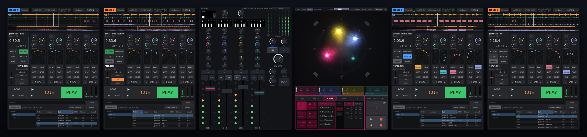

# StemDeck × A³ Motion

(stemdeck-with-motion-at-a-glance)=

## At a glance

The drop comes. On deck A the vocal rises over the crowd and comes back down
on the one. On the CDJ beside it the hi-hats circle the floor. The kick and
the bass of both hold the ground. Two instruments did that, each on its own
kind of source, and both landed on the same bar because they share one
clock.

| | Moves | How you play it |
| :--- | :--- | :--- |
| [**StemDeck**](stemdeck.md) | its own stems, one at a time | the action pads **ORBIT**, **PING**, **RISE**, **SCAT** on a stem, from the next bar |
| [**A³ Motion**](a3motion.md) | the stereo channels (**ST**): a CDJ, a turntable, a laptop | a clip per channel; **3d**, **FREQ** and **Q** pick the band that moves |
| [**The desk**](a3mix.md) | nothing: it picks what plays | each channel's **INPUT** knob: **A** to **D** for a deck, **ST** for the stereo input |

- **A deck is one source on the desk.** Turn a channel's INPUT to the deck's
  letter and push. The channel's fader, EQ and filter then act on the whole
  deck.
- **A³ Motion does not move a deck.** On a deck channel its screen says
  **DECK A** (or B, C, D) and it sends no movement for that channel. The
  stems move by StemDeck's actions.
- **One clock** for both: see [Who is the clock](#first-set-clock).

<!-- GIF: the room view on A³ Motion with a CDJ on ST moving, beside StemDeck's deck A with RISE running on the vocal -->

(stemdeck-with-motion-why)=

## Why it works so well

- **One moving part over a steady rest** reads as a gesture; a moving full
  mix smears. Both instruments follow this rule: A³ Motion lifts one band
  out of a stereo channel, StemDeck lifts one stem out of four.
- **At rest a stem sits all around the room**, with the rest of its track.
  Only while an action runs does it come loose, then it goes back.
- **The two never fight over a channel.** A channel plays either a deck or
  its ST input; Motion moves only ST channels, StemDeck moves only its own
  stems.
- **One beat.** StemDeck's actions start on the next bar of its own grid; A³
  Motion's clips count bars from the beat clock. With one clock for both,
  the bar lines agree.

(stemdeck-with-motion-setup)=

## Setting it up

You need StemDeck and A³ Core with the Beat Analyzer. For the stereo side you
also need A³ Motion (the hardware, or its screen alone, by touch or mouse) and a
player on an ST input. The A³ Mixer hardware is optional: the
{ref}`virtual desk <a3mix-virtual>` and A³ Motion's MIXER pages have the same
controls.

### 1. The audio: StemDeck into A³ Core

On the Core itself there is nothing to wire: the engine connects deck A, and
a user service keeps it running
({ref}`Always running on the Core <stemdeck-on-the-core>`). A deck on another
machine: [StemDeck on another machine](#stemdeck-with-motion-remote-machine).

### 2. The desk: a deck on a channel

Turn the channel's **INPUT** knob to the deck's letter and push; push **ST**
to go back to the stereo input. A deck plays on one channel at most: pushing
it on a second channel puts the first channel back on ST. The rules are on
{ref}`the desk's input selectors <a3mix-displays>`.

### 3. The clock

Pick one clock for the evening: [Who is the clock](#first-set-clock). With no
CDJs, StemDeck is the master:

1. Load a set and **wait for the BPM** (no beats before the analysis is done).
2. Press **MASTER** on the deck: its top bar reads `LINK master: A`.
3. On A³ Motion, tap the clock key to **PIO**. The BPM follows StemDeck.

StemDeck **broadcasts** on its own network; the Core must be in it (always,
on one machine). Chain: {ref}`Playing without CDJs <beat-analyzer-without-cdjs>`.
Ask before joining a venue's Pro DJ Link ({doc}`../ressources/trademarks`).

<!-- IMAGE: StemDeck's top bar sending as master next to A³ Motion's clock key reading PIO and the same BPM -->

(stemdeck-with-motion-first-set)=

## Your first set

Step by step, with a CDJ on ST and a deck beside it: [First set](first-set.md).

The **MOTION** / **STEMDECK** key at the far right of each top bar switches
between the two screens ({ref}`workspaces <stemdeck-workspaces>`).

(stemdeck-with-motion-remote-machine)=

## StemDeck on another machine

Deck A runs on the Core. Every further deck can run on a machine of its own,
a **deck host**, one deck letter per host. The shipped I/O map expects deck B
from another machine; on the I/O page each deck's source can be switched
between *Local StemDeck* and *AES67 stream*
({ref}`the I/O map <audio-engine-io>`).

A deck host sends its deck to the Core as one **AES67** stream of 41 channels
on the audio network ({ref}`ports <ports-audio-network>`); the Core's REC bus
comes back on channels 1 and 2 for the recorder. Both machines need a cable
between their second sockets (or a switch) and an address each on
`192.168.9.0/24`; the Core's is `192.168.9.10/24`. The Core receives the
stream outside the PTP clock.

The deck host needs only the StemDeck package, no a3-core: it ships the
deck's sender and link map ({ref}`one deck per instance <stemdeck-one-deck>`).
Set up once:

1. Tell StemDeck where Core is: `~/.config/a3/core`
   ({ref}`StemDeck on radla <osc-radla>`).
2. Give the machine's second socket its address on the audio network.
3. Set the sample rate to 44.1 kHz **before** StemDeck starts; the AES67
   streams carry 44.1 kHz.
4. Run the installer's **deck-host** role and answer its three questions: the
   deck letter, the path latency (0 until you have measured it) and the audio
   socket. It starts the deck with its sender, link map and clock, and sets
   the panel to follow the workspace
   ({ref}`what the role does <stemdeck-one-deck>`). Without the role, nothing
   is linked and the deck is silent on the Core.

On a deck host with A³ Motion beside it, the panel follows the workspace in
front, A³ Motion or the deck.

(stemdeck-with-motion-troubleshooting)=

## Troubleshooting

| Symptom | What to do |
| :--- | :--- |
| The deck is silent on the desk | Is the channel's INPUT on the deck's letter (bracket over it) and the fader up? On the Core: deck A's ports against the engine's peers on the I/O page ({ref}`I/O map <audio-engine-io>`). Elsewhere: is the AES67 stream announced and cabled, and is PTP locked? |
| A³ Motion says **DECK A** and nothing moves | Right: Motion does not move a deck. Tap an action on a stem in StemDeck, or put the channel on **ST** for Motion |
| A stem plays but doesn't move | Stems move only while an action runs: tap ORBIT, PING, RISE or SCAT and wait for the next bar |
| An ST channel doesn't move | **3d** down, the clip not playing, or FREQ and Q on a band where the track has little |
| No tempo follow | BPM shown? Deck playing as master? A³ Motion on **PIO**? Core on StemDeck's network? |
| Movements a beat off the bar | StemDeck: CUE on the real first beat of a bar, **GRID**, **SNAP** |
| Stems stop after an audio-settings change | Set the rate before starting StemDeck; check that the AES67 stream is still announced on the audio network |
