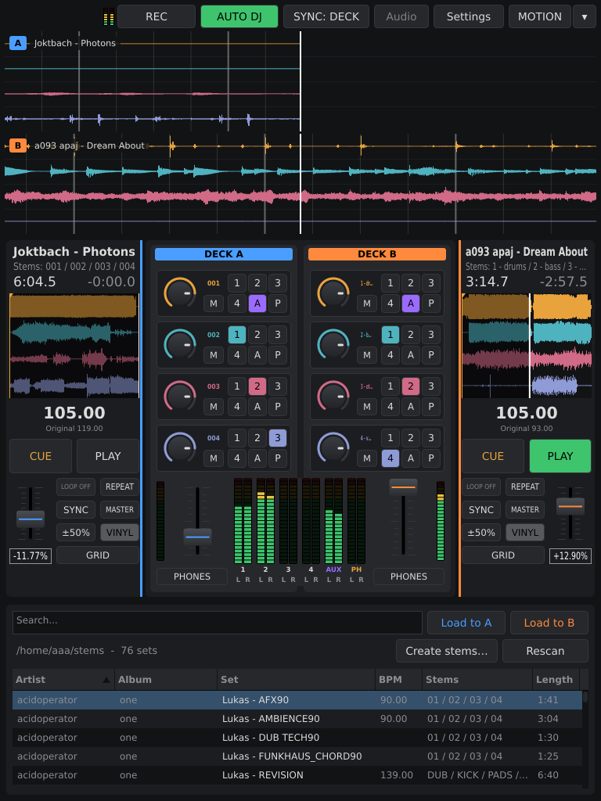
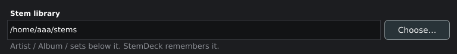
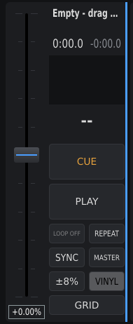
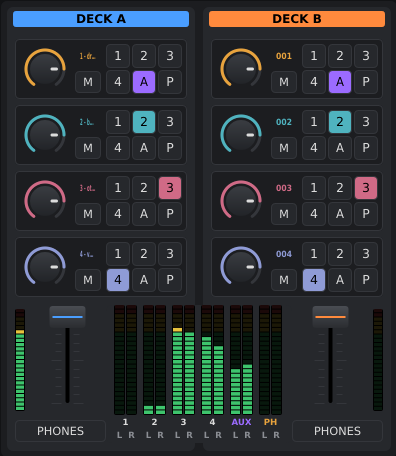
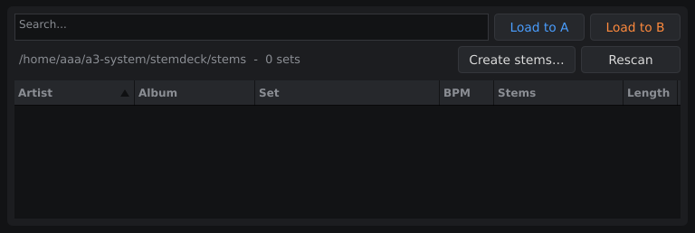

# StemDeck

(stemdeck-at-a-glance)=

## At a glance



A stem player for DJs: **two decks, each playing a track split into four
stems**, and a mixer that sends every stem to its own output. Where a CDJ gives
A³ Core a stereo mix, StemDeck gives it the parts.

- On the rig each deck is its own instance that sends B-format to the Core,
  see [One deck per instance](#stemdeck-one-deck).
- Four stem buses go to A³ Core's channels 1–4, the aux bus to its Return.
  Pre-listening is the desk's cue; StemDeck has no headphone bus.
- The A³ Mixer [remote-controls it](#stemdeck-remote) through the Core.
- On the Core it always runs, on workspace **STEMDECK** (2);
  see [Always running on the Core](#stemdeck-on-the-core).
- With no CDJs it can be [the tempo master](#stemdeck-master).
- It [splits stereo tracks into stems](#stemdeck-stem-creator) itself.
- Linux, JUCE, JACK. Source: [stemdeck](https://github.com/rafjagger/stemdeck)
  (outside the `a3-audio` organisation, carried by a3-system).

```{tip}
**Best with A³ Motion**: each stem travels the room on its own path, in time
with StemDeck's beat. See [StemDeck × A³ Motion](stemdeck-with-motion.md).
```

(stemdeck-stem-sets)=

## Stem sets

A **set** is exactly four audio files in one folder, the same name with a
different ending after the last space, `-` or `_`:

```text
Artist - Title-001.wav  …  Artist - Title-004.wav
Artist - Title - DUB.wav, … - KICK.wav, … - PADS.wav, … - PERC.wav
```

Endings sort naturally (`01` before `10`, words alphabetically) into stems 1–4.
Three or five files are not a set. Formats: WAV, AIFF, FLAC, Ogg Vorbis; WAV
and AIFF stream from disk, so jumps and loops are instant.

### Artist, album, set

```text
stems/
├── Burial/
│   └── Untrue/
│       └── Archangel - 01.wav … Archangel - 04.wav
└── Aphex Twin/
    └── Drukqs/
        └── CD1/
            └── Avril 14th - 1.wav … Avril 14th - 4.wav
```

First folder: **artist**; second: **album**; deeper folders join the album
(`Drukqs / CD1`). The library scans its folder recursively; it starts in
`stems/` next to where StemDeck started and remembers the last folder.

(stemdeck-screen)=

## The screen

Top: both decks' scrolling waveforms (drag to move, wheel to zoom). Middle:
deck A, mixer, deck B. Bottom: the library. The top bar holds **REC** (24-bit
FLAC of the `rec_L/R` inputs into `recordings/`), **AUTO DJ**, the **SYNC**
source, **Audio** (grey under JACK), **Settings**, the workspace switch, and,
where there is room, the audio status.


(stemdeck-workspaces)=

### Over to A³ Motion, and back

**MOTION** shows A³ Motion, whose **STEMDECK** key sits in the same place.
**▾** lists the workspaces. See {ref}`A³ Core's screen <core-workspaces>`.

(stemdeck-settings)=

### Settings



The **stem library** folder, picked with **Choose…** (the touch screen has no
keyboard), and the [AUTO DJ](#stemdeck-autodj) overlap.

(stemdeck-decks)=

### Decks



Like a CDJ without the platter; the [SCS.3d](#stemdeck-scs3d) is the jog.

| Control | What it does |
| :--- | :--- |
| **CUE** | playing: back to the cue point and stop. Stopped: set the cue point, or on it, play while held |
| **PLAY** | start / pause |
| overview | one lane per stem. Click: jump; drag: loop |
| **LOOP OFF** | clears the loop |
| **REPEAT** | restarts at the end |
| **VINYL** | the controller's platter scratches |
| tempo fader | range button: ±8 / ±16 / ±50 % |
| **BPM** | current tempo; **Original** below |
| **KEY** | key lock; see [KEY](#stemdeck-key) |
| **SYNC** | follow a leader; see [Sync](#stemdeck-sync) |
| **MASTER** | Pro DJ Link tempo master; see [MASTER](#stemdeck-master) |
| **GRID** | fix the beat grid; see [GRID](#stemdeck-grid) |

The tempo is analysed once per set in the background, over all four stems,
assuming a constant tempo.

(stemdeck-mixer)=

### Mixer



| Per stem | What it does |
| :--- | :--- |
| gain knob | −60 to +6 dB; double-click: 0 dB |
| **M** | mute |
| **n**, **A** | stem **n** plays on its own channel **n**; **A** is AUX. Deck B reads **n**, **A**, **CUE**, **M**, knob left to right, the knob on the deck's outer side; deck A is mirrored: knob, **M**, **CUE**, **A**, **n**. Both off: silent |

A stem can only be on its own channel, on AUX or off; a switch onto another
channel is refused. A channel carries one deck's stem **n** at most: switching
the other deck's stem **n** onto it moves the first to AUX.

Below: the channel fader (every bus is post-fader). Between the strips: meters
for buses 1–4 and AUX, each with a clip lamp that holds for a second. The desk
sets the switches through Core and StemDeck reports back, so both agree.

(stemdeck-start-buses)=

**Where the stems start:** on **AUX only**. A stem on bus 1–4 silences that
desk channel's analog input, so a fresh StemDeck takes no channel. Loading a
set keeps the switches; a session restores its own. An older session with a
stem on another channel loads with that stem on AUX.

**Every bus is trimmed 6 dB**, before its meter: two full tracks on AUX would
otherwise clip, and the channels match it.

(stemdeck-library)=

### Library



Columns **Artist | Album | Set | BPM | Stems | Length**; click a header to
sort. Search matches name, artist or album. Load with **Load to A/B**, a
double-click or Return (first deck not playing), or drag onto a deck.
**Rescan** reads the folder again.

(stemdeck-grid)=

### GRID: correcting the beat grid

Grid Adjust, as on a CDJ-3000:

| Control | What it does |
| :--- | :--- |
| jog | moves the grid; a turn is 100 ms |
| **‹1/2** / **1/2›** | half a beat |
| **SNAP** | downbeat to the cue point |
| **SET 1** | downbeat to the playhead |
| **SHIFT** | takes a beat aligned by ear with the jog ring |
| **RESET** | the analysed grid again |

Corrections are kept in `analysis.xml`.

(stemdeck-downbeats)=

#### Where the bar's one is

The tempo analysis finds the beats. StemDeck then decides which beat is the
**one** of the bar, from the stems: drums and bass coming back after a break
or stopping for one, chord changes, the arrangement changing at a bar line.
Four beats a bar are assumed.

- Tracks analysed before are corrected **once**, when you load them.
- Your own corrections (**◀1 / 1▶**, **SNAP**, **SET 1**) always win; StemDeck
  never moves a grid you set.

(stemdeck-key)=

### KEY: key lock

**KEY** sits at the foot of the deck's tile, with the tempo controls. Off, the
pitch follows the tempo fader as on a turntable. On, the tempo changes and the
**key stays**, like a CDJ's Master Tempo.

- Scratching stays pitched: a scratch is pitch by nature, so KEY lets go while
  the platter is touched.
- It is kept in the [session](#stemdeck-session).
- It costs CPU while it is on. Leave it off on decks that run at their own
  tempo.

(stemdeck-autodj)=

### AUTO DJ

Plays the sets the search shows, at random, each once, and mixes them the way
a DJ with a stem player would: **nothing fades**. It hands the stems over from
one deck to the other, one by one, on downbeats.

While AUTO DJ runs, desk channels 1–4 carry **drums, bass, other and vocals**
of one deck at a time, and their analog inputs are off. The faders stay where
they are; AUTO DJ never touches a mute.

- Nothing playing: loads a set on deck A and plays it.
- 30 s before the mix: loads the next set on the other deck.
- **Overlap:** about 20 s, in whole bars of the playing track, SYNC on. The
  new track starts on a downbeat of its own.
- **Drums first.** At the start of the overlap the new drums take channel 1.
- **Bass, then other,** one at a time, each at the downbeat where the change is
  least heard. AUTO DJ looks 8 s around each downbeat: the old stem is quiet
  just after it, the new one was quiet just before it.
- **Vocals last.** The old vocals sing to the end of the old track; the new
  ones come in on the first downbeat after it. Then the old deck stops and SYNC
  goes off.
- A stem that is not playing is on no channel and not on AUX.
- **Where a track is heard.** AUTO DJ reads the stems' levels: silence at the
  start and the end of a file is ignored. A track that starts with a pickup
  (a few notes before the bar's one) starts on the downbeat before it, so the
  pickup is heard whole.
- **No beat grid:** four steps over 10 s, unsynced, the same order: drums, bass,
  other, vocals.
- Never mixes out of a loop or loads onto a looping deck.
- **Next / Prev** on the playing deck mixes at once, from the next downbeat.
- Switching AUTO DJ off leaves the routing as it is. It is yours to carry on.

**Your switches win.** Put a stem on AUX (allowed while AUTO DJ runs; only
you can put a stem there), and AUTO DJ leaves it alone. The stem stays yours
until its deck stops or gets a new track. A stem of the old deck that you put
on its channel is handed over normally when that channel changes over. Turning
AUX off gives the stem back at once.

The length of the overlap is **AUTO DJ overlap** in [Settings](#stemdeck-settings)
(default ≈ 20 s; or a number of bars). Tracks without a grid use a time in
seconds (default 10 s). A new value applies to the next mix.

(stemdeck-keys)=

### Keys

| | Deck A | Deck B |
| :--- | :---: | :---: |
| Play / pause | `D` | `L` |
| Cue (hold to preview) | `S` | `K` |
| Mute stem 1–4 | `1` `2` `3` `4` | `7` `8` `9` `0` |

(stemdeck-scs3d)=

### The Stanton SCS.3d

Up to two, one per deck, taken as plugged in (first = deck A;
`<VALUE name="scs3dSwap" val="1"/>` in `~/.config/StemDeck/StemDeck.settings`
swaps them). Mapping follows Mixxx's.

| SCS.3d | StemDeck |
| :--- | :--- |
| **FX EQ LOOP TRIG** | mute stem 1–4 |
| **VINYL** | loop in; again: loop out |
| **DECK** | loop off, and on again from its start |
| circle top left / right | previous / next set |
| circle centre tap | load the selected set (not onto a playing deck) |
| **GAIN** / **PITCH** | channel fader / tempo (relative) |
| ring | scratch: touch holds, turning scratches |
| **PLAY CUE SYNC TAP** | play, cue, SYNC, MASTER |

(stemdeck-stem-creator)=

## Making stems from a stereo track

<!-- IMAGE: the "Create stems" question with its Target folder field, and the strip under the library bar showing a running job, e.g. "Stems: Title  42 %  +2 waiting". Not taken: both need files dropped on the rig's running StemDeck. -->

### Starting

1. Drop stereo files or a folder onto the library, or press **Create stems…**
   (FLAC, WAV, MP3, AIFF, OGG, M4A, Opus).
2. Set the **Target folder**, relative to the library (typed, **Browse…**, or
   empty). It is preset from the source path (`Artist/Album`). The whole batch
   goes there.
3. **Create**.

### What you get

```text
stems/Artist/Album/
├── Title - 1 - drums.flac
├── Title - 2 - bass.flac
├── Title - 3 - other.flac
├── Title - 4 - vocals.flac
└── originals/Title.flac
```

- Stems 1–4: drums, bass, other, vocals. `originals/` holds a copy and is not
  scanned.
- Format: FLAC, WAV, AIFF at 24 bit; Ogg at quality 8; MP3, M4A and Opus
  become FLAC.
- A name already in the album becomes `Title (2)`. When done, the library
  rescans and selects the set.

### While it works

[Demucs](https://github.com/adefossez/demucs) (`htdemucs`, 44.1 kHz) runs in
the background, one track at a time, **while the decks play**: the audio
thread owns CPU 1, the separator gets the other cores at idle CPU and disk
priority, at most 6 GB. Fewer cores: `<VALUE name="separatorCores" val="1"/>`
in `StemDeck.settings` (CPU 0 only: about 1.2 × the track's length).

The strip under the library bar shows progress and the queue (`+2 waiting`), or
`Stems: failed: …`. **Cancel** stops the track and leaves nothing behind.

(stemdeck-stem-creator-setup)=

### Setting it up, once

About 1 GB per machine, from the StemDeck checkout:

```sh
sudo apt install ffmpeg python3-venv
tools/setup-separator.sh
```

It installs Demucs and CPU PyTorch into `~/.local/share/StemDeck/separator`
and fetches the model. Without it the strip says `separator not installed`.

(stemdeck-remote)=

### Remote control from the desk

With A³ Core running, the A³ Mixer chooses what is on its channels: turn a
channel's encoder to a stem and push; a push on the channel's **A** (its
analog input) takes it off. How the desk does it, and the rules for
it, are on the {ref}`desk's input selectors <a3mix-displays>`. From
StemDeck's side:

- **StemDeck keeps the truth.** Core only relays the desk's request to switch a
  bus and asks StemDeck for all switches when it hears StemDeck for the first
  time. A click on a bus switch here also shows on the desk.
- **Stem N only on channel N.** A stem plays on its own channel or on AUX,
  nothing else; a switch to another channel is refused (screen, panel and OSC).
  A channel plays at most one stem. StemDeck itself loads a stem from an old
  session on AUX when it sat on another channel. Core only tidies the reports
  of an older StemDeck: it keeps the lowest stem on a bus and puts the others
  on AUX.
- **Every stem no channel plays is on AUX.** Its **A** is lit in either
  return mode, and Core switches a free stem's A back on if you click it off.
  A stem pushed onto a channel loses its A. The return's mode only chooses
  what the return plays: in stem mode the AUX bus, in analog mode the analog
  inputs 11/12, and then the stems on AUX are not heard.
- **The C switches are yours.** A stem's **C** puts it on StemDeck's CUE bus,
  for pre-listening here, e.g. a stem no channel plays yet. Core does not set
  them: a desk channel's cue goes through the channel itself (see
  {ref}`the cue <a3mix-cue>`).
- **StemDeck says hello to Core every 30 seconds**, and Core learns its
  address from that. StemDeck listens on `stemdeck.osc` (see
  {doc}`../ressources/ports`).
- **It starts on AUX only**, on no desk channel — see
  [Where the stems start](#stemdeck-start-buses).
- **Stem meters.** StemDeck sends one meter per stem to the desk only
  (deck A stems 1–4 are `/vu/41`–`/vu/44`, deck B `/vu/45`–`/vu/48`), 25 times
  a second. Each is measured after the stem's knob and mute, before the fader
  and the buses.
- **AUX bus meter.** StemDeck also meters its AUX bus as a stereo pair,
  `/vu/49` (L) and `/vu/50` (R), at the same rate: peak and rms of each side
  after the bus and its 6 dB trim, i.e. what goes to the aux return. The desk shows it as STEM
  beside the analog return, ANALOG.

(stemdeck-panel)=

## The A³ Motion panel as StemDeck's controller

The A³ Motion hardware panel can drive StemDeck: on the machine that runs
StemDeck, plug the panel in by USB. StemDeck finds it by its USB ID, not by a
port name, and picks it up again after you replug it.

The panel splits down the middle. The **left half is deck A, the right half deck
B**. Each half is a small mixer for its deck.

| Control | What it does |
| :--- | :--- |
| outer column, top | **CUE** |
| outer column, below it | **PLAY** |
| pad rows 2–5 | a row per stem, in the screen's order (below) |
| encoders | turn: that stem's gain. Push: mute |
| inner pot | the deck's fader |
| outer pots | not used |

A stem's row on the panel reads like its row on the [screen](#stemdeck-mixer),
column for column. Deck B, left to right: the stem's own channel **n**, **AUX**,
**CUE**, **M**, and a dark pad; deck A is mirrored: a dark pad, **M**, **CUE**,
**AUX**, **n**. The dark pad sits where the screen row has its knob, on the
deck's outer side; it does nothing and stays unlit. The knob itself is the
stem's encoder over the pads: turn for gain, push for mute (the same as the
**M** pad).

A **n** or **AUX** pad switches its stem onto that channel or off it, as a click
on the screen does. **CUE** toggles the stem's cue, **M** mutes it.

**Lights.** A stem's pads light exactly like the screen keys of its row. Off,
they show the screen key's dim grey. On, the channel pad takes the stem's
colour, the **AUX** pad violet, the **CUE** pad amber while the stem is cued
and the **M** pad red while it is muted. A muted stem does not dim its channel
or AUX pad. Only the transport **CUE** and **PLAY** keys rest dim in their
deck's colour, so the halves still read as A and B; CUE lights amber, PLAY
green.

```{warning}
**One program at a time.** A³ Motion and StemDeck never drive the panel
together. Whichever has the panel holds it exclusively; the other finds it
busy. See [StemDeck × A³ Motion](stemdeck-with-motion.md).
```

(stemdeck-one-deck)=

## One deck per instance: the Core's rig

On the rig every deck is its own StemDeck instance, `-bformat --deck A` (unit
`stemdeck@A`; B is `stemdeck@B`). Deck A runs on the Core, deck B on the
second machine beside A³ Motion. The instance plays one deck and sends
**B-format** to the Core's engine; the two-deck screens above are the older
mode, kept as a fallback. What an instance sends (41 channels):

| Ports | Channels | What |
| :--- | :--- | :--- |
| `bformat_1` … `16` | 16 | the deck's main signal, third order |
| `aux_1` … `16` | 16 | the deck's aux bus: only the stems you send, at their positions |
| `cue_1` … `9` | 9 | the stem cue, second order |
| `phones_L/R` | 2 | local only, never on the network |
| `rec_L/R` (inputs) | 2 | the recorder |

The jack client is `StemDeck-<letter>`. The stereo cue and aux pairs of the old
mode are gone, and so is the cue's own decoder: the Core decodes the cue with
the same headphone sound as everything else.

### AUX per stem

Each stem has an **AUX** knob (0 to 1, default 0: nothing reaches the delay
until you ask). It is a send taken after the stem's GAIN, MUTE and 3D, so a
muted stem sends nothing. The four knobs of a stem sit in a 2 × 2 block: **GAIN
and 3D** above, **AUX and WIDTH** below. A stem that is sent shows "AUX" in its
state line. The deck's AUX meter shows the aux bus. Only the sent stems reach
the delay, not the whole deck; the desk's **AUX pot** on the deck's channel
scales all of it ({ref}`the engine <audio-engine>`).

### The panel's pots

On an A³ Motion panel the four **pots** are the AUX of stems 1 to 4. A pot
works with **pickup**: after a load, a session restore, a set load or when the
panel comes back to this deck, a pot does nothing until it has passed the
stored value (or comes within 1 % of an end). Until then the knob on the
screen shows the pot's position as a small mark. If you move the stored value
with the touch screen, the pot waits again until you cross it. So the send
never jumps. The encoders and pads are unchanged.

### The panel follows the workspace

With **`STEMDECK_PANEL_WORKSPACE`** set (for example `2:STEMDECK`; A³ Motion has `A3_MOTION_PANEL_WORKSPACE`, for
example `1:MOTION`), the
program whose workspace is in front holds the panel. The other lets go at
once. A program takes the panel only after its workspace has been in front for
three quarters of a second, so a short visit changes nothing and the two
never read the port together. A workspace of neither program changes nothing.
Without the variable the older rule holds: A³ Motion keeps the panel, and
StemDeck takes it by its lock file ("panel: this deck").

### Links on a deck host

Deck A needs no links: the engine makes them. On a machine without an
engine the instance links its own ports from a **link map**, in the same
format and with the same code as the engine's map, and never removes a link it
did not make. It reads `~/.config/StemDeck/links-<letter>.json`, else the file
named by `STEMDECK_LINK_MAP` (`{X}` is the letter), else nothing. The package
ships `/usr/share/stemdeck/links-aes67.json`: the 41 outputs to the instance's
AES67 sender, and the REC bus (the Core's stream, channels 1 and 2) to
`rec_L/R`. A port name the instance does not have is refused.

The package also ships the sender, `a3-aes67-deck@<letter>` (it renders its
PipeWire file from the same truth StemDeck already holds; it needs no a3-core
on that machine) and turns EEE off on the audio port.

### Path latency

A deck on another machine is heard about 18 ms later. Set
**`STEMDECK_PATH_LATENCY_MS`** (0 to 200, default 0; deck A leaves it at 0) in
the instance's unit drop-in. StemDeck then counts a beat from when it is
*heard*: the Pro DJ Link beats it sends as master go out when the beat reaches
the PA, and it follows a master by its audible position. Two synced decks then
land on the same beat at the PA. Measure the value, with the reference click,
rather than guessing it. The Pro DJ Link beats go out on the control network,
not the audio network.

### Recording

The recorder always records the Core's **REC bus**, never a separate mix, on
every deck host. A **USB stick** (or disk) with a filesystem is mounted at
`/media/a3-usb` when plugged in and unmounted after it has been idle; takes go
to `A3-recordings/` on it, otherwise to the local recordings folder. The
record button shows **USB** or **LOCAL**, before and during a take. Pulling
the stick mid-take stops the take with a message, and what was written stays
a playable FLAC. The **local folder is capped at 100 GB**: a take does not
start at the cap and a running one stops cleanly when it reaches it, with a
message. Nothing is ever deleted for you. The stick has no cap but its free
space.

(stemdeck-audio)=

## Audio out

A JACK client, `StemDeck`: ten outputs (`deck1_L` … `aux_R`) and the `rec_L/R`
inputs. Ports and where they land in Core: {ref}`the engine's I/O map <audio-engine-io>`.
`deck1` … `deck4` are the **buses**, not the decks; bus N is A³ channel N, aux
is Core's Return.

- **Nothing connects by itself.** On the Core the engine's I/O map does;
  elsewhere see [StemDeck on another machine](#stemdeck-with-motion-remote-machine).
- It **never starts a JACK server**: it uses JACK, PipeWire's JACK, or ALSA
  (**Audio**). With fewer than ten outputs, buses are summed down.
- It takes the graph's rate and buffer and resamples itself; changing a
  running graph would disturb the AES67 stream. Set the rate before starting, e.g.
  `pw-metadata -n settings 0 clock.force-rate 44100`.

<!-- NOTE: audio I/O (ports, AES67 channels) is documented once, in the audio engine page (src/user/audio-engine.md, the I/O map). -->

(stemdeck-sync)=

## Sync

<!-- IMAGE: the top bar under SYNC: PIO, with the PIO status readout (e.g. "PIO 128.0 · CDJ 2") and the player box. Not taken: switching SYNC on the rig's running StemDeck turns off every SYNC that was on. The top bar as it is, under SYNC: DECK, is under "The screen" above. -->

**SYNC** on a deck follows a leader, chosen in the top bar: **DECK** (the other
deck) or **PIO** (the Pro DJ Link tempo master). Switching it turns all SYNC
off.

- **Tempo:** the leader's × ½, 1 or 2, whichever is the smallest change, chosen
  when SYNC goes on; the fader range widens if needed.
- **Phase:** only while both play and nobody scratches. Over 50 ms off: jump;
  closer: nudge, at most 2 %.

### DECK: one deck follows the other

SYNC on A follows B; SYNC on B hands over. At ×1 it also lines up **bars**.

(stemdeck-pio)=

### PIO: following the Pro DJ Link tempo master

Follows the master's tempo (pitch included) and beat; both decks may follow.

- StemDeck is **player 6**; it reads the Pro DJ Link ports (`prolink.*`) from
  `a3-osc.json` ({ref}`Where addresses live <osc-truth>`). On the Core it
  follows Core's file and restarts its window once (about 5 s) when it changes
  ({ref}`Following Core <osc-follow>`). No file: `PIO: no a3-osc.json`.
- It shares the ports with the beat-analyzer (player 7) on one machine;
  retries every 2 s while the network is down.
- No status packets for 2 s: **no master**; it follows the player picked in the
  box (default: the first heard).
- Master silent: tempo **held**, phase left alone.
- It aligns the **beat, not the bar**; set the downbeat with the jog.
- Player number: `pioDevice` in `~/.config/StemDeck/StemDeck.settings`.

Ask the venue before joining their Pro DJ Link network.

(stemdeck-master)=

## MASTER: StemDeck as the tempo master

With no CDJs, **MASTER** on a deck makes StemDeck the Pro DJ Link tempo master;
the beat-analyzer (mode 2) and A³ Motion on **PIO** follow. Whole chain:
{ref}`Playing without CDJs <beat-analyzer-without-cdjs>`.

- Press MASTER to take it, on the other deck to hand over, again to drop it.
  MASTER off and SYNC not on PIO: StemDeck leaves the network.
- No master chosen: the only playing deck becomes master — not under SYNC: PIO
  (two masters would fight), and not after you turned it off.
- Sends, as player 6, a **beat packet per beat** (BPM × fader, beat counted from
  the grid's first beat) and a **status packet every 200 ms**.
- A master that stops while the other deck plays hands over (like a CDJ-3000).
- Nothing goes out until the deck's tempo is analysed.
- **Broadcast** on the first non-loopback interface that can, so a listener on
  the same machine hears it.
- Beats are timed to about 1 ms on their own thread: none lost, none doubled,
  no burst after a jump.
- Top bar: `PIO master: A` (or B).

Packets follow [prolink-connect](https://github.com/EvanPurkhiser/prolink-connect)'s
reading. Independent implementation; not affiliated with AlphaTheta or
Pioneer — see {doc}`../ressources/trademarks`.

(stemdeck-build)=

## Build and start

Needs CMake ≥ 3.22, a C++17 compiler, pkg-config, **JUCE** ({ref}`the A³
version <build-juce>`, found under `~/local/juce` unless `CMAKE_PREFIX_PATH`
says otherwise), and:

```sh
apt install libjack-jackd2-dev libflac-dev libvorbis-dev libogg-dev librubberband-dev
```

`librubberband-dev` is for [key lock](#stemdeck-key); a built StemDeck needs
`librubberband3` to run. Key lock uses the
[Rubber Band Library](https://breakfastquay.com/rubberband/)
(GPL-2.0-or-later, used under GPL-3.0-or-later). Stem splitting uses
[Demucs](https://github.com/adefossez/demucs).


GoogleTest (`libgtest-dev`) only for {ref}`the tests <build-commands>`. Then:

```sh
./start.sh
```

It configures a Release build in `build/` once, rebuilds what changed and
starts StemDeck via JACK, `pw-jack` or ALSA. Binary:
`build/StemDeck_artefacts/Release/StemDeck`.

Settings live in `~/.config/StemDeck/`, with `analysis.xml` (tempo analyses and
grids, per file, size and date). Delete it, with StemDeck closed, to analyse
everything again.

(stemdeck-session)=

### Session

`~/.config/StemDeck/session.xml` is written every 2 s while anything changes and
on quit. Next start restores decks, key lock, mixer and bus switches, library and stem
jobs; a playing deck plays on.

(stemdeck-on-the-core)=

### Always running on the Core

A user service on i3 workspace `2:STEMDECK`. The package's i3 config tiles the
main window borderless (i3 full screen would make every dialog full screen);
all other windows float. The {doc}`installer <../configuration/install>` (role
StemDeck) sets it up; by hand:

```sh
cp .config/systemd/user/stemdeck.service ~/.config/systemd/user/
systemctl --user daemon-reload
systemctl --user enable --now stemdeck
```

It runs the build in `build-make/`; `systemctl --user restart stemdeck` picks up
a rebuild. `tools/rig-keep-the-screen.sh` gives the screen back to the
workspace that showed before the start.

```{warning}
**Do not restart StemDeck mid-set.** Its JACK client leaving and joining
causes xruns: clicks on everything the Core plays.
```

(stemdeck-troubleshooting)=

## Troubleshooting

| Symptom | What to do |
| :--- | :--- |
| A set is missing | Exactly four files, one name, different endings. **Rescan**. Right folder? [Settings](#stemdeck-settings) |
| `separator not installed` | [Set it up once](#stemdeck-stem-creator-setup) |
| Stems are slow to make | Idle priority on the free cores; see `separatorCores` |
| Nothing to hear | Ports are never connected automatically; patch them |
| `JACK-Server wurde beendet` | JACK went away. Restart StemDeck after JACK |
| A stem does not move | Its channel's **3d** up, clip playing; a stem only on **A** is on the Return. See [StemDeck × A³ Motion](#stemdeck-with-motion-troubleshooting) |
| A³ Motion ignores MASTER | Wait for the BPM; deck playing? Motion on **PIO**? |
| Downbeat on the wrong beat | CUE on the real first beat of a bar, **GRID**, **SNAP** |
| `PIO: no a3-osc.json` | No truth found: `$A3_OSC_TRUTH`, `~/.cache/a3/a3-osc.json` (filled by Core's announcement) or `/usr/share/a3/a3-osc.json` (from a3-core) |
| SYNC: PIO says **no master** | Status packets don't arrive; it follows the player in the box |
