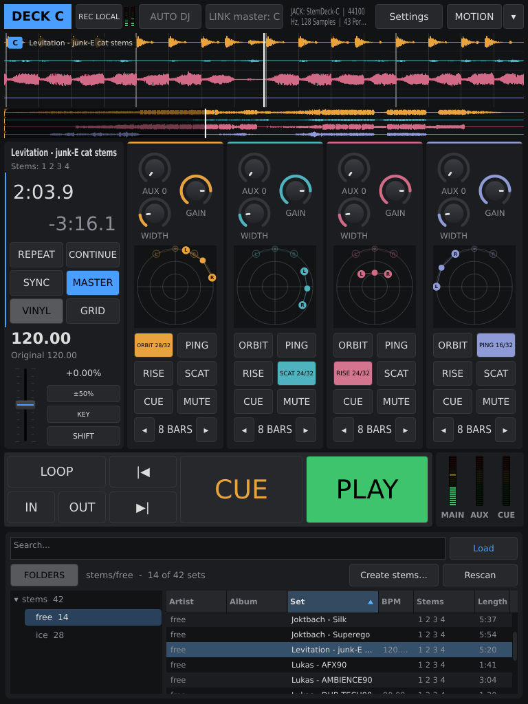
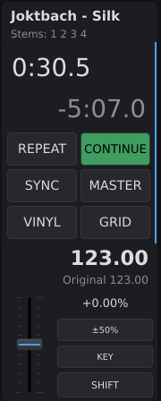
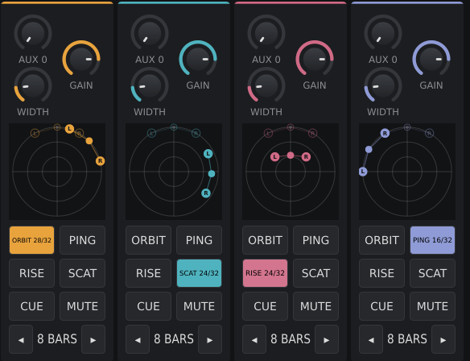
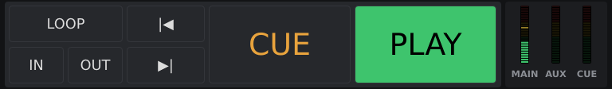
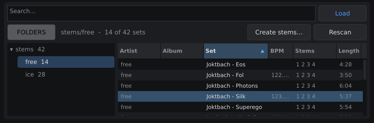

# StemDeck

(stemdeck-at-a-glance)=

## StemDeck



For the moment when one part of a track should take the room: the vocal
rises over the crowd on the drop, the hats circle the floor, and the drums and
the bass hold the ground. StemDeck plays a track as **four stems** — drums,
bass, other, vocals — and moves each one on its own, in time with the beat.
Where a CDJ gives A³ Core a stereo mix, StemDeck gives it the parts, already
placed in the room. New to A³? Read [How A³ sounds](how-it-sounds.md) first.

- **One deck per program.** On the rig up to four StemDecks run, deck **A** to
  **D**, each with its own screen. Deck A runs on A³ Core, the others on the
  Core or on machines of their own; see
  [One deck per instance](#stemdeck-one-deck).
- **Per stem**: GAIN, WIDTH, an AUX-Send to the delay, four actions that move
  the stem (ORBIT, PING, RISE, SCAT), CUE and MUTE; see [The stems](#stemdeck-stems).
- **On the desk** a deck is one source: turn a channel's INPUT knob to its
  letter and push. The channel's fader, EQ and filter act on the whole deck
  ({ref}`the desk <a3mix-displays>`).
- **Pre-listening**: a stem's CUE key puts it in the headphones, whether the
  deck is on a channel or not.
- On the Core it always runs, on workspace **STEMDECK** (2);
  see [Always running on the Core](#stemdeck-on-the-core).
- With no CDJs it can be [the tempo master](#stemdeck-master).
- It [splits stereo tracks into stems](#stemdeck-stem-creator) itself.
- Linux, JUCE, JACK. Source: [a3-stemdeck](https://github.com/a3-audio/a3-stemdeck)
  (carried by a3-system; a3-stem-separator is its submodule).

```{tip}
**With A³ Motion**: StemDeck moves its stems, A³ Motion moves the stereo
channels beside them, and both follow one beat. See
[StemDeck × A³ Motion](stemdeck-with-motion.md).
```

(stemdeck-stem-sets)=

## Stem sets

A **set** is exactly four audio files in one folder, the same name with a
different ending after the last space, `-` or `_`:

```text
Artist - Title-001.wav  …  Artist - Title-004.wav
Artist - Title - DUB.wav, … - KICK.wav, … - PADS.wav, … - PERC.wav
```

Endings sort naturally (`01` before `10`, words alphabetically) into stems 1–4.
Three or five files are not a set. Formats: WAV, AIFF, FLAC, Ogg Vorbis; WAV
and AIFF stream from disk, so jumps and loops are instant.

### Artist, album, set

```text
stems/
├── Burial/
│   └── Untrue/
│       └── Archangel - 01.wav … Archangel - 04.wav
└── Aphex Twin/
    └── Drukqs/
        └── CD1/
            └── Avril 14th - 1.wav … Avril 14th - 4.wav
```

First folder: **artist**; second: **album**; deeper folders join the album
(`Drukqs / CD1`). The library scans its folder recursively; it starts in
`stems/` next to where StemDeck started and remembers the last folder.

(stemdeck-screen)=

## The screen

One deck, top to bottom: the **top bar**; the stems' scrolling waveforms
(drag to move, wheel to zoom) and the overview of the whole track; the
[deck tile](#stemdeck-decks) on the left and the [four stems](#stemdeck-stems)
beside it; the [transport band](#stemdeck-transport); the
[library](#stemdeck-library) at the bottom.


The top bar holds the deck's letter, **REC** (it records the Core's REC mix;
the key shows where the take goes, see [Recording](#stemdeck-one-deck)),
**AUTO DJ** (greyed out: it needs the [older two-deck mode](#stemdeck-two-deck)),
the **SYNC** status (see [Sync](#stemdeck-sync)), the audio status,
**Settings**, and the workspace switch.

(stemdeck-workspaces)=

### Over to A³ Motion, and back

**MOTION** shows A³ Motion, whose **STEMDECK** key sits in the same place.
**▾** lists the workspaces. See {ref}`A³ Core's screen <core-workspaces>`.

(stemdeck-settings)=

### Settings


The **stem library** folder, picked with **Choose…** (the touch screen has no
keyboard).

(stemdeck-decks)=

### Decks



Like a CDJ without the platter.

| Control | What it does |
| :--- | :--- |
| **REPEAT** | restarts the track at its end |
| **CONTINUE** | at the end, goes on with the next set of the library list |
| **SYNC** | follow a leader; see [Sync](#stemdeck-sync) |
| **MASTER** | the network's tempo master; see [MASTER](#stemdeck-master) |
| **VINYL** | a jog controller's platter scratches (see the note under [GRID](#stemdeck-grid)) |
| **GRID** | fix the beat grid; see [GRID](#stemdeck-grid) |
| **BPM** | current tempo; **Original** below |
| tempo fader | range button: ±8 / ±16 / ±50 % |
| **KEY** | key lock; see [KEY](#stemdeck-key) |
| **SHIFT** | the next action pad starts at once, not on the next bar |
| overview | one lane per stem. Click: jump; drag: loop |

The tempo is analysed once per set in the background, over all four stems,
assuming a constant tempo.

(stemdeck-stems)=

### The stems



One column per stem, its colour on top. The knobs sit as on the
[A³ Motion panel](#stemdeck-panel-one-deck):

| Per stem | What it does |
| :--- | :--- |
| **AUX** | send to the beat delay, 0 to 1 (default 0); see [AUX per stem](#stemdeck-aux) |
| **WIDTH** | how wide the stem is while it moves: a point or a wall |
| **GAIN** | the stem's level |
| viewer | the room seen from above: the stem's place (drag it) and, while an action runs, where it is |
| **ORBIT**, **PING**, **RISE**, **SCAT** | an action: the stem leaves the rest and moves (circles, jumps side to side, rises, scatters), from the next bar, then goes back |
| **CUE** | the stem in the headphones |
| **MUTE** | silences the stem |
| **‹ length ›** | how long an action runs: ½, 1, 2, 4 or 8 bars |

**At rest a stem has no direction of its own**: it sounds all around, with
the rest of the track. Only while an action runs does it come loose and move.
A running pad shows its beat count (`ORBIT 28/32`). There is no 3d knob per
stem.

(stemdeck-transport)=

### The transport band



| Control | What it does |
| :--- | :--- |
| **CUE** | playing: back to the cue point and stop. Stopped: set the cue point, or on it, play while held. Hold CUE and press **PLAY**: plays on without a gap, as on a CDJ-3000 |
| **PLAY** | start / pause |
| **IN**, **OUT** | loop in and loop out, on the beat grid; OUT while looping leaves the loop |
| **LOOP** | leaves a running loop, or goes back into the last one; lit while looping |
| **\|◀**, **▶\|** | the previous / next set in the folder |
| meters | the deck's MAIN, AUX and CUE outputs |

(stemdeck-library)=

### Library



Columns **Artist | Album | Set | BPM | Stems | Length**; click a header to
sort. Search matches name, artist or album. **FOLDERS** shows the folder
tree. Load with **Load**, or drag a set onto the deck or its waveform.
**Rescan** reads the folder again.

(stemdeck-grid)=

### GRID: correcting the beat grid

Grid Adjust, as on a CDJ-3000:

| Control | What it does |
| :--- | :--- |
| jog | moves the grid; a turn is 100 ms |
| **‹1/2** / **1/2›** | half a beat |
| **SNAP** | downbeat to the cue point |
| **SET 1** | downbeat to the playhead |
| **SHIFT** | takes a beat aligned by ear with the jog ring |
| **RESET** | the analysed grid again |

Corrections are kept in `analysis.xml`.

The jog and **SHIFT** rows need a jog controller. Today only the
[older two-deck mode](#stemdeck-two-deck) takes one (the Stanton SCS.3d); on
the one-deck screen use **‹1/2**, **1/2›**, **SNAP** and **SET 1**.

(stemdeck-downbeats)=

#### Where the bar's one is

The tempo analysis finds the beats. StemDeck then decides which beat is the
**one** of the bar, from the stems: drums and bass coming back after a break
or stopping for one, chord changes, the arrangement changing at a bar line.
Four beats a bar are assumed.

- Tracks analysed before are corrected **once**, when you load them.
- Your own corrections (**◀1 / 1▶**, **SNAP**, **SET 1**) always win; StemDeck
  never moves a grid you set.

(stemdeck-key)=

### KEY: key lock

**KEY** sits at the foot of the deck's tile, with the tempo controls. Off, the
pitch follows the tempo fader as on a turntable. On, the tempo changes and the
**key stays**, like a CDJ's Master Tempo.

- Scratching stays pitched: a scratch is pitch by nature, so KEY lets go while
  the platter is touched.
- It is kept in the [session](#stemdeck-session).
- It costs CPU while it is on. Leave it off on decks that run at their own
  tempo.

(stemdeck-stem-creator)=

## Making stems from a stereo track

<!-- IMAGE: the "Create stems" question with its Target folder field, and the strip under the library bar showing a running job, e.g. "Stems: Title  42 %  +2 waiting". Not taken: both need files dropped on the rig's running StemDeck. -->

### Starting

1. Drop stereo files or a folder onto the library, or press **Create stems…**
   (FLAC, WAV, MP3, AIFF, OGG, M4A, Opus).
2. Set the **Target folder**, relative to the library (typed, **Browse…**, or
   empty). It is preset from the source path (`Artist/Album`). The whole batch
   goes there.
3. **Create**.

### What you get

```text
stems/Artist/Album/
├── Title - 1 - drums.flac
├── Title - 2 - bass.flac
├── Title - 3 - other.flac
├── Title - 4 - vocals.flac
└── originals/Title.flac
```

- Stems 1–4: drums, bass, other, vocals. `originals/` holds a copy and is not
  scanned.
- Format: FLAC, WAV, AIFF at 24 bit; Ogg at quality 8; MP3, M4A and Opus
  become FLAC.
- A name already in the album becomes `Title (2)`. When done, the library
  rescans and selects the set.

### While it works

[Demucs](https://github.com/adefossez/demucs) (`htdemucs`, 44.1 kHz) runs in
the background, one track at a time, **while the decks play**: the audio
thread owns CPU 1, the separator gets the other cores at idle CPU and disk
priority, at most 6 GB. Fewer cores: `<VALUE name="separatorCores" val="1"/>`
in `StemDeck.settings` (CPU 0 only: about 1.2 × the track's length).

The strip under the library bar shows progress and the queue (`+2 waiting`), or
`Stems: failed: …`. **Cancel** stops the track and leaves nothing behind.

(stemdeck-stem-creator-setup)=

### Setting it up, once

About 1 GB per machine, from the StemDeck checkout:

```sh
sudo apt install ffmpeg python3-venv
tools/setup-separator.sh
```

It installs Demucs and CPU PyTorch into `~/.local/share/StemDeck/separator`
and fetches the model. Without it the strip says `separator not installed`.

(stemdeck-one-deck)=

## One deck per instance: the Core's rig

On the rig every deck is its own StemDeck instance, `-bformat --deck A` (unit
`stemdeck@A`; B is `stemdeck@B`, and so on to `stemdeck@D`). Deck A runs on the
Core, deck B on the second machine beside A³ Motion; decks C and D are
hosts of their own (any machine with the deck-host role, letter C or D). The instance plays one deck and sends
**B-format** to a3-core on the Core. What an instance sends (41 channels):

| Ports | Channels | What |
| :--- | :--- | :--- |
| `bformat_1` … `16` | 16 | the deck's main signal, third order |
| `aux_1` … `16` | 16 | the deck's aux bus: only the stems you send, at their positions |
| `cue_1` … `9` | 9 | the stem cue, second order |
| `phones_L/R` | 2 | local only, never on the network |
| `rec_L/R` (inputs) | 2 | the recorder |

The jack client is `StemDeck-<letter>`. The Core decodes the cue with the same
headphone sound as everything else; StemDeck has no decoder of its own.

- **Nothing to patch by hand.** On the Core a3-core's I/O map connects the
  deck; on a deck host the instance links itself from its
  [link map](#stemdeck-links).
- It **never starts a JACK server**: it uses JACK or PipeWire's JACK.
- It takes the graph's rate and buffer and resamples itself; changing a
  running graph would disturb the AES67 stream. Set the rate before starting,
  e.g. `pw-metadata -n settings 0 clock.force-rate 44100`.

(stemdeck-aux)=

### AUX-Send per stem

Each stem has an **AUX** knob (its AUX-Send) (0 to 1, default 0: nothing reaches the delay
until you ask). It is a send taken after the stem's GAIN and MUTE, so a
muted stem sends nothing; a moving stem is sent from where it is. The deck's
AUX meter shows the aux bus. Only the sent stems reach the delay, not the
whole deck. The AUX bus goes **straight into the delay** after the channel's
input-select fade and VOLUME; the desk's AUX-Send on the deck's channel does
not scale it (it sends the deck's main output, the channel's own signal). A
pulled fader, or a deck on no channel, sends nothing
({ref}`the engine <audio-engine-decks>`).

(stemdeck-panel-one-deck)=

### The panel on one deck

An A³ Motion panel on a deck's machine plays that one deck. The stems stand
under their encoders, one stem per pair of pad columns, left to right:

| Control | What it does |
| :--- | :--- |
| pot (one per stem) | **AUX** of that stem. Absolute: the pot's position is the value at once |
| upper encoder | **GAIN**. Push: mute; two quick pushes: GAIN back to its default |
| lower encoder | **WIDTH** (its push does nothing) |
| pads, per stem | **ORBIT PING** / **RISE SCAT** / **CUE MUTE** / **‹ ›** (the action's length), in rows 3 to 6 |
| left column | **CUE**, **PLAY**, **LOOP**, **LOOP IN**, **LOOP OUT**, **CONTINUE** |
| right column | **SHIFT** (held): the next action starts at once |

The panel wins over the screen: turn a pot and the stem's AUX on the screen
follows, whatever it showed before. A stem's pads light in its colour; a
running action blinks while it waits for the bar.

### The panel follows the workspace

On a shared screen the program whose workspace is in front holds the panel.
The other lets go within about half a second. A program takes the panel only
after its workspace has been in front for three quarters of a second, so a
short visit changes nothing and the two never read the port together. A
workspace of neither program changes nothing. The deck-host role (below) sets
this up; by hand it is `STEMDECK_PANEL_WORKSPACE` (for example `2:STEMDECK`)
for StemDeck and `A3_MOTION_PANEL_WORKSPACE` (for example `1:MOTION`) for A³
Motion.

In this mode StemDeck never opens the panel at start, and the Settings row
**Panel follows workspace** is greyed out: the workspace decides. Without the
variable the older rule holds: A³ Motion keeps the panel, and StemDeck takes it
by its lock file (Settings, "panel: this deck").

### Deck host: what the installer sets up

On the deck's machine (a3nuc2 for deck B today; C and D can run on any deck host, one letter per host) the installer's **deck-host** role
does the wiring; it asks for the deck letter, the path latency and the audio
socket. It enables the deck instance, the AES67 base (`stemdeck-aes67.service`:
PTP client and receiver) and the deck's sender (`a3-aes67-deck@<letter>`),
points the instance at the shipped link map, sets the path latency and the
panel workspaces (StemDeck and, beside it, A³ Motion), and tells the sender
which socket is the audio network. Where a3-core's own AES67 setup is left over,
the role moves it aside (not deleted; leaving puts it back), because two PTP
drivers must not run: the base stays off while such a unit exists. Without
the role, none of this happens by itself; the package alone links nothing.

The settings are environment variables in the units' drop-ins, named here once:
`STEMDECK_LINK_MAP`, `STEMDECK_PATH_LATENCY_MS`, `STEMDECK_PANEL_WORKSPACE`,
`A3_MOTION_PANEL_WORKSPACE` and `STEMDECK_AUDIO_PORT`.

(stemdeck-links)=

### Links on a deck host

Deck A needs no links: the engine makes them. On a machine without an
engine the instance links its own ports from a **link map**, in the same
format and with the same code as the engine's map, and never removes a link it
did not make. It reads `~/.config/StemDeck/links-<letter>.json`, else the file
named by `STEMDECK_LINK_MAP`, else it links nothing; `{X}` in the map's peer
names stands for the letter, so one file serves every deck. The package ships `/usr/share/stemdeck/links-aes67.json`, but it is
only used where `STEMDECK_LINK_MAP` points at it, which the role does. If the
variable names a missing or unreadable file, StemDeck logs "no links" and
links nothing. The shipped map links the 41 outputs to the instance's AES67
sender, and the REC bus (the Core's stream, channels 1 and 2) to `rec_L/R`. A
port name the instance does not have is refused. The map names the Core's
sender (`AES67 a3nuc1 out`): if the Core has another host name, edit it there
too, together with the engine's map.

The sender renders its PipeWire file from the host's own audio socket
(`STEMDECK_AUDIO_PORT`, set by the role) rather than the Core's truth, which
on this machine is only a copy of the Core's. It needs no a3-core. The package
also turns EEE off on the audio port.

### Path latency

A deck on another machine is heard about 18 ms later. The role asks for
**`STEMDECK_PATH_LATENCY_MS`** (0 to 200, default 0; deck A leaves it at 0).
StemDeck then counts a beat from when it is
*heard*: the Pro DJ Link beats it sends as master go out when the beat reaches
the PA, and it follows a master by its audible position. Two synced decks then
land on the same beat at the PA. Measure the value, with the reference click,
rather than guessing it. The Pro DJ Link beats go out on the control network,
not the audio network.

### Recording

The recorder always records the Core's **REC bus**, never a separate mix, on
every deck host. A **USB stick** (vfat, exFAT or NTFS) is
mounted at `/media/a3-usb` when plugged in and unmounted after it has been idle;
takes go to `A3-recordings/` on it, otherwise to the local recordings folder.
The record button shows where the take goes: **USB**, **LOCAL**, or **USB RO**
when a stick is in but read-only (the take then goes LOCAL, so you can see it
did not land on the stick). Problems show on the button's face, not in a
popup: **STICK GONE** if the stick is pulled mid-take (what was written stays
a playable FLAC), **WRITE ERR** if writing fails, **100 GB FULL** when the
**local folder is capped at 100 GB**: a take does not start at the cap and a
running one stops cleanly when it reaches it. Nothing is ever deleted for you.
The stick has no cap but its free space.

(stemdeck-sync)=

## Sync

<!-- IMAGE: the top bar while SYNC follows: "LINK 128.0 · Player 6". Not taken: switching SYNC on the rig's running StemDeck changes the set. -->

**SYNC** on a deck follows the **tempo master on the DJ network** (Pro DJ
Link): another StemDeck deck with [MASTER](#stemdeck-master) on, on this
machine or another, or a CDJ. The top bar shows what it hears:

| Top bar | Meaning |
| :--- | :--- |
| `SYNC: LINK` | SYNC and MASTER are off |
| `LINK 128.0 · Player 6` | following the master, here deck A (player 6) at 128 BPM |
| `LINK 128.0 · held` | the master went silent; the tempo is held, the phase left alone |
| `LINK –` | nothing heard on the network yet |
| `LINK master: A` | this deck is the master |

- **Tempo:** the master's × ½, 1 or 2, whichever is the smallest change, chosen
  when SYNC goes on; the fader range widens if needed.
- **Phase:** only while both play and nobody scratches. Over 50 ms off: jump;
  closer: nudge, at most 2 %.
- It aligns the **beat, not the bar**: set the downbeat on the grid.
- With no master heard the deck runs on its own grid.

(stemdeck-pio)=

### On the Pro DJ Link network

- Each deck is a Pro DJ Link **player** whose number follows its letter: **A
  is player 6, B 5, C 4, D 3** (the beat-analyzer is 7). A deck beyond D has
  no player number and says so.
- It reads the Pro DJ Link ports (`prolink.*`) from `a3-osc.json`
  ({ref}`Where addresses live <osc-truth>`). On the Core it follows Core's
  file and restarts its window once (about 5 s) when it changes
  ({ref}`Following Core <osc-follow>`). Without the ports, SYNC and MASTER are
  greyed out and say so.
- It shares the ports with the beat-analyzer (player 7) on one machine.

Ask the venue before joining their Pro DJ Link network.

(stemdeck-master)=

## MASTER: StemDeck as the tempo master

With no CDJs, **MASTER** on a deck makes it the Pro DJ Link tempo master. The
beat-analyzer (mode 2) and A³ Motion on **PIO** follow, and so does every
other deck with SYNC on. The delay follows the tempo of the MASTER deck too
when no beat clock runs ({ref}`delay tempo <osc-beat-delay>`). Whole chain:
{ref}`Playing without CDJs <beat-analyzer-without-cdjs>`.

- **Press MASTER** to take it, again to drop it. A deck without a beat grid
  refuses it: wait for the BPM.
- **The newest press wins.** Press MASTER on deck B and deck A gives it up,
  on any machine. There is no automatic master: a deck that just plays does
  not take it.
- Sends, as the deck's player, a **beat packet per beat** (BPM × fader, beat
  counted from the grid's first beat) and a **status packet every 200 ms**.
- **Broadcast** on the first non-loopback interface that can, so a listener on
  the same machine hears it.
- Beats are timed to about 1 ms on their own thread: none lost, none doubled,
  no burst after a jump.
- Top bar: `LINK master: A` (or B, C, D).

Packets follow [prolink-connect](https://github.com/EvanPurkhiser/prolink-connect)'s
reading. Independent implementation; not affiliated with AlphaTheta or
Pioneer — see {doc}`../ressources/trademarks`.

(stemdeck-two-deck)=

## The older two-deck mode

Started without `-bformat`, StemDeck is the older **two-deck app**: decks A
and B in one window, a stereo mixer with a bus switch per stem (stem N on desk
channel N, or on AUX), **AUTO DJ**, SYNC to the other deck, keyboard keys and
up to two Stanton SCS.3d controllers. It predates a3-core's audio backend. On a Core its
unit `stemdeck.service` is kept off, and these pages describe only the
one-deck StemDeck.

(stemdeck-build)=

## Build and start

Needs CMake ≥ 3.22, a C++17 compiler, pkg-config, **JUCE** ({ref}`the A³
version <build-juce>`, found under `~/local/juce` unless `CMAKE_PREFIX_PATH`
says otherwise), and:

```sh
apt install libjack-jackd2-dev libflac-dev libvorbis-dev libogg-dev librubberband-dev
```

`librubberband-dev` is for [key lock](#stemdeck-key); a built StemDeck needs
`librubberband3` to run. Key lock uses the
[Rubber Band Library](https://breakfastquay.com/rubberband/)
(GPL-2.0-or-later, used under GPL-3.0-or-later). Stem splitting uses
[Demucs](https://github.com/adefossez/demucs).


GoogleTest (`libgtest-dev`) only for {ref}`the tests <build-commands>`. Then:

```sh
./start.sh
```

It configures a Release build in `build/` once, rebuilds what changed and
starts StemDeck via JACK, `pw-jack` or ALSA. Its arguments go to StemDeck:
`./start.sh -bformat --deck A` starts one deck; without `-bformat` it is the
[older two-deck app](#stemdeck-two-deck). Binary:
`build/StemDeck_artefacts/Release/StemDeck`.

Settings live in `~/.config/StemDeck/`, with `analysis.xml` (tempo analyses and
grids, per file, size and date). Delete it, with StemDeck closed, to analyse
everything again.

(stemdeck-session)=

### Session

Each deck keeps its own session, `~/.config/StemDeck/<letter>/session.xml`
(deck A: `~/.config/StemDeck/A/session.xml`), written while anything changes
and on quit. The next start restores the deck, key lock, the library and the
stem jobs; a playing deck plays on.

(stemdeck-on-the-core)=

### Always running on the Core

Deck A is the user service `stemdeck@A`, on i3 workspace `2:STEMDECK`; the
Core starts it with everything else (`a3-main.service`). The package's i3
config tiles the main window borderless (i3 full screen would make every
dialog full screen); all other windows float. A further deck on the Core is
`stemdeck@C`, `stemdeck@D`, and so on.

```{warning}
**Do not restart StemDeck mid-set.** Its JACK client leaving and joining
causes xruns: clicks on everything the Core plays.
```

(stemdeck-troubleshooting)=

## Troubleshooting

| Symptom | What to do |
| :--- | :--- |
| A set is missing | Exactly four files, one name, different endings. **Rescan**. Right folder? [Settings](#stemdeck-settings) |
| `separator not installed` | [Set it up once](#stemdeck-stem-creator-setup) |
| Stems are slow to make | Idle priority on the free cores; see `separatorCores` |
| Nothing to hear | Is the deck on a desk channel (INPUT on its letter) with the fader up? On the Core: the deck's links on the a3-core window's I/O page. On a deck host: the [link map](#stemdeck-links) |
| `JACK-Server wurde beendet` | JACK went away. Restart StemDeck after JACK |
| A stem does not move | Stems only move while an action runs: tap ORBIT, PING, RISE or SCAT and wait for the next bar. Is the deck on a desk channel (INPUT on its letter) with the fader up? |
| A³ Motion ignores MASTER | Wait for the BPM; deck playing, top bar `LINK master`? Motion on **PIO**? |
| Downbeat on the wrong beat | CUE on the real first beat of a bar, **GRID**, **SNAP** |
| SYNC and MASTER greyed out | No Pro DJ Link ports: no truth found, or an old one. It looks in `$A3_OSC_TRUTH`, `~/.cache/a3/a3-osc.json` (filled by Core's announcement) or `/usr/share/a3/a3-osc.json` (from a3-core) |
| `LINK –` while a master plays | Its packets don't arrive: same network? Is the master's deck playing? |
