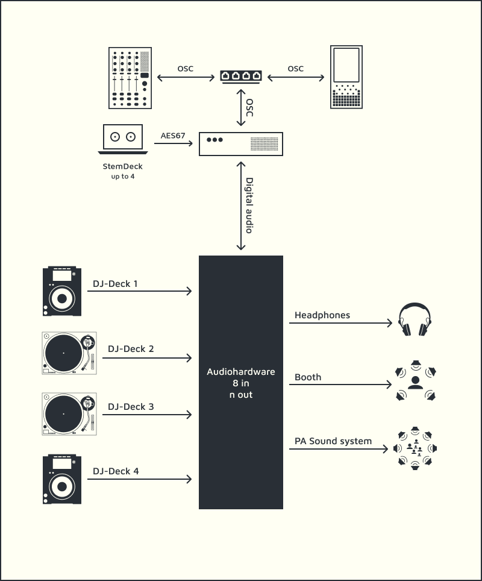
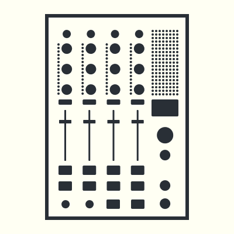
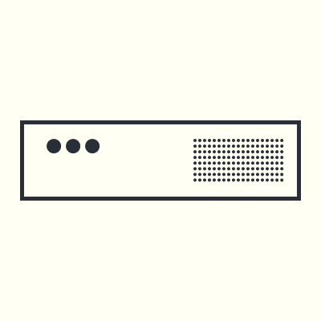

# Welcome

(welcome-setup)=

```{figure} pics_user/stemdeck-desk-motion-overview.png
:alt: Four StemDecks around the virtual desk and A³ Motion: decks A and B on the left, the desk and A³ Motion in the middle, decks C and D on the right

The full set: four StemDecks, the virtual desk and A³ Motion.
```

(welcome-start)=

```{tip}
**Start here.** One way in, in this order:

1. [How A³ sounds](how-it-sounds.md): what happens to your music, in five minutes.
2. [What you need](what-you-need.md): the computer, the speakers (or just
   headphones), and what is optional.
3. The devices: [A³ Motion](a3motion.md), [StemDeck](stemdeck.md),
   [A³ Mixer](a3mix.md).
4. [The audio engine](audio-engine.md): setting up a room.
5. [First set](first-set.md): your first twenty minutes.
6. [On stage](a3motion-on-stage.md): before your first gig.
```

Four [StemDecks](stemdeck.md), A to D, each play their own track as four
stems (drums, bass, other, vocals) and move each stem on its own with their
actions. In the middle sits the desk, the [A³ Mixer](a3mix.md) or the
{ref}`virtual desk <a3mix-virtual>` on a screen, which picks what plays on
each of its four channels: a deck, or **ST**, the stereo input for a CDJ or a
turntable. Beside it, [A³ Motion](a3motion.md) moves the stereo channels
through the room. Everything goes into the [Engine](audio-engine.md) on A³
Core, which places each sound on the speakers.

## The A³ System

Three devices on one network, talking **only OSC**
({doc}`ports <../ressources/ports>`):

| Device | What it is | What it does |
| :--- | :--- | :--- |
| [**A³ Core**](a3core.md) | the hardware everything plugs into | runs the Engine, the audio backend: takes the audio in, computes the 3D field, sends it out; remote controlled |
| [**A³ Mixer**](a3mix.md) | a 4-channel DJ mixer, hardware | gain, EQ, filter, faders, cue, all as OSC; the virtual desk is the same on a screen |
| [**A³ Motion**](a3motion.md) | the motion sampler | a loopstation for *where a sound is* |

All audio — decks, phones, booth, main — connects to A³ Core. Two programs
belong too:

| Program | What it is | What it does |
| :--- | :--- | :--- |
| [**Beat Analyzer**](beat-analyzer.md) | the beat clock | on the Core: the beat and the level meters for every device |
| [**StemDeck**](stemdeck.md) | a stem player | one deck per instance, A to D, each a track as four stems that move on their own; tempo master without CDJs |

```{tip}
**StemDeck × A³ Motion.** StemDeck moves its own stems: fire an action on
the vocal and only the vocal travels the room. A³ Motion moves the stereo
channels beside it — a turntable, a CDJ — and both run in time, because
StemDeck can be the clock. See [StemDeck × A³ Motion](stemdeck-with-motion.md).
```



## One state, told to everyone

Because the devices talk over OSC rather than through each other, there is only
ever **one** state, and every device is told all of it.

| What you do | What follows |
| :--- | :--- |
| turn a knob on the A³ Mixer | A³ Motion's screen follows |
| move a fader in Core's own mixer | both devices follow |
| switch a device on mid-evening | it asks what is already sounding before it says anything, so nothing jumps |

The same feed can be given to anything else — a light or video desk, say — by
naming it when the Core starts. See
{ref}`Adding a department <core-subscriber>`.

## The beat

The [**Beat Analyzer**](beat-analyzer.md) on A³ Core sends the tempo every
device follows, and the meters they show. Its clock comes from A³ Motion's own
tempo, from the music, or from a Pro DJ Link tempo master — a CDJ, or
[StemDeck](stemdeck.md). Everything that moves on its own counts in **bars**,
so a four-bar figure stays four bars when the tempo changes.

## Where to go next

| Section | What is in it |
| :--- | :--- |
| **User** | the way in ([above](#welcome-start)), then the devices, control by control |
| [**Repository**](https://github.com/a3-audio/a3-system) | the umbrella repository that carries all the others |
| **Assembly** | prototype pictures and how the boxes go together |
| **Configuration** | {doc}`installing the system <../configuration/install>`, each device's hardware, and the files each device reads at startup |
| **Development** | building and hacking on the software |
| [**History**](https://a3-audio.github.io/a3-doc/ressources/history.html) | project impressions |
| [**OSC reference**](https://a3-audio.github.io/a3-doc/ressources/osc.html) | every address the system speaks |

## Support A³

A³ is open source and made by one artist and its contributors, in their own time. If it moves your
room, you can support the work with any amount — no account needed beyond PayPal's own checkout:
**[Support A³ via PayPal](https://www.paypal.com/paypalme/RaphaelEismann)**.





