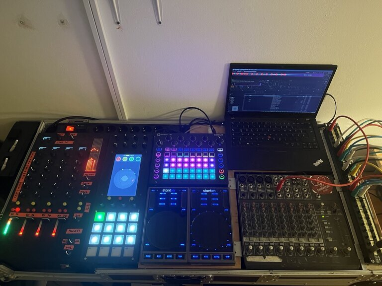
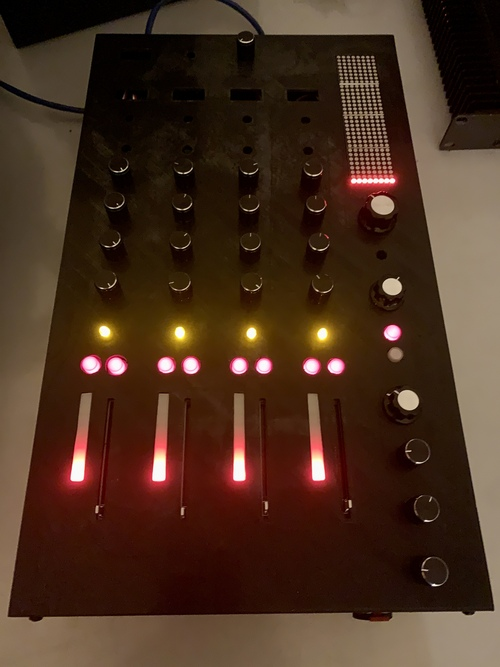
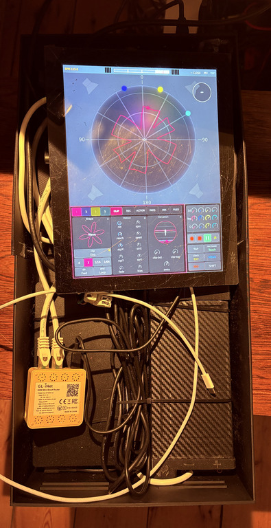

(what-you-need)=

# What you need

The short answer: **one computer with a multichannel audio interface, and at
least four speakers around the crowd, or just headphones.** Everything else
either has a software stand-in or is optional.



| Part | What it is | Do you need it? |
| :--- | :--- | :--- |
| **A³ Core** | the computer everything plugs into; it runs **the Engine**, the 3D audio | **yes** |
| **Audio interface** | on the Core: the stereo inputs (**ST**) and one output per speaker | **yes** |
| **Speakers** | around the crowd, a sub if you have one | **at least 4**, or headphones only |
| **Headphones** | on the PHONES output: cue, and the whole room folded to two ears | yes |
| [**StemDeck**](stemdeck.md) | the stem player, software | for stems; deck A runs on the Core |
| [**A³ Mixer**](a3mix.md) | the four-channel desk, hardware | no: the **virtual desk** does the same on a screen |
| [**A³ Motion**](a3motion.md) | the motion sampler, hardware panel with a touch screen | no: its screen alone, by touch or mouse |
| **Network switch** | one cable per device; PoE powers the hardware panels | with the hardware panels |
| **Players** | CDJs, turntables, a laptop, into ST | optional; StemDeck plays without them |
| **Deck hosts** | a computer of its own for a further StemDeck deck | optional; further decks can also run on the Core |

```{note}
**Cost.** A³ is not for sale yet. What the parts and kits cost will be
published with the Kickstarter campaign.
```

(what-you-need-core)=

## A³ Core and the audio interface

**A³ Core is the hardware**: the box everything plugs into. **The Engine is
its audio backend**, the program `a3-core` running on it, which places every
sound in the room and feeds each speaker
([The audio engine](audio-engine.md)).

- **The computer**: a PC on Debian testing with a realtime kernel. The rig
  runs on an Intel NUC (NUC8i7HNK) with a portrait touch screen, which shows
  the Engine's window and StemDeck deck A. Earlier Cores ran on a tower and a
  Mac ({doc}`assembly <../assembly/core>`).
- **The interface**: the rig uses a Focusrite Scarlett 18i20. The shipped I/O
  map uses:

  | Use | Interface channels |
  | :--- | :--- |
  | ST inputs of channels 1–4 | inputs 1–8 (a stereo pair each) |
  | MAIN: sub and four tops | outputs 1–5 |
  | PHONES | outputs 9–10 |
  | BOOTH: sub and four tops | outputs 11–15 |

  So the shipped map needs an interface with **15 outputs**. A smaller one
  works too: assign the outputs you have on the Engine's **I/O** page
  (four tops and the phones are 6 outputs; the booth is optional).
- **Inputs**: one stereo pair per ST channel you want to use. With StemDeck
  only, you need none.

(what-you-need-speakers)=

## Speakers, or headphones

- **At least four speakers around the crowd.** The shipped layout is a
  square of four tops with one sub (4.1). Another layout, more speakers or
  different angles, is set on the Engine's ZONES and SPEAKERS pages.
- **Or just headphones.** The PHONES output carries the whole room in
  binaural stereo: turn **CUE/MIX** to MIX and every movement is in your
  ears. The REC output is the same binaural mix, for the recording. This is
  the way to try A³ before you have a speaker ring.
- **A booth** of its own (BOOTH, a second set of speakers around the DJ) is
  optional.

(what-you-need-hardware)=

## The panels and their stand-ins

```{list-table}
:widths: 50 50

* - 
  - 
* - The **A³ Mixer** (V02)
  - **A³ Motion** (v03), open
```

| Hardware | Software stand-in | What you lose without the hardware |
| :--- | :--- | :--- |
| **A³ Mixer**: the desk, four channels, OSC and power over one PoE cable | the **virtual desk** (`a3-desk`), on any machine with a screen ({ref}`virtual desk <a3mix-virtual>`) | knobs and faders under your fingers; the delay rows of the FX Return display |
| **A³ Motion**: pads, encoders and pots beside a touch screen, a computer of its own inside | the **Motion UI** alone, by touch or mouse; 3d, FREQ and Q are in its channel row | the pads and the pots, two hands at once |

In the dark of a booth the hardware is what you want; the stand-ins are for
trying, for a second operator, and for the day a panel is not there. The
hardware is a prototype you build yourself: boards are KiCad files and the
housings print on a 3D printer ({doc}`Assembly <../assembly/moc>`).

(what-you-need-network)=

## The network

- **The A³ switch**: Core, the Mixer, Motion and any deck host on one
  Ethernet switch. All control goes over OSC on it
  ({doc}`ports <../ressources/ports>`). A **PoE** switch powers the Mixer and
  Motion over the same cable.
- **The audio network**, only for deck hosts: a second socket on the Core
  and on each deck host, joined by a cable or a switch. A deck host sends
  its deck as one AES67 stream
  ({ref}`StemDeck on another machine <stemdeck-with-motion-remote-machine>`).

(what-you-need-audio-network)=

## The audio network

Decks on other machines only sound clean if every packet arrives. Two decks send
about 100 Mbit/s to the Core, without a pause, for the whole set.

- **Its own gigabit switch.** Put the Core's audio socket and every deck host's
  audio socket on a gigabit switch of their own, not on the house router. On a
  router's built-in switch, two decks lost about one packet in thirteen: a
  constant crackle on both decks. A small dedicated gigabit switch fixed it.
- **Energy Efficient Ethernet off.** Many small switches save power by putting
  the line to sleep between packets (EEE, "Green Ethernet"). For audio that is
  fatal: the clock sync (PTP) times out, a deck goes silent or crackles, links
  drop. A³'s packages switch EEE off on the Core and on every deck host, so you
  do nothing — the check is in {ref}`install-audio-network`.
- **IGMP snooping** helps on a managed switch shared with other devices. With
  only the A³ machines on the audio switch it is not needed.

(what-you-need-effort)=

## Effort

- **Installing**: one installer run per machine
  ({doc}`Installing the system <../configuration/install>`). Packages by
  default, nothing to compile.
- **Setting up a room**: cables, speakers, level, once per room
  ([Setting up a room](#audio-engine-setup)). After that the Engine starts
  with your settings.
- **Making stems**: StemDeck splits a stereo track into four stems
  ([Making stems](#stemdeck-stem-creator)). Do it before the gig, best on
  your own computer: it takes a while, and the Core's processor is for
  playing.

```{warning}
**Today the installer has a limit.** The rig's roles (Core, StemDeck,
Motion, deck host, desk) install only for the user **`aaa`**, with the
checkout in **`/home/aaa/a3-system`**: their services name that path.
Anywhere else the installer only shows what it would do (`--dry-run`). The
new **laptop** role, the whole rig on one machine, runs as any user; it is
still being tested ({ref}`Installing the system <install>`).
```

## Next

[First set](first-set.md): your first twenty minutes, with or without
speakers.
